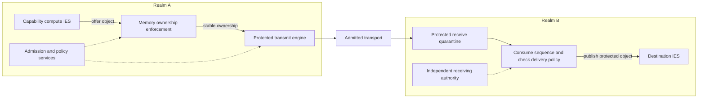

# ASKA v3 — Capability compute, protected I/O, and admitted networks

**Architecture draft · 21 October 2026**

ASKA v3 proposes a computer and network architecture that enforces limits on applications, operating systems, drivers, and route controllers independently of those components. A compromised component can use its remaining permissions; it cannot create new permissions by editing a pointer, DMA descriptor, route, or packet label.

The target machine uses **64-bit RISC-V with CHERI capability extensions**, hardware-enforced IES boundaries, a **multi-chiplet package**, and a protected network interface. Applications run on compute cores under an OS or runtime. Dedicated packet engines process records. Small isolated services install policy, establish sessions, and create, retire, or reassign execution domains.

The complete machine remains a design proposal. ASKA has no implementation, measurements, or completed proof. Endpoint, admission, and gate experiments can run without native capability compute; their results do not establish protection inside an ordinary application domain. The research plan evaluates native compute costs alongside those experiments.

## The decisions

| Question | v3 decision |
|---|---|
| Existing ISA or a new one? | Reuse RV64 and CHERI extensions. Specify the precise revisions and ABI in each implementation manifest. Do not invent a replacement general-purpose ISA. |
| What runs the application? | An OS or runtime inside an IES. Native capability software is the target; existing binaries use a separately identified compatibility IES. |
| Does seL4 run the machine's main workload? | It is an optional supervisor or management-service kernel. No per-record seL4 IPC is required in the main data path. |
| Are chiplets part of the architecture? | Yes, as the target physical organization: compute, memory/I/O enforcement, and root/management functions. Initial experiments can use simulation or FPGA partitions. |
| Is the security chiplet on every memory access? | No. Distributed local checks enforce installed policy. The root authorizes changes and protects root secrets. |
| How are buffers handed off? | The 1 KiB message profile uses coherent protected copying. Bulk buffers use acknowledged ownership transfer, with one allocation retained across its child records. |
| How are data restrictions tracked? | Realm-scoped categories, execution-domain confinement, and object labels. Access capabilities and confidentiality labels remain distinct. |
| How do independent machines connect? | Authenticated online admission with independent local decisions and transcript-bound session installation. |
| How does transit work? | SCION carriage is a comparison/integration profile. A separate experimental native profile defines protected port checks and packet-carried grants. |
| How are rejected replays handled? | A valid authenticated record consumes its sequence even when delivery is denied. Admission scope and replay spaces are narrowed to limit the consequences. |

## One operation through the machine

A request names a local buffer and a remote operation. The submission queue identifies the caller through protected context. Memory enforcement holds the buffer's allocation, generation, ownership, and restriction stable. The transmit engine obtains stable bytes, checks outbound authority, and authenticates those bytes and the operation. Transit gates check separate forwarding authority. The receiver authenticates the record in quarantine, consumes its sequence, checks current delivery policy, and exposes accepted output only to the named destination.

Receiver consent permits delivery to an object; a path grant permits use of forwarding resources. Disclosing confidential source information also requires source-side flow permission. Each operation must satisfy all applicable permissions.

## Read the set

| File | Subject |
|---|---|
| [0010 — Architecture and reading map](0010_architecture_and_reading_map_gpt.md) | Decisions, scope, and system organization |
| [0011 — Compute, ISA, and IES](0011_compute_isa_and_ies_gpt.md) | Native compute, compatibility, seL4's role, and capability boundaries |
| [0012 — Authority and information flow](0012_authority_and_information_flow_gpt.md) | Categories, delegated authority, request isolation, and controlled release |
| [0013 — Memory ownership and lifecycle](0013_memory_ownership_and_lifecycle_gpt.md) | Buffer state machines, revocation, DMA, reuse, and reset |
| [0014 — Identity and online admission](0014_identity_and_online_admission_gpt.md) | Discovery, trust roots, enrollment, key establishment, and rotation |
| [0015 — Transport and protected transit](0015_transport_and_protected_transit_gpt.md) | Overlay limits, native grants, packet binding, and physical egress |
| [0016 — Records and receive processing](0016_records_and_receive_processing_gpt.md) | Experimental encoding, authenticated consumption, quarantine, and publication |
| [0017 — Chiplets and hardware integration](0017_chiplets_and_hardware_integration_gpt.md) | Package boundaries, protected I/O, root complex, and management paths |
| [0018 — Performance and validation](0018_performance_and_validation_gpt.md) | Cost arithmetic, implementation stages, attacks, and acceptance gates |
| [0019 — Implementation contracts and sources](0019_implementation_contracts_and_sources_gpt.md) | Required interfaces, source status, and remaining implementation decisions |

Read 0010–0013 for the machine, 0014–0016 for communication, and 0017–0018 for what must be built and tested.

## Threat model and trust

The adversary controls ordinary host kernels and hypervisors outside the protected boundary, workload code within granted rights, drivers, ordinary route controllers, and untrusted links. It can race requests, retain stale handles, replay traffic, reset exposed devices, and exhaust offered resources.

The trusted components are capability enforcement, protected ownership metadata, memory and DMA enforcement, gate firmware and datapaths, authorized policy installers, and their root and update chain. Classification also depends on the producer or confinement mechanism that assigns it. Controlled release depends on the release service performing its specified computation.

Administrators can grant harmful rights, measured software can contain bugs, and compromised workloads can send false data within an allowed schema. Boundary enforcement limits authority; it does not prevent these errors.

The initial security model covers explicit access, explicit message delivery, and designated egress decisions. Timing, cache contention, power, thermal behavior, invasive physical attacks, and malicious fabrication require additional profiles. Availability requires resource and connectivity assumptions. Logical path authorization does not establish cable geography or anonymity.

## Status and requirements language

“Must” states a requirement of the proposed profile. “Target” is a design objective. References support the individual mechanisms they describe. The ASKA composition still needs validation. Each implementation manifest must identify exact specification, toolchain, and firmware versions, enabled protections, and assumptions.

[0019](0019_implementation_contracts_and_sources_gpt.md) collects the implementation contracts, references, and decisions needed to develop this design.
