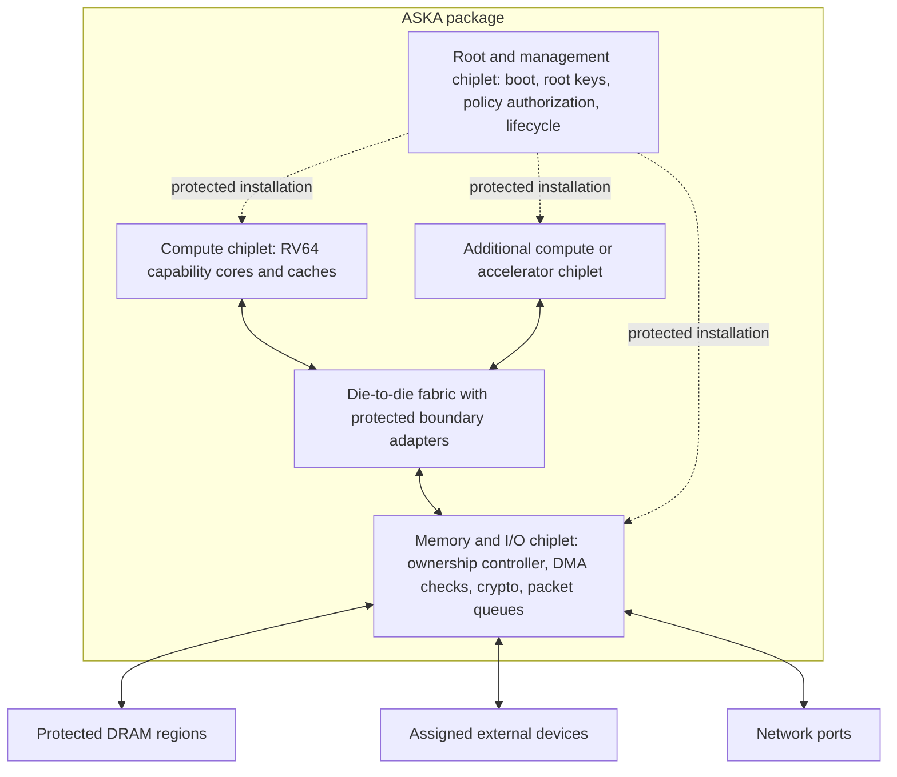

# ASKA — Chiplets and hardware integration

[Start](0010_architecture_and_reading_map_gpt.md) · [Previous](0016_records_and_receive_processing_gpt.md) · [Next](0018_performance_and_validation_gpt.md)

The target package assigns compute, memory/I/O enforcement, and root management to separate chiplets. Their interfaces must check authority on every required path; physical separation alone does not enforce it.

## Package organization



The first package design can combine root and I/O functions on one die if this reduces risk and cost. It can also begin as a single FPGA with explicit protected partitions. Process node, core count, SRAM capacity, and package yield remain implementation parameters.

Compute can use a performance-oriented process while root and I/O functions use processes suited to their memory, analog, interface, and cost needs. Tamper resistance needs specific measures, including control of reset, debug, and provisioning. A mature process node alone supplies none of those controls.

## Die-to-die interface

UCIe is the selected interface family to investigate for package links. Its specification covers die-to-die physical and protocol integration; it does not by itself define ASKA authority or label semantics. [UCIe specifications](https://www.uciexpress.org/specifications).

Boundary adapters must preserve:

```text
requester identity and IES generation
allocation identity and generation, or protected translation to them
access type, bounded extent, and ownership version
transaction/completion identity
integrity status and fault behavior
```

A link packet may carry these fields explicitly, or a protected bridge may reconstruct them from a non-spoofable channel context. PCIe/CXL bridges must preserve that association to meet the profile.

Compute-side checks protect capability use inside the core/cache hierarchy. Memory-side checks protect allocations against DMA and invalid owners. Local gates enforce cached immutable policy under bounded generations and invalidate it through protected updates. Loads and packets therefore need no central root-management lookup.

Link confidentiality and integrity protect different properties from end-to-end object policy. Bringing physical package probing into scope would require a specified link-protection profile and key lifecycle. Short package wires supply no assumed protection in the initial threat model.

## Protection-point matrix

| Boundary | Enforcement and protected state | Attacker-controlled input |
|---|---|---|
| Core dereference | Capability validity, bounds, permissions | Program instructions and pointer operations |
| Allocation ownership | Memory-side owner/generation table | Handles, mappings requested by the guest |
| Device DMA | Protected requester mapping and allocation checks | Descriptors and driver requests |
| Ownership transition | Revoke/drain controller and outstanding-request table | Transfer offers, reset requests, racing writes |
| Network transmit | Stable buffer binding, grant lookup, nonce allocator | Requested operation and queue submissions |
| Network receive | Bounded parser, AEAD, replay arbiter, protected placement | Untrusted datagrams |
| Physical egress | Port-bound grant checks and transmit enable | Route proposals and raw transmit attempts |
| Policy update | Role-scoped installer, version and boot freshness | Signed update proposals |

For every row, the implementation manifest must name the responsible component and define its reset behavior. The diagram identifies the functions; those details specify how to implement them.

## Server/DPU integration profile

A confidential VM paired with a DPU under restricted management provides a separate prototype for endpoint placement and host exclusion. An unmodified x86 guest in that prototype retains its ordinary execution semantics.

Protected direct I/O requires compatible CPU, root complex, device, firmware, attestation, assignment, and memory translation. IDE protects specified link traffic; TDISP-related assignment and device-interface controls address different parts of the path. Neither substitutes for application flow policy. Intel's [TDX documentation](https://www.intel.com/content/www/us/en/developer/tools/trust-domain-extensions/documentation.html) is a specification starting point, not evidence that an arbitrary host/card pair supports the required combination.

A DPU mode must actually restrict the external host's reconfiguration authority. BlueField distinguishes host-trusted modes from restricted host-isolation operation. Its embedded management software remains trusted. [Modes of operation](https://networking-docs.nvidia.com/bsp/latest/modes-of-operation).

Qualify each board configuration by checking these paths:

1. Identify who controls the root complex, IOMMU, device interface, and security manager.
2. Enumerate DMA, peer-to-peer, ATS, VF/PF, debug, and management paths.
3. Establish where plaintext and data keys reside and which requesters can read them.
4. Demonstrate that host-initiated reset closes access and requires fresh protected association.
5. Trace the path from authenticated quarantine to private destination memory without a host-readable plaintext bounce buffer.

Where direct protected placement is unavailable, terminate inside the DPU and use an authenticated encrypted channel to the VM. Untrusted shared memory can carry ciphertext. Measure the added copies and crypto as an encrypted bridge, separately from protected direct DMA.

## Reset, firmware, and debug

Host-triggerable PCIe function resets, secondary-bus resets, link errors, and DPU reboot are modeled events. Before resuming traffic, the platform must restore verified firmware, invalidate stale device association, retire uncertain sessions, and reinstall authorized mappings. Reset cannot enable a bypass mode.

The root's update authority is part of the trusted computing base. Gate firmware, FPGA images, microcode affecting enforcement, and management tools have versioned, authenticated update paths and rollback policy. Production debug is disabled or requires separately controlled destructive/service authorization. The service policy must say whether existing secrets are erased before debug access.

Recovery never restores an old key/counter snapshot into active use without proving nonce and replay continuity. After state uncertainty, the initial implementation establishes fresh sessions.

## Scaling the fast path

Use parallel queue engines and sharded session arbiters. A session has one logical consumption order even when authentication runs across multiple lanes. Shared tenant budgets use a protected parent allocator or preallocated disjoint credits.

Packet engines receive compiled finite rules, not arbitrary remote policy programs. Management services can use seL4 or another isolated runtime where supported, while dedicated engines process the common path. The control/data boundary must be visible in performance measurements and authority review.
