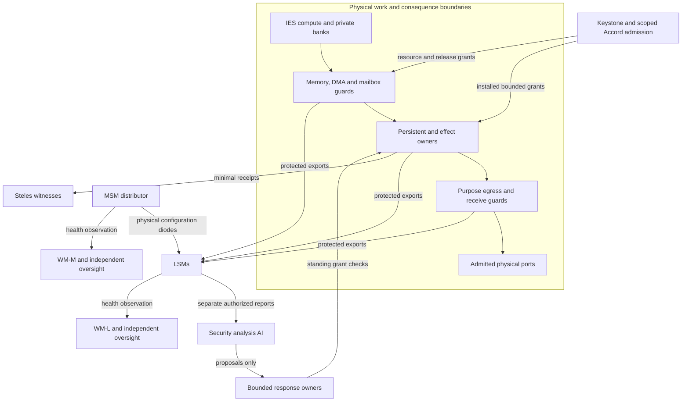

# ASKA v6 — System architecture

**Status:** proposed normative target. Requirements describe obligations; they do not certify an implemented machine.

## 1. Machine thesis and boundary

ASKA is a networked physical machine in which computation, owned memory, devices, persistent objects, observation and external effects have separately enforceable boundaries. Its native unit of isolation is an **Isolated Execution Stack (IES)**: an assigned set of execution engines, writable memory and protected communication endpoints. A cell runs for a bounded lifetime inside that scope. A kernel or model inside a cell may be fully compromised without acquiring another IES's memory, a security observer's installation keys, or a recipient's execution rights.

The architecture combines mandatory guards, independent observation and explicit effect authority. A memory guard is necessarily in the memory transaction path it governs. An observer receives evidence without becoming the workload's supervisor. A watcher observes an observer through separately rooted paths. Neither a well-formed alert nor a trusted signature creates permission to intervene. A protected effect owner performs a consequence only under installed authority derived from an admitted contract.

The reference machine in [Chapter 04](04_reference_machine_and_reachability.md) is a conceptual board arrangement, not a fabrication claim. Native confinement can use separate boards or appropriately guarded chiplets. Die boundaries alone do not establish independent reset, power, debug, firmware or supplier failure domains. Coherence is permitted **inside one trust domain**; cross-trust writable sharing requires a separately justified ownership protocol rather than an ambient shared address space.

## 2. Integrated machine graph

Arrows describe different contracts, not universal buses. Every arrow that carries confidential content is an information release; every arrow that can change state has an installation or effect owner. Watcher observation includes independent counters and sideband taps rather than trusting the monitored component's narrative. Steles records qualified commitments and receipts; it is not the security watcher hierarchy.

## 3. Component responsibilities

| Component | Protected responsibility | Explicit limit |
|---|---|---|
| IES and cell allocator | Resource assignment, lifetime, fuel and retirement | Scheduling does not authorize foreign data or external effects |
| Memory/device guards | Requester attachment, bounds, generation and DMA mediation | They do not establish application correctness |
| DMNoC and mailbox guards | Bounded routing and admitted object exchange | A route or raw pointer cannot create a receiving right |
| Persistent object owners | Object-specific methods, durability, keys and snapshots | Device completion needs a declared persistence contract |
| Effect and egress owners | Final checks, consumption, emission and receipts | Receipt scope ends at its named finality point |
| LSM/MSM | Local observation and scoped configuration distribution | No arbitrary runtime command or universal plaintext export |
| WM-L/WM-M | Independently rooted oversight of security meshes | Watchers can lie or fail; they do not mint policy authority |
| Keystone | Protected canonical interaction and local authorization | It cannot overrule an independent realm or conjure missing keys |
| User companion AI | Context-bounded planning, explanation and composition | Generated text, code and tool instructions are untrusted proposals |
| AESDS/IAMA | Candidate generation, testing and legacy-model research | Build agents cannot approve their own evidence or deployment |
| Steles | Privacy-scoped witness commitments, correction and notice | Witness agreement is not proof that an external event was true |

An implementation MUST assign every responsibility to an identified component and root. Combining responsibilities on one processor is permitted only in a profile that reports the resulting dependency; it cannot claim the independence of the separately rooted reference arrangement.

## 4. A complete useful operation

Consider a private contract review followed by an approved commercial payment. A Sanctum object owner offers a read view to a bounded analysis cell. The user companion can propose a summary, but the cell's output retains the source confidentiality restrictions. A separately admitted transform constructs the exact fields intended for Agora. The source release owner checks the output commitment and the Agora receiver independently accepts it. A payment proposal then enters Accord with its amount, account, idempotency key and spending ceiling.

Keystone presents canonical terms using its protected surface. Business approval may be independently required. Once the contract is admitted, the installer derives an attenuated grant at the payment owner. That owner checks freshness, generations and budget at the payment finality point; submission to an external bank and confirmed settlement are distinct events. A lost acknowledgment produces uncertainty where the external system cannot resolve the operation. Steles receives a minimal commitment under its own release contract.

Throughout this flow, guards export authorized event metadata to the appropriate LSM. A suspected parser compromise can activate a preinstalled `ISOLATE_CELL` or `FREEZE_EGRESS` grant. This need not interrupt a person for a new negotiation, but it cannot install new code, confiscate unrelated objects, or shut down other realms. If the security analyzer itself is malicious, the effect owner still checks the same target, deadline and cumulative response budget.

## 5. Purpose and carriage are separate dimensions

Sanctum, Polis, Agora and Wilder classify intimate/personal, civic, commercial and untrusted encounter contexts. Steles adds a witness role. These purposes determine applicable identities, data restrictions, service duties and endpoint separation. Keystone is a trusted interaction function, not another social plane.

STN names sovereign trust governance and selected continuity operations. ATN names authenticated communication arrangements. MCN describes multiple admitted channels. DMNoC is internal carriage. LSM configuration diodes, telemetry and watcher exports are security infrastructure edges with separate physical contracts. An Agora object can travel on an authenticated network without becoming public, and an STN affiliation does not authorize reading it. [Chapters 40–46](40_societal_planes_and_endpoint_separation.md) define the compositional mapping.

RP-A assigns separate purpose interfaces at a workstation and explicitly shares chassis power. RP-B places roles in independently powered community appliances with declared local and upstream paths. Neither label promises that every provider, duct or regional facility is independent. Continuity is conditional on surviving resources and admitted paths.

## 6. Evidence and research boundary

Published systems demonstrate important constituent mechanisms. The [M3 paper](https://os.inf.tu-dresden.de/papers_ps/asmussen-m3-asplos16.pdf) is a comparison for heterogeneous execution and communication mediation; [DStar](https://usenix.org/events/nsdi08/tech/full_papers/zeldovich/zeldovich.pdf) is a comparison for distributed information-flow enforcement. ASKA's architectural obligation is to compose such boundaries with physical effect owners, independent observers and civil authority. That composition remains to be implemented and evaluated.

The [seL4 proof-assumption statement](https://sel4.systems/Verification/assumptions.html) makes the relevance of hardware, boot, DMA and observation assumptions explicit. ASKA similarly separates a formal property from the physical evidence needed to connect it to an apparatus. Passive RAM/SSD sensing, fine-grained spatial utilization, independent packaging, reliable autonomous repair and physical provenance remain research programs. Failure of an optional sensing candidate must not invalidate a separately established guard property.

## 7. Canonical contracts and reading

The threat model and global obligations belong to [Chapter 02](02_requirements_and_threat_model.md); independence belongs to [Chapter 03](03_assurance_trust_and_failure_domains.md). [Chapter 05](05_unified_execution_data_and_effect_contract.md) owns effect states, [Chapter 06](06_authority_calculus_and_nonexpansion.md) owns non-expansion, and [Chapter 07](07_information_flow_and_release.md) owns label and release semantics. Terms and identifier rules belong to [Chapter 08](08_terminology_and_specification_conventions.md).

Subsystem chapters refine these contracts rather than granting exceptions by omission. A conflict must produce a specific unresolved obligation or a changed, declared profile. It must not be hidden inside phrases such as secure channel, trusted component, intelligent protection or seamless recovery.

## Native encounter and established service

First-contact discovery and enrollment use a dedicated physical encounter port, parser lane, FIFO, bank and DMA domain. Established ATN/STN service does not traverse that encounter FIFO or depend on its free-buffer pool. Only bounded admitted metadata can reach a local admission owner; a first-contact worker cannot write established-session tables. Chapter 04 names this additional domain E and counts its port separately from the four purposes and Steles witness.

## Normative requirements and acceptance obligations

**R-01-01 — One constrained machine.** Every native realization MUST mediate computation, data movement and consequential effects using the common physical and authority contracts.

**Acceptance T-01-01:** Trace one useful application through all owners; inject a bypass at each boundary and require denial or a documented claim failure.

**R-01-02 — Physical native ownership.** Mutually distrusting native IESs MUST have assigned physical execution and writable-memory scope; internal coherence MAY remain within one trust domain.

**Acceptance T-01-02:** Run hostile coherent activity inside one IES and cross-IES writes; require the former to work and the latter to be denied.

**R-01-03 — Separated security roles.** Implementations MUST distinguish enforcement, observation, watcher oversight, response and witness functions in their dependency manifest.

**Acceptance T-01-03:** Compromise each role separately and check that its graph does not acquire another role’s privileged edges.

**R-01-04 — Useful integrated application.** An assurance demonstration MUST complete an authorized application as well as denying attacks.

**Acceptance T-01-04:** Run the contract-review/payment workflow with a malicious parser and measure permitted completions and explicit failures.

**R-01-05 — No implied universal control.** A coordinating AI, MSM, Keystone or institution MUST NOT receive cross-realm rights merely from its system role.

**Acceptance T-01-05:** Present a valid coordinator credential to a foreign owner; require a separate valid local contract and grant.

**R-01-06 — Evidence-scoped architecture.** Every claim MUST identify whether it is a design obligation, candidate, model result or implementation result.

**Acceptance T-01-06:** Inspect a claimed passive sensor or whole-system proof; reject a claim lacking the exact artifact, observation scope and assumptions.

