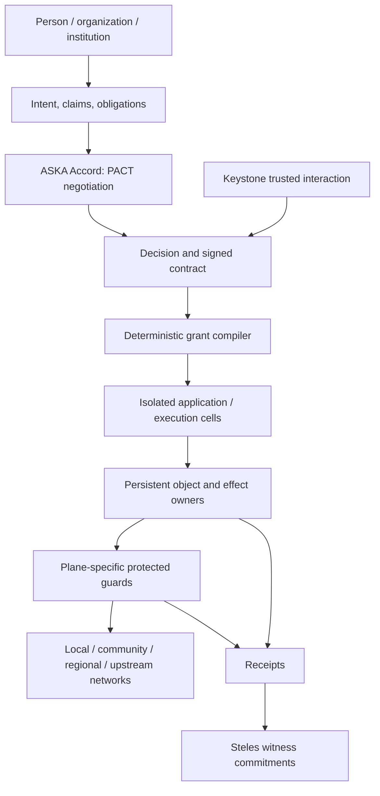

# ASKA v5 — System architecture and unified vision

**Status:** proposed normative target with explicit research and realization gates. This document is the entry point for the complete architecture. The [README](README.md) provides the visual overview; [02](02_requirements_and_threat_model.md) gives testable requirements.

## 1. Architectural thesis

ASKA designs a networked computer and its surrounding network as **one authority-enforcing machine**. A person, household, service, court, enterprise, or community needs to prove a particular right to cause a particular computation, disclosure, transport, or physical effect. Neither an operating-system call nor a network route by itself grants that right. The resulting system does not put all trust into a kernel, an identity provider, a social organization, or a carrier.

The central architecture is the **ASKA Accord Suite**, which expresses and executes a limited social/institutional agreement as four distinct objects: **Claim → Contract → Grant → Receipt**. A claim is evidence; a contract is the admitted outcome of a conflict-aware evaluation; a grant is installed narrow machine authority; a receipt is an independently checkable account of what actually occurred. The protocol does not decide what society's laws *ought* to be, and signatures do not prove the justice of an institution.

## 2. Six cooperating system layers

| Layer | Responsibility | Must not gain implicitly |
|---|---|---|
| Human and institution | State intent, issue credentials, contest decisions | Root hardware access through an assertion |
| Accord control plane | Verify claims, compare policies, negotiate contracts | Permission to execute arbitrary effects |
| Keystone and trusted interaction | Protect local identity, consent, signing and emergency stop | Unbounded access to every object or institution |
| Native compute substrate | Execute bounded cells in isolated resource sets | External effects or foreign memory access |
| Physical purpose fabrics | Carry admitted communications on required independent paths | Disclosure or command authority from mere connectivity |
| Steles accountability | Commit minimal evidence and publish qualified audit results | A global plaintext surveillance store |

## 3. The 4 + 1 endpoint

ASKA's native civil-endpoint reference architecture distinguishes **Sanctum** (personal, familial and intimate activity), **Polis** (civic and public-institutional activity), **Agora** (commerce and enterprise), **Wilder** (untrusted/legacy encounter), and **Steles** (out-of-band witness, attestation and accountability). These are **roles**, not a secret ranking and not mutually exclusive descriptions of a person. Each active plane has its own admission, identity-context, network, memory/input, and effect constraints. Steles is a separate accountability role, not a fifth general-purpose application socket. **Keystone** protects local trusted interaction and is distinct from both Polis and Steles.

The **4 + 1** choice is a reference architecture and a separation requirement for the native high-assurance profile; it is **not** a proven theorem that four transceivers are the universal minimum for every social network. More paths or independently administered appliances may be needed. A prototype with shared equipment must report the weaker properties it demonstrates. [10](10_societal_planes_and_keystone.md) and [11](11_physical_substrate_and_hardware.md) define these claims precisely.

## 4. Machine structure

An **Isolated Execution Stack (IES)** owns an assigned physical execution and writable-memory resource set for an independent trust domain. A **cell** is a bounded execution lifetime within an IES. Most application state persists behind separate object owners. The native application should not need a universal filesystem, process-wide ambient sockets, a global address space, or a shared privileged GUI. Conventional compilers and instruction sets may implement an IES only if the surrounding memory, device, and lifecycle restrictions hold. A compromised cell can run arbitrary in-scope instructions but must still be denied foreign objects and ungranted effects.

Local orchestration, admission, signing, policy installation, witness collection, updates, allocation, and recovery use **scoped** control. A single user convenience service or AI assistant must not become a universal administrator. Even permitted read access does not imply permission to export, print, share through a device, or publish through a network endpoint.

## 5. System-wide transaction

1. A party proposes a typed operation naming source, effect, recipient, budget, and justification.
2. The Accord evaluator checks recognized claims, obligations, negative restrictions, jurisdiction/realm profile, and independently required approvers; ambiguity is explicit.
3. Keystone or another protected owner presents the canonical operation and collects any necessary informed approval.
4. A trusted installer derives grants bounded by the admitted contract, installed at **effect-final** checks.
5. Data and computation remain in owned islands; protected release components bind any cross-plane representation changes.
6. A guarded physical plane carries only the admitted action. Receiving owners independently decide whether to accept and publish the result.
7. Receipts distinguish proposal, execution, durable commit, disclosure, and notice. Steles records minimal protected commitments.

## 6. A motivating complete workflow

An unknown supplier sends an invoice. Wilder receives it in quarantine. A disposable parser emits a typed, bounded invoice candidate; neither its program nor the supplier has an Agora payment capability. A guarded transformer proposes importing selected fields. AI helps compare the invoice with a permitted Agora purchase order. Keystone renders the exact amount, recipient account, provenance, restrictions and fee under a new contract. After approval and independently checked business rules, Agora receives a one-use payment grant; the effect owner debits or rejects the request. The user obtains a receipt and Steles records a minimal commitment. If a regulator later requests in-scope accessible records, that separate Polis process has no ambient access to the user's entire Sanctum context.

## 7. Reading architecture

**Foundations:** [02](02_requirements_and_threat_model.md), [03](03_authority_calculus_and_conflicts.md), [04](04_accord_objects_and_schemas.md), [05](05_pact_negotiation_and_states.md).

**Relationships and institutions:** [06](06_identity_relationships_and_delegation.md), [07](07_governance_profiles_and_institutions.md), [08](08_legal_process_and_emergencies.md), [09](09_civic_services_and_elections.md).

**Physical and native computing:** [10](10_societal_planes_and_keystone.md) through [20](20_admission_transport_and_protected_delivery.md).

**Accountability, operation and rollout:** [21](21_steles_witness_and_notice.md) through [34](34_interoperability_and_migration.md).

## 8. Conformance versus implementation

“Must” defines a target requirement; it is not evidence that a hardware system exists. “Candidate,” “research,” and “profile-specific” mark choices and unresolved proofs. Demonstrating one parser guard, cryptographic handshake, CHERI variant, FPGA circuit, or network link is **not** a whole-system ASKA conformance result. The [validation program](27_conformance_tests_and_vectors.md) requires explicit trust, physical and observation boundaries for each claim.
