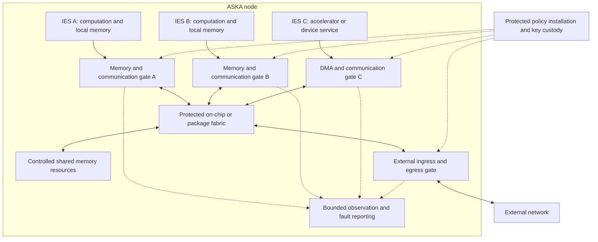

# 02 — IES execution and authority

[Start](README.md) · [Previous](01_vision_problem_and_threat_model.md) · [Next: protected handoff](03_protected_handoff.md)

An **Isolated Execution Stack (IES)** is ASKA's proposed unit of protected computation and resource authority. It includes an execution context and enforced permissions for memory, devices, communication and lifecycle operations. An IES may contain one core, several cores, or an accelerator. The name does not require a literal vertical stack of dies.

Systems with related compartment designs include [M³](07_prior_art_and_sources.md#a01), [untrusted-core isolation](07_prior_art_and_sources.md#a02), [TEEM³](07_prior_art_and_sources.md#a03), [OctopOS](07_prior_art_and_sources.md#a10), [Composite Enclaves](07_prior_art_and_sources.md#a12), [HETEE](07_prior_art_and_sources.md#b09). [CURE](07_prior_art_and_sources.md#a13), [ACAI](07_prior_art_and_sources.md#a14), [CapChecker](07_prior_art_and_sources.md#a15) cover important CPU/device variants. The comparison concerns how each system enforces authority, classification and lifecycle requirements.

The defining requirement is that ordinary software inside or outside the IES cannot widen its boundary by changing an ordinary page table, device descriptor, routing rule, or scheduler setting. The enforcement design and its verification remain unfinished.

## The proposed machine organization

The diagram groups components by function. Placement, interconnect topology, numbers of cells, cache organization, and clock domains remain open. A first model can use disjoint memory regions and a small message queue. It cannot infer the costs or guarantees of a many-core package from that simplification.

Physical enforcement means the relevant access paths terminate in hardware-controlled checks whose policy ordinary software cannot override. It does not automatically imply dedicated DRAM, separate power, or freedom from shared-cache timing channels. Every implementation must state which resources are private, spatially partitioned, temporally partitioned, or shared without a timing guarantee.

Concrete platform comparisons include [Trustworthy Silicon](07_prior_art_and_sources.md#a04), [trust-minimized accelerator integration](07_prior_art_and_sources.md#a05) and [the M3/FractOS O-RAN account](07_prior_art_and_sources.md#a09). Those platforms assume trust in parts of their infrastructure and management. A comparison involving hostile external transit must account for that difference. For sharing costs and assumptions about observable behavior, see [time protection](07_prior_art_and_sources.md#c12), [HyperFlow](07_prior_art_and_sources.md#c03).

## Keep the kinds of authority distinct

| Concept | Meaning | Example |
|---|---|---|
| Resource authority | Permission to act on a particular local object | Read buffer X; submit to queue Y |
| Information-flow restriction | Constraints on where information may influence an output | Restricted input cannot produce a public output without release |
| Release authority | Permission for a defined exception to that restriction | Publish one approved aggregate to a named service |
| Operation authority | Permission to invoke a particular effect | Append telemetry; never change a control setpoint |
| Receiver acceptance | The receiving owner's independent permission | Accept telemetry from an approved source context |
| Transport authority | Permission to use a protected forwarding resource | Use a particular local egress or admitted path class |
| Lifetime and resource limits | Bounds on when and how much authority is usable | Session deadline, byte allowance, queue budget |

Capability hardware is relevant to resource authority. CHERI protects pointers with bounds, permissions, and integrity metadata. Its tag is not a general confidentiality label for every byte reachable through the pointer. Software still expresses policy that hardware enforces. [CHERI FAQ](https://www.cl.cam.ac.uk/research/security/ctsrd/cheri/cheri-faq.html).

CHERIoT adds an embedded system design with compartmentalization and restrictions on capability propagation. An IES design should evaluate those mechanisms. Derived payload data still needs an explicit classification rule. [CHERIoT architecture paper](https://cheriot.org/papers/2023-micro-cheriot-uarch.pdf).

ASKA therefore needs an explicit source for data restrictions. That source cannot be an arbitrary field supplied by the untrusted producer.

Resource rights, IFC and controlled release are separate mechanisms in [SAFE](07_prior_art_and_sources.md#c01), [PUMP](07_prior_art_and_sources.md#c02), [DataSafe](07_prior_art_and_sources.md#ds), [DStar](07_prior_art_and_sources.md#c05), [FLAM](07_prior_art_and_sources.md#c07). A capability tag describes access rights; data confidentiality needs its own label and rules.

## A tractable first classification model

Use two confidentiality classes in the initial model: `public` and `restricted`, ordered so that public information may flow into a restricted destination. The reverse requires explicit release. This vocabulary is a modeling choice, not a universal classification scheme.

The simplest candidate uses **fixed-class cells**. A cell allowed to receive restricted input has restricted output authority for its entire lifetime. It cannot produce a public message by writing a lower label. A public cell cannot read restricted input. A separate, narrowly trusted release component performs any approved downgrade.

Fixed hardware security domains and directional classification gates already appear in [the FPGA domain-separation disclosure, Figs.1–3](07_prior_art_and_sources.md#fpga); [RFC2401 §8](07_prior_art_and_sources.md#mls) is a historical sensitivity-aware networking precedent. ASKA uses two classes to keep the first model small.

This trades precision for simpler enforcement. A restricted cell's harmless constant output may still be restricted. Measure that loss of utility before considering finer tracking. The classification decision must remain outside untrusted code.

An alternative is a monotonically increasing cell label: receiving a more restricted input raises the cell's label, and all subsequent output inherits it. A reset to a lower label requires a lifecycle transition that clears or invalidates all relevant state, including registers, memory aliases, queues, device state, and persistent output references. The transition must cover all of that state.

For taint accumulation and request reset compare [Ryoan §§4.2,5.2](07_prior_art_and_sources.md#ry); for hardware data-policy tracking compare [DataSafe](07_prior_art_and_sources.md#ds), [US10185584B2](07_prior_art_and_sources.md#dsp), [HDFI](07_prior_art_and_sources.md#g03). Ryoan permits declassification of a principal’s own tag. Its module-reset mechanism has not been shown to clear the full set of device and queue references required here.

Fine-grained tracking through individual values and control dependencies is a further candidate. It may preserve more useful communication but enlarges the hardware/software contract. HyperFlow and the subsequent ISA work provide concrete precedents for studying dynamic labels and timing-aware information flow; their processor results leave the surrounding ASKA fabric to be evaluated. [HyperFlow](https://www.cs.cornell.edu/andru/papers/hyperflow/), [information-flow ISA](https://www.cs.cornell.edu/andru/papers/hyperisa/).

Classification and integrity also differ. Receiving an authenticated restricted record establishes neither that its contents are true nor that a particular analysis produced them. A later integrity model must name its trusted producers and endorsement rules. The design treats classification and integrity separately.

Related policy frameworks include [Fabric](07_prior_art_and_sources.md#c06), [Thoth](07_prior_art_and_sources.md#c09), [CamFlow](07_prior_art_and_sources.md#c08), [Sirius](07_prior_art_and_sources.md#c10). The comparison must identify which kernels and runtimes they trust and which middleware remains unfinished. Those assumptions determine whether they tolerate a hostile host kernel.

## Operations and application semantics

The gate can enforce an operation such as “enqueue this record into mailbox 7.” That is a finite, observable action. A claim such as “this operation is safe maintenance” requires a trusted interpretation of the application's effects.

Permission to read confidential information and permission to send public messages must not combine into an implicit permission to disclose. Information-flow rules address that relationship. Separately, a system may need rules against conflicting effects, such as one principal both preparing and approving a transaction. Such a rule needs protected history or a transaction protocol; a packet field alone cannot enforce it.

For autonomous software, the same distinction applies. An agent may propose a tool call, but the call's authority comes from a protected grant and a defined effect. Tool descriptions, generated explanations, and untrusted external text cannot grant permission. If an effect declaration is used, the code or device behind it must be tied to that declaration by a trusted mechanism. Even an inaccurate description can carry a valid issuer signature.

Delegation/flow composition is treated by [FLAM](07_prior_art_and_sources.md#c07); scoped delegated grants by [Macaroons](07_prior_art_and_sources.md#e01), [WAVE](07_prior_art_and_sources.md#e02); action-bound authority by [CONTINUITY](07_prior_art_and_sources.md#f01), [execution-finality drafts](07_prior_art_and_sources.md#f02), [WO2026154461A2](07_prior_art_and_sources.md#cvp). They provide comparisons for specifying operation semantics. ASKA still needs to tie each declaration to the operation performed and show how enforcement works.

A finite output schema can reduce the space of disclosures, but it cannot establish zero information release. Choices among valid values, repeated requests, ordering, and timing can carry information. A release policy must account for what the output actually reveals and how often it can occur.

## Memory, devices, and internal communication

A source identity used by the gate must come from a protected execution or bus context. It cannot be a software-writable “IES number” in a descriptor. Address translation, requester identification, interconnect routing, and policy lookup must agree about which principal made the request.

A device assigned to one IES must not reach another cell's protected memory through DMA, peer-to-peer transactions, an alternative aperture, or a management interface. The initial candidate treats an untrusted device's writes as untrusted inputs to its assigned region. It does not let the device create protected provenance by writing a tag beside its data.

For protected requester and device identity paths inspect [CURE §5.3](07_prior_art_and_sources.md#a13), [Composite Enclaves](07_prior_art_and_sources.md#a12), [ACAI](07_prior_art_and_sources.md#a14), [TDX Connect](07_prior_art_and_sources.md#e05), [IOPMP](07_prior_art_and_sources.md#e07), [CapChecker](07_prior_art_and_sources.md#a15). [SGXIO](07_prior_art_and_sources.md#b06), [ReZone](07_prior_art_and_sources.md#b07), [Aster](07_prior_art_and_sources.md#b08), [Sancus 2.0](07_prior_art_and_sources.md#b12) provide additional protected-world/module comparisons with different TCBs. Access isolation is not evidence that the device truthfully classified or computed its input.

Cross-cell communication can use copying, ownership transfer, or immutable sharing:

| Mechanism | Required enforcement | Main cost to investigate |
|---|---|---|
| Copy into protected destination storage | Stable source data during the copy; correct destination label | Memory traffic and buffering |
| Transfer exclusive ownership | Invalidate every old writable alias before acceptance | Revocation, coherence, and completion latency |
| Share immutable data | Enforce immutability against every writer for the shared lifetime | Retention, tracking, and reclamation |

These options can coexist.

The sharing comparison starts with [Elasticlave §§3–5](07_prior_art_and_sources.md#b05): exclusive-access lock transfer is not owner-identity transfer. [Composite Enclaves](07_prior_art_and_sources.md#a12), [TensorTEE](07_prior_art_and_sources.md#b10) provide device/computation granularity comparisons. The selected snapshot mechanism must specify how it invalidates aliases and drains CPU and device writes. Shared writable memory across mutually distrusting cells needs a substantially stronger contract for races, classification, and observable interference. It is excluded from the first handoff model so that the initial property can be stated clearly.

The internal fabric must preserve the same authority on cache writebacks, coherence requests, retries, and responses as on the initiating access. Checking only an initial CPU load leaves other transaction classes unexplained. A delayed device response must not become valid for a new occupant merely because a cell identifier was reused. These details make the fabric and its lifecycle state part of the IES boundary.

Partial precedents include [UCI coherence/communication enforcement](07_prior_art_and_sources.md#a02), [CURE bus/DMA/cache IDs](07_prior_art_and_sources.md#a13), [FractOS §3.6 reboot counters](07_prior_art_and_sources.md#a08) and [silicon-finality profiles 153/240/242](07_prior_art_and_sources.md#cvs). The inspected passages do not show a generation check on every late writeback, retry and response in one system. [Statement 1](08_defensive_structural_disclosure.md#compartment-lifecycle) requires that relation together with ordered compartment reassignment; a generation counter by itself does not satisfy it.

Message-oriented hardware and protected messaging have substantial prior art. The M-Machine's protected message interface is one example. ASKA needs to compare the scope of its boundaries and how they work together with those existing interfaces. [Lee et al., 1998](https://www.cs.utexas.edu/~skeckler/pubs/ieeecomputer98.pdf).

## Subdivision and execution granularity

An IES can host multiple programs under one external restriction. That does not give those programs mutual isolation; a candidate needing isolation within the cell must supply another protected boundary. Use measurements to choose which units need isolation and whether they need dedicated cores.

Dynamic subdivision is a possible extension. Creating a child would delegate a subset of resource and operation authority, with protected accounting for shared budgets. It must not manufacture new permissions or allocate the same exclusive memory to two owners. The parent-child relationship does not automatically imply permission to read a child's data; inspection, suspension, destruction, and reallocation are separate authorities.

Heterogeneous cells could specialize for general computation, accelerators, I/O, or narrow security functions. Their value depends on workload placement and communication cost. A hierarchy of smaller cells is useful only if its boundary transitions, metadata, and scheduling costs support the intended computation. ASKA 2.0 leaves cell counts and hierarchy depth open for that comparison.

For bounded delegation and resource subdivision, use [seL4 manual §2.4](07_prior_art_and_sources.md#sel), [FractOS §3.5](07_prior_art_and_sources.md#a08) and [SemperOS](07_prior_art_and_sources.md#a07). For common enforcement of heterogeneous units use [M³](07_prior_art_and_sources.md#a01), [TEEM³](07_prior_art_and_sources.md#a03), [trust-minimized accelerator platform](07_prior_art_and_sources.md#a05). Shared-budget accounting needs checks beyond conservation of exclusive memory. For granularity and utilization, compare [Coral dissertation](07_prior_art_and_sources.md#a11), [accelerator-TEE SoK](07_prior_art_and_sources.md#b11), [CHERI network stack](07_prior_art_and_sources.md#b03), [CXL capability analysis](07_prior_art_and_sources.md#b04).

## Lifecycle is part of the boundary

Each candidate needs a lifecycle with explicit transitions: provisioned, active, quiescing, cleared, and retired. These names identify the lifecycle states.

Before reassigning an IES, the system must stop new work, resolve outstanding DMA and messages, invalidate old capabilities and session references, and clear or make inaccessible the previous owner's state. A generation number distinguishes reused identifiers.

The hardware-controlled context associates admitted work with the old generation. Checks on delayed writebacks, retries and responses must use that generation before allowing memory effects, even if a new occupant is active on arrival. Admission of the new occupant follows resolution of old work, invalidation of old communication references and protection of retained data. That number does not itself clear data, stop a device, or make an old packet expire. Transaction encoding, generation wrap/reuse and the completion rules remain to be designed and verified.

For reuse and sanitation, compare [Sanctum](07_prior_art_and_sources.md#sc), [CURE](07_prior_art_and_sources.md#a13), [Coral dissertation](07_prior_art_and_sources.md#a11), [TDX Connect](07_prior_art_and_sources.md#e05); for reference invalidation and distributed lifecycle, compare [FractOS](07_prior_art_and_sources.md#a08), [SemperOS](07_prior_art_and_sources.md#a07), [silicon-finality draft](07_prior_art_and_sources.md#cvs). Do not equate a Controller reboot epoch with a cell generation carried on outstanding transactions. [IPsec failover literature](07_prior_art_and_sources.md#ha) is relevant when keys/counters migrate or replicate.

Migration is more demanding than local creation. It moves execution state, rights, possibly keys, and obligations to another machine. It must prevent two active copies from accidentally sharing nonce space or exceeding one allowance. The initial candidate permits static placement. The migration protocol remains open.

The same discipline applies to firmware updates and recovery. An update key that can replace the gate's enforcement logic belongs in the trusted computing base. Recovery may restore access, but its authority and the possibility of data exposure must be stated. Ordinary host software cannot invoke an undocumented all-access fallback.

## Observation without a universal supervisor

ASKA retains a role for protected denial and fault reporting. A gate may report malformed requests, failed checks, queue saturation, and hardware faults through a bounded evidence channel. It cannot infer every compromise or detect malicious intent from the absence of denials.

An observer can also become a disclosure channel or an availability hazard. Logs need their own classification and resource limits. Any automatic response should have a bounded scope, such as throttling one ingress, and no authority to broaden another principal's access.

Event-driven security throttling is already described by [OPTIGA Trust M](07_prior_art_and_sources.md#obs); limited authority can be expressed through [capability-controlled resource operations](07_prior_art_and_sources.md#sel). The references leave the proposed observer and separately bounded actuator to be specified and tested. Logs and response wiring require their own analysis. A separate observer still needs an account of shared power, reset, firmware, and sensor dependencies.

## The ISA decision remains conditional

There are three useful branches: an existing core with external enforcement; an existing ISA extended with required security operations; and a new execution architecture. Compare them under the same threat model, workload, and lifecycle rules.

For external enforcement with existing ISAs, see [M³](07_prior_art_and_sources.md#a01), [untrusted-core isolation](07_prior_art_and_sources.md#a02), [CapChecker](07_prior_art_and_sources.md#a15); for protected policies and tags, see [SAFE](07_prior_art_and_sources.md#c01), [PUMP](07_prior_art_and_sources.md#c02), [HyperFlow](07_prior_art_and_sources.md#c03), [information-flow ISA](07_prior_art_and_sources.md#c04). [Komodo](07_prior_art_and_sources.md#c13), [Sanctorum](07_prior_art_and_sources.md#c14), [seL4 IFC proofs](07_prior_art_and_sources.md#c11) provide alternatives based on small protected monitors and verification. Their use of software does not by itself make them weaker baselines.

External enforcement may reduce software ecosystem costs while leaving difficult metadata and DMA integration. ISA extensions may express the requirements more directly but need toolchain work. A new architecture permits larger changes and carries the greatest verification and software burden. Each branch needs useful-performance measurements and an explanation of how protected state reaches the external fabric.

The next document specifies the handoff all three branches would have to support.
