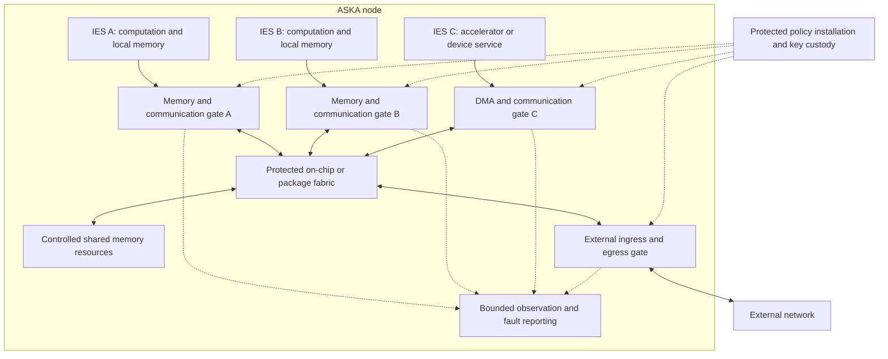

# 02 — IES execution and authority

[Start](README.md) · [Previous](01_vision_problem_and_threat_model.md) · [Next: protected handoff](03_protected_handoff.md)

An **Isolated Execution Stack (IES)** is ASKA's proposed unit of protected computation and resource authority. It includes an execution context and an enforceable relationship to memory, devices, communication, and lifecycle operations. An IES may contain one core, several cores, or an accelerator. The name does not require a literal vertical stack of dies.

The defining requirement is that ordinary software inside or outside the IES cannot widen its boundary by changing an ordinary page table, device descriptor, routing rule, or scheduler setting. Enforcement still has to be designed and verified; drawing a box around a core does not establish it.

## The proposed machine organization

This is a functional decomposition. Placement, interconnect topology, numbers of cells, cache organization, and clock domains remain open. A first model can use disjoint memory regions and a small message queue. It cannot infer the costs or guarantees of a many-core package from that simplification.

Physical enforcement means the relevant access paths terminate in hardware-controlled checks whose policy ordinary software cannot override. It does not automatically imply dedicated DRAM, separate power, or freedom from shared-cache timing channels. Every implementation must state which resources are private, spatially partitioned, temporally partitioned, or shared without a timing guarantee.

## Keep the kinds of authority distinct

| Concept | Meaning | Example |
|---|---|---|
| Resource authority | Permission to act on a particular local object | Read buffer X; submit to queue Y |
| Information-flow restriction | Constraints on where information may influence an output | Restricted input cannot produce a public output without release |
| Release authority | Permission for a defined exception to that restriction | Publish one approved aggregate to a named service |
| Operation authority | Permission to invoke a particular effect | Append telemetry; never change a control setpoint |
| Receiver acceptance | The receiving owner's independent permission | Accept telemetry from an approved source context |
| Transport authority | Permission to use a protected forwarding resource | Use a particular local egress or admitted path class |
| Lifetime and resource limits | Bounds on when and how much authority is usable | Session deadline, byte allowance, queue budget |

Capability hardware is relevant to resource authority. CHERI protects pointers with bounds, permissions, and integrity metadata. Its tag is not a general confidentiality label for every byte reachable through the pointer. Software still expresses policy that hardware enforces. [CHERI FAQ](https://www.cl.cam.ac.uk/research/security/ctsrd/cheri/cheri-faq.html).

CHERIoT adds an embedded system design with compartmentalization and restrictions on capability propagation. Those mechanisms should be evaluated for an IES candidate. They do not establish that arbitrary derived payload data acquires a complete information-flow label merely because a CHERIoT core stored it. [CHERIoT architecture paper](https://cheriot.org/papers/2023-micro-cheriot-uarch.pdf).

ASKA therefore needs an explicit source for data restrictions. That source cannot be an arbitrary field supplied by the untrusted producer.

## A tractable first classification model

Use two confidentiality classes in the initial model: `public` and `restricted`, ordered so that public information may flow into a restricted destination. The reverse requires explicit release. This vocabulary is a modeling choice, not a universal classification scheme.

The simplest candidate uses **fixed-class cells**. A cell allowed to receive restricted input has restricted output authority for its entire lifetime. It cannot produce a public message by writing a lower label. A public cell cannot read restricted input. A separate, narrowly trusted release component performs any approved downgrade.

This trades precision for simpler enforcement. A restricted cell's harmless constant output may still be restricted. That loss of utility is measurable and may motivate finer tracking later. It does not justify allowing untrusted code to decide which of its outputs were harmless.

An alternative is a monotonically increasing cell label: receiving a more restricted input raises the cell's label, and all subsequent output inherits it. A reset to a lower label requires a lifecycle transition that clears or invalidates all relevant state, including registers, memory aliases, queues, device state, and persistent output references. Clearing one software variable is insufficient.

Fine-grained tracking through individual values and control dependencies is a further candidate. It may preserve more useful communication but enlarges the hardware/software contract. HyperFlow and the subsequent ISA work provide concrete precedents for studying dynamic labels and timing-aware information flow; their processor results do not establish a complete ASKA fabric. [HyperFlow](https://www.cs.cornell.edu/andru/papers/hyperflow/), [information-flow ISA](https://www.cs.cornell.edu/andru/papers/hyperisa/).

Classification and integrity also differ. Receiving an authenticated restricted record establishes neither that its contents are true nor that a particular analysis produced them. A later integrity model must name its trusted producers and endorsement rules. ASKA 2.0 does not collapse both properties into a scalar trust score.

## Operations and application semantics

The gate can enforce an operation such as “enqueue this record into mailbox 7.” That is a finite, observable action. A claim such as “this operation is safe maintenance” requires a trusted interpretation of the application's effects.

Permission to read confidential information and permission to send public messages must not combine into an implicit permission to disclose. Information-flow rules address that relationship. Separately, a system may need rules against conflicting effects, such as one principal both preparing and approving a transaction. Such a rule needs protected history or a transaction protocol; adding another field to a packet does not enforce it.

For autonomous software, the same distinction applies. An agent may propose a tool call, but the call's authority comes from a protected grant and a defined effect. Tool descriptions, generated explanations, and untrusted external text cannot grant permission. If an effect declaration is used, the code or device behind it must be tied to that declaration by a trusted mechanism. A signature on an inaccurate description authenticates the description's issuer, not its accuracy.

A finite output schema can reduce the space of disclosures, but it cannot establish zero information release. Choices among valid values, repeated requests, ordering, and timing can carry information. A release policy must account for what the output actually reveals and how often it can occur.

## Memory, devices, and internal communication

A source identity used by the gate must come from a protected execution or bus context. It cannot be a software-writable “IES number” in a descriptor. Address translation, requester identification, interconnect routing, and policy lookup must agree about which principal made the request.

A device assigned to one IES must not reach another cell's protected memory through DMA, peer-to-peer transactions, an alternative aperture, or a management interface. The initial candidate treats an untrusted device's writes as untrusted inputs to its assigned region. It does not let the device create protected provenance by writing a tag beside its data.

Cross-cell communication can use copying, ownership transfer, or immutable sharing:

| Mechanism | Required enforcement | Main cost to investigate |
|---|---|---|
| Copy into protected destination storage | Stable source data during the copy; correct destination label | Memory traffic and buffering |
| Transfer exclusive ownership | Invalidate every old writable alias before acceptance | Revocation, coherence, and completion latency |
| Share immutable data | Enforce immutability against every writer for the shared lifetime | Retention, tracking, and reclamation |

These options can coexist. Shared writable memory across mutually distrusting cells needs a substantially stronger contract for races, classification, and observable interference. It is excluded from the first handoff model so that the initial property can be stated clearly.

The internal fabric must preserve the same authority on cache writebacks, coherence requests, retries, and responses as on the initiating access. Checking only an initial CPU load leaves other transaction classes unexplained. A delayed device response must not become valid for a new occupant merely because a cell identifier was reused. These details make the fabric and its lifecycle state part of the IES boundary.

Message-oriented hardware and protected messaging have substantial prior art. The M-Machine's protected message interface is one example. ASKA's research question concerns the scope and composition of the enforced boundaries, not ownership of message passing as an idea. [Lee et al., 1998](https://www.cs.utexas.edu/~skeckler/pubs/ieeecomputer98.pdf).

## Subdivision and execution granularity

An IES can host multiple programs under one external restriction. That does not give those programs mutual isolation; a candidate needing isolation within the cell must supply another protected boundary. The architecture should measure which units are worth isolating rather than equate every software task with a dedicated core.

Dynamic subdivision is a possible extension. Creating a child would delegate a subset of resource and operation authority, with protected accounting for shared budgets. It must not manufacture new permissions or allocate the same exclusive memory to two owners. The parent-child relationship does not automatically imply permission to read a child's data; inspection, suspension, destruction, and reallocation are separate authorities.

Heterogeneous cells could specialize for general computation, accelerators, I/O, or narrow security functions. Their value depends on workload placement and communication cost. A hierarchy of smaller cells is useful only if its boundary transitions, metadata, and scheduling costs support the intended computation. ASKA 2.0 leaves cell counts and hierarchy depth open for that comparison.

## Lifecycle is part of the boundary

Each candidate needs a lifecycle with explicit transitions: provisioned, active, quiescing, cleared, and retired. These are descriptive states, not a certification vocabulary.

Before reassigning an IES, the system must stop new work, resolve outstanding DMA and messages, invalidate old capabilities and session references, and clear or make inaccessible the previous owner's state. A generation number distinguishes reused identifiers. That number does not itself clear data, stop a device, or make an old packet expire.

Migration is more demanding than local creation. It moves execution state, rights, possibly keys, and obligations to another machine. It must prevent two active copies from accidentally sharing nonce space or exceeding one allowance. The initial candidate permits static placement. Migration remains a separate research question with a clear reason for deferral.

The same discipline applies to firmware updates and recovery. An update key that can replace the gate's enforcement logic belongs in the trusted computing base. Recovery may restore access, but its authority and the possibility of data exposure must be stated. Ordinary host software cannot invoke an undocumented all-access fallback.

## Observation without a universal supervisor

ASKA retains a role for protected denial and fault reporting. A gate may report malformed requests, failed checks, queue saturation, and hardware faults through a bounded evidence channel. It cannot infer every compromise or detect malicious intent from the absence of denials.

An observer can also become a disclosure channel or an availability hazard. Logs need their own classification and resource limits. Any automatic response should have a bounded scope, such as throttling one ingress, and no authority to broaden another principal's access. A separate observer still needs an account of shared power, reset, firmware, and sensor dependencies.

## The ISA decision remains conditional

There are three useful branches: an existing core with external enforcement; an existing ISA extended with required security operations; and a new execution architecture. Compare them under the same threat model, workload, and lifecycle rules.

The first may reduce ecosystem cost while leaving difficult metadata and DMA integration. The second may express the boundary contract more directly while requiring toolchain work. The third permits larger changes but carries the greatest verification and software burden. No branch receives an exemption from measuring useful performance or explaining how protected state reaches the external fabric.

The next document specifies the handoff all three branches would have to support.
