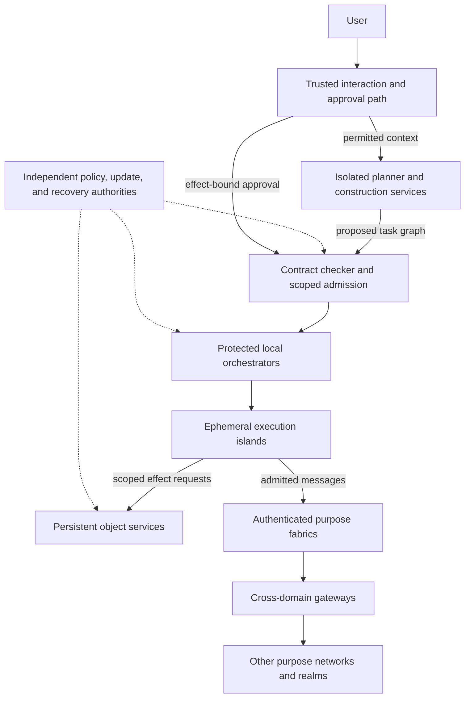

# ASKA v4 — Architecture and reading map

**22 October 2026 · Research architecture**

ASKA organizes computing around small domains whose authority is enforced outside the code they run. The native system combines physically owned execution resources, persistent object services, networks separated by purpose, and an AI-first operating environment. Applications consist of bounded computations and explicitly authorized effects. Compromising a parser, runtime, or planner must leave the surrounding boundaries effective. The same obligation applies to an authorized insider, a network controller, or a cross-domain transformer: existing access and connectivity must not become new disclosure or effect authority.

The architectural destination is independent of the processor, programming language, carrier, or fabrication process used to investigate it. A prototype can test one mechanism without satisfying the whole architecture. It cannot redefine the target by omitting a difficult requirement.

## System organization

An **Isolated Execution Stack (IES)** is a domain with an assigned physical resource set, a lifecycle generation, a confinement policy, and explicit communication edges. A **cell** is an execution lifetime inside that domain. A **realm** owns resources and policy under its own authorities. An application can span many IESs and realms; application membership grants no implicit access between them.

The target has five cooperating parts:

| Part | Responsibility | Authority it does not acquire |
|---|---|---|
| Execution islands | Run bounded cells on exclusively assigned compute and memory | Access to another island's memory or services |
| Persistent object owners | Store state and commit authorized operations | General control over request workers or unrelated objects |
| Purpose networks and gateways | Admit communication and mediate named crossings | Permission to disclose data or invoke arbitrary application effects |
| AI operating environment | Interpret intent, retrieve permitted context, construct and coordinate tasks | Minting user consent, broadening policy, or installing its own code |
| Realm authorities | Independently control resources, policy, updates, and recovery | A universal administrative right across other realms |

The arrows are separately mediated interfaces. The diagram does not imply a central machine with unrestricted access to every component. Local orchestrators can allocate only resources already delegated to them. The planner can be malicious without gaining authority beyond its current task grants.

## Architectural choices

The selected organization is a **spatial object machine**: private execution memory, explicit object messages, and separately owned persistent effects. Its execution contract permits conventional instruction cores, new object-oriented instructions, or spatial/dataflow engines inside an island. These implementations must satisfy the same observable semantics.

Native cross-trust execution uses exclusive cores or execution engines, local private memory, and gated message paths. Sensitive administration and recovery occupy independently rooted physical domains. Shared cache/MMU isolation alone does not satisfy the native physical requirement. [0302](0302_architectural_candidates_and_decisions.md) compares distinct candidates; [0303](0303_physical_substrate_and_frontier.md) states what physical ownership entails.

There is no native dependency on a global filesystem, ambient process privileges, POSIX, Linux, an IP address space, or an unrestricted kernel. Scoped names, interactive tools, long-running services, and existing algorithms remain usable when their authority is explicit. Removing a familiar interface name is not itself a security boundary.

The architecture selects complete mediation and object/effect semantics now. It does not yet select a binary ISA, transistor process, inter-die protocol, or production packet encoding. Those choices require the comparisons and experiments specified here, including investigation of new mechanisms where existing ones fail.

## Reading order

| Document | Contents |
|---|---|
| [0300 — Architecture and reading map](0300_architecture_and_reading_map.md) | Whole-system organization and target |
| [0301 — Requirements and threat model](0301_requirements_and_threat_model.md) | Governing requirements and compromise assumptions |
| [0302 — Architectural candidates and decisions](0302_architectural_candidates_and_decisions.md) | Alternatives, selections, and reopening criteria |
| [0303 — Physical substrate and frontier](0303_physical_substrate_and_frontier.md) | Isolation, fabrication, packaging, optical links, and unconventional compute |
| [0304 — Execution and instruction semantics](0304_execution_and_instruction_semantics.md) | Native execution contract and processor research |
| [0305 — Memory, ownership, and lifecycle](0305_memory_ownership_and_lifecycle.md) | Snapshots, transfer, revocation, reset, and reuse |
| [0306 — Persistence and effects](0306_persistence_and_effects.md) | Durable objects, transactions, devices, and recovery |
| [0307 — Authority and information flow](0307_authority_and_information_flow.md) | Grants, confinement, transformations, and release |
| [0308 — Native applications and development](0308_native_applications_and_development.md) | Component contracts, composition, and developer workflow |
| [0309 — AI environment and trusted interaction](0309_ai_environment_and_trusted_interaction.md) | User interface, isolated intelligence, orchestration, and synthesis |
| [0310 — Purpose networks and gateways](0310_purpose_networks_and_gateways.md) | Physical topology, STN/ATN roles, routing, and crossings |
| [0311 — Admission and delivery](0311_admission_and_delivery.md) | Identity establishment, transport semantics, freshness, and publication |
| [0312 — Governance, updates, and recovery](0312_governance_updates_and_recovery.md) | Management separation and common-cause failure resistance |
| [0313 — Compromise and failure cases](0313_compromise_and_failure_cases.md) | PHP, Apple, AI, management, and authorized-abuse tests |
| [0314 — Validation and cost models](0314_validation_and_cost_models.md) | Model boundaries, physical tests, and performance arithmetic |
| [0315 — Research and realizations](0315_research_and_realizations.md) | Dependencies, long-horizon research, and intermediate builds |
| [0316 — Traceability and evolution](0316_traceability_and_evolution.md) | Requirement matrix, change control, and departures from earlier designs |
| [0317 — Sources and evidence](0317_sources_and_evidence.md) | Primary references, inspection depth, and evidence limits |
| [0318 — Cross-domain security and information release](0318_cross_domain_security_and_information_release.md) | Adversarial bridges, release transactions, peripherals, insider threats, and observation limits |

Read [0318](0318_cross_domain_security_and_information_release.md) alongside 0307 and 0310. It defines the system-wide crossing contract, including physical media and output devices. ATN/STN membership identifies governance and connectivity; neither name certifies an endpoint or authorizes an operation.

## How to interpret the specification

**Requirements** identify properties the target must preserve. **Selected designs** are architectural judgments intended to meet them. **Alternatives** remain candidates under stated conditions. **Assumptions** name remaining trust. **Research questions** identify mechanisms or arguments that are missing. **Hypotheses** are claims to test, not results.

“Must” defines a target obligation. “May” identifies a permitted choice; a choice cannot waive a governing requirement. Numerical bounds used in a model or example do not become universal architecture limits. All calculations state their inputs.

This set supplies subsystem contracts and a research program, not working ASKA hardware or a completed proof. The complete architecture is unvalidated. Existing demonstrations support individual mechanisms only. The source register distinguishes specifications, research artifacts, author-reported demonstrations, and exploratory work.

The acceptance question is concrete: after taking over an application component, an AI planner, or one management role, which unauthorized effects remain impossible under the declared enforcement assumptions, and what further independent failure would be necessary to cause them? [0313](0313_compromise_and_failure_cases.md) applies that question to complete application paths.
