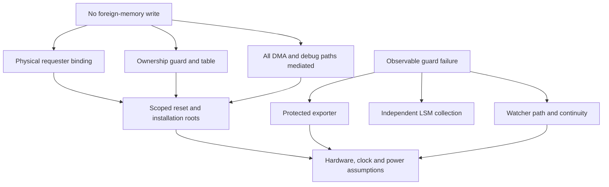

# ASKA v6 — Assurance, trust and failure domains

**Status:** proposed normative target. Requirements describe obligations; they do not certify an implemented machine.

## 1. Independence is a relation

A component is independent of attacker domain A **for property P** only when A cannot alter the enforcement or evidence functions on which P depends through the declared interfaces and management paths. This is a relation among a property, an attacker and a dependency graph; it is not a synonym for a separate process, die, board or vendor.

For every claim, define `Claim = (property, attacker, observations, trusted_functions, physical_boundary, availability_conditions, evidence)`. A trusted exporter may be independent of a guest but share the guest's FPGA image root. Such an exporter supports a guest-compromise claim while failing an image-producer-compromise claim. A watcher on a second board may survive an LSM crash while sharing its power supply; it does not prove observation during loss of that supply.

The [seL4 assumptions](https://sel4.systems/Verification/assumptions.html) are a useful discipline: proof boundaries include specific low-level and hardware assumptions, and confidentiality covers modeled channels. ASKA MUST state its corresponding assumptions without inferring whole-machine correctness from a verified subcomponent.

## 2. Root and function inventory

| Root/function | Permitted authority | Separate dependency to declare |
|---|---|---|
| Requester attachment | Bind physical source to cell/owner epoch | Port wiring, spoof resistance, reset behavior |
| Memory ownership | Enforce extents, permissions and generations | Table protection, cache aliases, DMA coverage |
| Effect owner | Check local finality and consume budget | Durable state, device truth, clock and key protection |
| Realm policy installer | Admit typed scope at named owners | Independent approvers, parser, firmware and rollback |
| LSM image/configuration roots | Validate observer artifacts | Producer/reviewer separation, receiver limits |
| Watcher roots | Install watcher logic and audit subscriptions | Separate keys, tooling, recovery and reset controls |
| MSM distribution root | Authenticate distribution identity and package forwarding | No implied package approval or destination policy right |
| Keystone UI root | Bind displayed terms to physical input | Display engine, input mux, maintenance and assistive paths |
| Steles root | Sign and retain qualified commitments | Retention, antirollback, notice release policy |
| Recovery custodians | Recover a named boundary under a defined procedure | Quorum, physical access, replacement identities, revoked keys |

A key held in the same unrestricted management processor as another key is not a separate failure domain simply because the certificates differ. Likewise, threshold signatures by two services built from the same compromised image do not establish independent review.

## 3. Dependency graph and cut sets

For a property P, a cut set is a set of failed or malicious functions sufficient to defeat P under the model. Minimal cut sets deserve explicit tests. They are logical dependencies, not probability estimates. No numerical multiplication of failure rates is permitted without evidence of the statistical independence assumed.

| Failure or cut set | Immediate consequence | Surviving claim, if conditions hold |
|---|---|---|
| One hostile guest | Arbitrary guest instructions and in-scope device requests | External guard confinement |
| One failed MG | Foreign memory may become reachable on that boundary | Independent egress can still constrain emission; confidentiality already lost locally |
| One hostile LSM | False, missing or delayed analysis input | Guard authorization and independent watcher evidence |
| One hostile MSM | Malformed, replayed or defective distributions | Local installation checks, distinct reports and WM-M observation |
| One hostile watcher | Forged oversight and hidden watcher failures | Other roots retain non-expanding authority; confidence in that watcher's evidence is lost |
| Shared BMC/debug writer | Several nominal domains can be rewritten | No independence claim across its actual reachable scope |
| Shared FPGA bitstream root | Guard, exporter and watcher logic may share a compromise | Only separation below/around that root can survive |
| Shared clock/reset controller | Counters, execution and watchdogs may stop together | No watchdog continuity claim against that controller |
| Chassis power loss in RP-A | Compute, guards and local observation stop | Persistent-state recovery only if its durability assumptions hold |
| Independent-appliance loss in RP-B | One realm/service disappears | Other powered appliances and independent paths can continue locally |
| Authorized recipient betrayal | Misuse of already released plaintext | Narrow exposure and attributable receipts; no forgetting guarantee |

When a lower boundary fails, a surviving outer boundary may limit propagation. It does not retroactively restore integrity or secrecy inside the failed scope. This distinction is essential when discussing redundant checks.

## 4. Finite watcher roots

WM-L observes the relevant LSM intake, configuration installation, output health and response proposals through independent taps or attestable exports. WM-M observes distribution and management health. The observed mesh MUST lack access to watcher keys, reset, firmware or policy writers within the asserted compromise model. The watcher itself is assumed or assessed at a declared terminal root; independent bench inspection, physical root custody and separately administered recovery close the assurance argument without infinite regress.

A watchdog proves only the property measured by its counter or challenge. A malicious observer may emit heartbeats while discarding security events. Therefore watcher evidence includes work-related sequences, subscription/configuration measurements, export loss counters and challenge tests where feasible. Even these cannot establish semantic completeness for invisible internal activity.

If watcher availability disappears, the system reports **unknown oversight**, not healthy observation. Existing guards may continue under a minimum policy and previously admitted bounded grants. A profile can require suspension of particular high-consequence activities, but cannot use blindness to authorize a universal shutdown or surveillance expansion.

## 5. Evidence classes and status

| Evidence class | Minimum record | Permitted interpretation |
|---|---|---|
| Requirement | Owner, assumption and oracle | Obligation, not demonstration |
| Selected decision | Alternative, rationale and reopen trigger | Chosen architectural direction |
| Implementation candidate | Concrete mechanism and dependencies | Feasible option to evaluate |
| Research hypothesis | Falsifier and experiment | Unestablished proposition |
| Model assumption | Explicit state abstraction or trusted function | Conditional premise |
| Simulated result | Model/code hash, inputs, bounds and output | Result within model scope |
| Measured result | Apparatus, instrument, workload and uncertainty | Observation on that apparatus |
| Independently replicated result | Independent party and comparable apparatus/protocol | Replication within stated scope |

Attestation, signature validation, proof checking and witness consistency are evidence operations with distinct meanings. None proves that a sensor's physical input was truthful, that a legal order was just, or that signed code has safe behavior. Negative tests should include authenticated lies and correctly signed defects.

## 6. Assurance loss and recovery

Each claim has a runtime status: `supported-under-manifest`, `degraded`, `unknown`, or `withdrawn`. These are assurance statuses, not common effect outcomes. A newly detected shared dependency withdraws affected independence claims. A disconnected report path degrades completeness. A missing monotonic counter makes session continuity unknown and may require retirement of the affected epoch.

Recovery must re-establish specific prerequisites: identity, applicable policy, installation provenance, monotonic state, sanitized resource ownership and any required independent observation. It must not restore broad historical rights from a backup merely because a service has restarted. The recovery receipt identifies which guarantees resumed and which remain unestablished.

## 7. Review procedure

Reviewers enumerate every data, control, management, debug, clock/reset and power edge in [Chapter 04](04_reference_machine_and_reachability.md). They select a target property and give the attacker every capability assigned by the threat model. They compute direct and indirect write influence, then test cut sets using independent instruments. The observer used as an oracle must not be the only component whose correctness is disputed.

For availability, reviewers record service lost as well as forbidden effects blocked. For privacy, they include sizes, timing, error categories, logs and sensor patterns in the observation boundary. For suppliers, they record shared source code, toolchains and review infrastructure. Administrative separation is useful, but it is not itself physical or implementation diversity.

## Normative requirements and acceptance obligations

**R-03-01 — Relative independence.** An independence claim MUST name the attacker, property, observation boundary and full dependency graph.

**Acceptance T-03-01:** Give the attacker control of every named domain and test all reachable writers of the claimed independent function.

**R-03-02 — Complete root inventory.** Each protected function MUST identify its policy, firmware, key, reset, debug, clock and power roots.

**Acceptance T-03-02:** Trace a BMC/reset/debug request and verify that no unlisted writer reaches protected state.

**R-03-03 — Common-cause honesty.** Shared dependencies MUST be represented as shared cut sets rather than counted as independent protection.

**Acceptance T-03-03:** Fail one shared image root or power controller and withdraw all dependent claims together.

**R-03-04 — Finite watcher boundary.** Watcher oversight MUST terminate at a declared root, and a monitored mesh MUST lack authority to rewrite that root within the claim model.

**Acceptance T-03-04:** Compromise LSM/MSM and attempt watcher firmware, reset and key writes; expected denial is independently observed.

**R-03-05 — Qualified evidence.** Evidence MUST distinguish authenticated origin, observation completeness, semantic truth and effect finality.

**Acceptance T-03-05:** Submit a signed false event and a missing event interval; neither may be reported as verified physical truth or proof of inactivity.

**R-03-06 — Assurance transition.** Loss of an assumption MUST downgrade or withdraw the affected claim and preserve the reason in a scoped receipt.

**Acceptance T-03-06:** Disconnect oversight, roll back a counter and recover; check explicit intermediate uncertainty and requalification before claim restoration.

