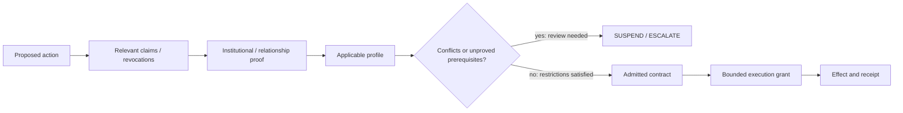

# ASKA v5 — Authority calculus, obligations, and conflict semantics

## 1. Authority has provenance, not a universal rank

A parent's care obligation, a user's refusal to disclose information, a professional duty, an employment delegation, a court order and a network operator's route authorization are distinct kinds of authority. Their relative effects depend on governing law, mandate, contract, location, custody and purpose. The Accord evaluator **shall not** reduce them to a universal chain such as `State > Employer > Parent > User`. Nor may it treat every participant's preference as consent to a mandatory legal obligation.

Define a candidate action `a = (actor, method, target, content_selector, recipient, purpose, plane, time, budget, output, commitments)`. The evaluator is a **partial decision procedure** over that action and a finite, revisioned evidence/procedure set; it is not a metaphysical legitimacy oracle.

## 2. Typed authority evidence

| Type | What it may establish | What it does not establish |
|---|---|---|
| `FACT` | a signed assertion, observation, date, relationship or status | arbitrary effect authority |
| `ROLE` | authorized institutional office/position, within its scope | authority outside office or term |
| `DELEGATION` | rights delegated by a principal over an allowed subset | nondelegable rights or unbounded subdelegation |
| `DUTY` | required action or retention under an applicable profile | universal access to data |
| `PROHIBITION` | forbidden recipient, disclosure, output or effect | the ability to block unrelated lawful duties by default |
| `CONSENT` | informed, purpose/recipient/period-bounded authorization | proof that it was voluntary if legally compelled |
| `ORDER` | institutional command with issuer, scope and review path | legal justice, technical access, universal decryption |
| `CAPACITY` | limits associated with guardianship, incapacity or fiduciary powers | unrestricted ownership transfer |
| `ATTESTATION` | protected measured system state under an appraisal policy | truthful application computation |
| `REVOKE` | current invalidity or withdrawal evidence | retroactive recall of disclosed plaintext |

Each evidence type has its own issuer qualification rules. An institutional signature proves which key signed an assertion. A **profile-qualified verification step** assesses whether that issuer and instrument are applicable; the same key may be valid for one service and irrelevant elsewhere.

## 3. Decision context

Let `Γ = (Profiles, Claims, Revocations, Relationships, Resources, Clock, LocalPolicy, RecipientPolicy)`. An evaluator must derive a decision for a **specific** action, not grant a generic capability from a profile or identity credential:

```text
Γ ⊢ a ⇓ {ALLOW, ALLOW_WITH_OBLIGATIONS, DENY,
         SUSPEND, ESCALATE, UNAVAILABLE}
```

`SUSPEND` means evidence or contestation is pending; `ESCALATE` means an identified independent decision-maker must intervene; `UNAVAILABLE` means technically inaccessible after admission checks, not a permission to bypass controls. `DENY` is definite under the current profile and evidence. Each result carries `reason_code`, `required_missing_evidence`, `profile_revision`, `decision_time_basis`, and an optional challenge/notice contract.

### 3.1 Recommended evaluation algorithm

1. Validate encoding and issuer binding; reject unknown critical fields.
2. Load pinned governance profile hashes and check jurisdiction/organizational applicability.
3. Verify evidence validity windows and **fresh revocation status** within a declared staleness budget.
4. Resolve source object rights, applicable role, delegation paths and nondelegable exclusions.
5. Evaluate negative restrictions independently of positive permissions.
6. Compute effect, confidentiality and recipient obligations independently.
7. If contradictory instruments apply without a recognized precedence procedure, return `SUSPEND` or `ESCALATE`, **not** a fabricated winner.
8. Bind output schema, recipient, path class, concurrency budget, expiry, appeal, notice and receipt obligations.
9. Obtain the independently required approvals and protected user interaction.
10. Compile a grant whose rights are a subset of the contract; refuse if any required restriction cannot be enforced.

### 3.2 An explicit proof graph



The proof graph records why the actual decision occurred. It may reveal only hashes or selectively disclosed subgraphs where disclosure is unnecessary or unsafe. It is a per-operation provenance DAG, **not** a universal ledger of everyone's relationships.

## 4. Delegation and attenuation

A delegation edge `d: principal₁ -> principal₂` carries permitted verbs, object selectors, purpose, applicable realm, recipient sets, time window, budgets, subdelegation restrictions, revocation handles and supporting proof. Composing delegations intersects powers and accumulates obligations. It does **not** union rights from inconsistent sources.

For a source delegation `D` and derived grant `G`, require:

`Methods(G) ⊆ Methods(D)`, `Objects(G) ⊆ Objects(D)`, `Recipients(G) ⊆ Recipients(D)`, `Budget(G) ≤ RemainingBudget(D)`, and `Expiry(G) ≤ Expiry(D)`.

Nondelegable obligations remain nondelegable. Delegating the same budget twice must not duplicate spending power: a protected counter or reservation authority charges the shared allowance before admitting sibling grants.

## 5. Consent, compulsion and disagreement

A click on “approve” is not necessarily voluntary. The contract records `authority_basis` separately as `consent`, `legal_duty`, `contractual_obligation`, `institutional_instruction`, `emergency_exception`, or `other_profile_defined`. A lawful order may compel an applicable custodian to produce accessible information; this does not convert the citizen's lack of consent into consent. A person can dispute an order while an institution asserts its applicability. These facts belong in the record, and profile-defined courts or review bodies—not a hidden model heuristic—adjudicate conflicts.

## 6. Formal safety statements

- **No creation by parsing:** Untrusted claim bytes do not change the installed grant set until an authorized evaluator and installer commit.
- **Non-expansion:** Every installed grant is justified by a live admitted contract, and its executable scope is included in the contract's machine constraints.
- **Closed-world effects:** Any effect lacking a complete live grant/effect-owner check is denied.
- **Monotonic restriction:** In the absence of a separate authorized release, a transformation preserves or strengthens the union of source information restrictions.
- **Independent consent:** A sender cannot fabricate a recipient's receive policy or current object ownership.
- **Revocation safety:** Revocation does not invent new permissions. An admitted operation may require a safe drain to terminate; it cannot continue with authority after its enforced lease or revocation epoch is invalid.

## 7. Limits of formalization

A model can prove properties **conditional on a written profile**. It cannot prove the quality of legislation, election legitimacy, factual accuracy of a witness, or whether a person understands coercion. This is not a reason to omit legal semantics; it is a reason to keep technical, legal and human responsibilities separately named, reviewable and contestable. See [08](08_legal_process_and_emergencies.md), [27](27_conformance_tests_and_vectors.md) and [33](33_formal_properties_and_model_sketch.md).
