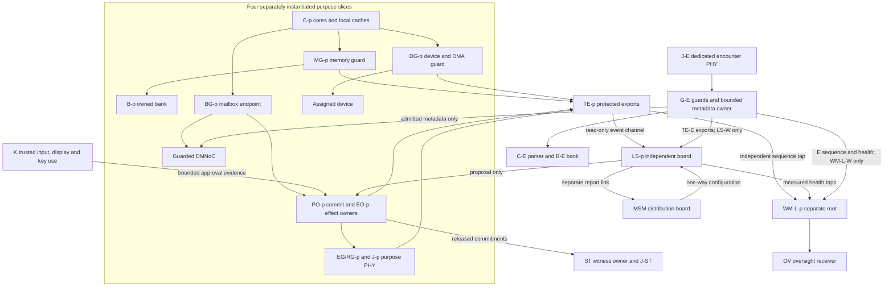

# ASKA v6 — Reference machine and reachability

## 1. Reference status and indexing

This chapter defines two conceptual physical reference profiles, **RP-A** and **RP-B**. They are implementable board/appliance organizations to be refined into schematics, RTL, firmware and measured apparatus. No production layout, completed fabrication, electrical compliance or demonstrated isolation is asserted. Connector and module counts below are sample profile counts at a stated boundary, not a universal consequence of the four societal purposes.

In tables, `p ∈ {S,P,A,W}` denotes Sanctum, Polis, Agora and Wilder. `t ∈ {S,P,A,W,T}` additionally includes trusted-service observation. A parameterized row expands into one independently identified interface per listed value; it never means a shared unguarded bus. The implementation manifest MUST expand these rows into actual pins, lanes, modules, wiring and firmware identities before claiming physical conformance.

[Separation kernels](https://www.csl.sri.com/papers/sosp81/) and [MILS](https://www.inderscience.com/info/inarticle.php?artid=14859) are the starting comparison for protected partitions. RP-A adds separately inventoried device, reset, debug, power and installation paths. It claims neither original physical partitioning nor greater assurance before a circuit-level inspection. [Qubes OS](https://www.qubes-os.org/doc/QubesArchitecture/) is a deployment comparison for purpose compartments sharing a virtualization stack; RP-A must demonstrate a concrete reduction in reachable attacker paths before justifying its extra boards.

## 2. RP-A: split-board sovereign workstation

Each purpose has a compute module `C-p`, an assigned writable bank `B-p`, one boundary guard `G-p`, and a purpose PHY `J-p`. The names MG (memory), DG (device/DMA), BG (handoff), PO (persistent commit), EO (effect) and EG/RG (egress/receive) identify **functions inside that one guard**, not extra chips or independent protection roots. Each claimed transaction must pass its applicable function before the irreversible boundary. Parsers and transition workers run in confined cells; only protected guard state holds ownership and finality tables. Loss of `G-p` compromises that purpose's full boundary.

`C-p` may contain internally coherent cores and caches. The memory controller path through MG-p enforces the bank allocation; writebacks and retries carry protected owner/lifetime identity. No CPU in C-W has a direct wired load/store path to B-S. Cross-purpose application communication uses a BG handoff and a source/receiver contract. DMNoC is the conceptual guarded interconnect connecting these endpoints; it does not grant routing controllers access to bank contents.

Keystone `K` has its own processing, small memory, trusted display/input controller and local key-use root. Steles `ST` has a separate witness owner, storage and PHY `J-ST`. Their banks are not mapped into a purpose IES. The independent oversight receiver `OV` accepts watcher reports under a limited receiving policy and can present qualified oversight evidence; it has no generic write path to a purpose guard.

There are also LS-T and WM-L-T for authorized K/ST/service exports, and WM-M for MSM oversight. T is an observation scope, not a fifth general-purpose application plane. WM-M's export reaches OV independently of the MSM report parser. Each watcher retains its own boot root and local evidence buffer. ST can receive a separately released commitment about oversight; it does not absorb the watcher's authority or replace OV's receiver policy.

### First-contact domain E

Both RP-A and RP-B add one dedicated duplex encounter port `J-E`, with a separate parser/receive lane, FIFO, buffer bank `B-E`, compute domain `C-E` and device/DMA path behind `G-E`. E is a Wilder-governed first-contact resource domain, not a fifth societal purpose. The ordinary `J-W` purpose port remains distinct and can carry established admitted Wilder sessions. Established ATN/STN traffic never traverses E's FIFO and never depends on E's free-buffer pool, parser, allocator or recovery progress.

G-E supplies MG/DG/BG and EG/RG boundaries plus a narrow owner for encounter-queue publication and admission-metadata effects. C-E has no raw path to an established session table, foreign bank, purpose PHY or installer. First-contact discovery and enrollment are bounded there. A promotion copies only the admitted metadata through BG-E to the responsible local admission owner; that owner independently evaluates the contract and installs any established session. Subsequent established traffic uses its separately admitted purpose port and resources. A forged session identifier arriving on a purpose port cannot divert that port into unrestricted encounter parsing.

G-E shares the Wilder installation authority with G-W in these reference profiles; compromise of that installer is a declared cut set affecting both. This is not claimed as installer independence. The protected data path and allocation remain separate: an encounter parser crash, exhausted E pool or E flood does not consume the reserved established-session resources. Shared power, guard implementation, external carrier and physical facility limitations remain explicit.

TE-E exports minimized boundary and resource events to LS-W through its own bounded interface; WM-L-W has independently admitted E sequence/health taps as well as its W inputs. E response proposals terminate at EO-E under separate target and cumulative budgets. These additional local exporter, proposal and tap lanes do not add another LSM or watcher root and cannot turn either into a data reader or session-table writer.

The interface-class register expands I01–I06, I09–I10 and applicable maintenance/reset/clock rows for E as well as their purpose/service instances. E has no general PO or actuator entitlement: I04-E terminates only in its bounded queue/admission-metadata owner unless a separately admitted object method is explicitly added. Its sealed service, power and debug entries must appear in the implementation manifest. The five MSM-to-LSM links, five LSM reports and six watcher-to-OV links remain unchanged.

The following E-specific bindings override the ordinary purpose/service indices. They do not instantiate LS-E or WM-L-E.

| Interface | E-specific path and admission rule | Required separation |
|---|---|---|
| I05-E | EG/RG-E ↔ J-E under a preinstalled, bounded encounter intake/reply policy; an established session is not a prerequisite for this narrowly admitted first contact | Separate receive lane, quarantine, parser, queue and bank; replies obey destination, size, rate and cumulative resource limits; this policy cannot install an established session |
| I06-E | G-E functions → TE-E → LS-W | Independently bounded E input, event identity, drop accounting and reservation; no observer RAM bus-mastering |
| I09-E | LS-W → EO-E proposal input | EO-E validates the E-specific standing grant, target, expiry, cumulative budget and safety constraints; no authority over established W session tables |
| I10-E | E exporter, configuration, output and health taps → WM-L-W | Independently admitted E evidence and counters; neither LS-W self-report nor W traffic can substitute for E coverage |

I01-E through I03-E instantiate only E-owned resources and guarded handoff. I04-E retains the narrow owner restriction above. Admission promotion is a separate receiving-owner decision; successful encounter parsing or an observer proposal does not confer that authority.

### Minimum boundary versus monitored realization

| Claim profile | Required apparatus | Additional permitted evidence and costs |
|---|---|---|
| `HARDWARE_GUARDED` | `C-p`, `B-p`, `G-p` with protected owner tables, admitted physical ports, local install/recovery and an independent actual device-path inspection | Qualifies prevention for inventoried paths; it does not claim watcher-independent detection |
| `OOB_PARTIAL` | The guarded apparatus plus explicitly bounded outside observation | Must disclose coverage gaps, observer write paths and added sharing |
| `OOB_NATIVE` / RP-A extended example | Above plus LS/MSM, WM-L/WM-M and OV where a measured threat demands them | Each new root, link, exporter, key custody role and maintenance path enters the cost, trust and assurance register |

The RP-A diagram and I01–I22 bill describe the **extended** configuration; they are not minimum manufacturing requirements. A per-purpose `G-p` may use internal submodules only when the interface register shows their physical routes and shared roots. The installation manifest distinguishes hardware guards from merely named software services.

## 3. Component and installation roots

| Component set | Installation/policy authority | Permitted operational writers | Reset/debug ownership |
|---|---|---|---|
| C-p and its cell workers, plus C-E workers | Per-purpose application installer | Its assigned cell lifetime | Local compute reset controller; no access to G-p keys |
| G-p/MG/DG/BG/PO/EO/EG/RG, plus G-E | Per-purpose boundary installer with separate high-consequence review | Typed local table transitions only | Boundary recovery controller; production debug locked |
| K | Local trusted-interaction root and declared recovery custodians | Canonical input/display/key-use APIs | K-specific physical recovery; no shared BMC writer |
| ST | Witness owner and its retention/recovery policy | Append/correction operations within release contract | ST-specific recovery and monotonic state |
| LS-t | Local observer installer, scoped configuration admission | Validated observer data/rules only | LS-specific recovery, unavailable to C-p |
| WM-L-t | Separate watcher installer/recovery root | Declared oversight state | Independent from LS-t reset and debug |
| MSM | Distribution root; package authority remains separate | Queued authenticated package forwarding | MSM-local recovery |
| WM-M | Separate master watcher root | Declared oversight state | Unavailable to MSM |
| OV | Independent oversight receiver root | Bounded report intake and presentation | Separate OV recovery, no downstream policy writer |

The term “per-purpose” means a separately scoped authority domain. If a deployment uses the same firmware image, toolchain or human custodian for several domains, it records that common cause. A single board with several guard functions can be a useful first realization, but does not demonstrate independent silicon or supplier faults.

## 4. Protected reachability register

This is the complete **logical interface-class register** for RP-A. An implementation must provide an exhaustive physical expansion, including unbonded/debug/test and maintenance routes. “No alternate” means none is authorized by this profile; a discovered route invalidates the applicable claim until mediated or excluded explicitly.

| ID | Physical path and direction | Allowed initiator and operation | Parser/enforcement boundary | Alternate route |
|---|---|---|---|---|
| I01-p | C-p → MG-p → B-p; memory transactions | Assigned cell, bounded reads/writes with epoch | Hardware transaction decoder and ownership table | No direct bank wiring or management DMA |
| I02-p | Assigned device ↔ DG-p ↔ owned buffers | Admitted device queue and device generation | Descriptor snapshot, extent/permission guard | Peer DMA disabled unless separately registered |
| I03-p | C-p ↔ BG-p ↔ DMNoC | Typed copy/loan/handoff requests | Bounded mailbox parser and generation checks | No raw remote-pointer interface |
| I04-p | BG-p → PO-p/EO-p | Admitted object methods/effects | Object parser in cell; protected finality owner | No worker-owned persistent backing writes |
| I05-p | EG/RG-p ↔ J-p external PHY | Installed transmit/receive session | Quarantine, record verifier, last egress gate | Management queues also traverse gate |
| I06-p | G-p functions → TE-p → LS-p | Hardware exporter for authorized event fields | Fixed event encoder; bounded LSM parser | No LSM read/write RAM bus-mastering |
| I07-t | MSM TX-t → simplex medium → LS-t RX | Distributor sends typed configuration packages | Receiver manifest/parser/scope checks | Reverse signaling physically absent at this interface |
| I08-t | LS-t TX → separate simplex medium → MSM RX-t | LSM sends permitted posture/requests | Separate bounded report parser | Cannot become configuration ingress |
| I09-t | LS-t → EO-t proposal input | Observer/SAI proposal within known template schema | EO validates installed standing grant | No script, code-loader or policy-writer side effect |
| I10-t | TE/config/output taps → WM-L-t | Independent hardware exports and measured health | Watcher bounded observation decoder | LSM self-report alone is insufficient |
| I11 | MSM distribution/export taps → WM-M | Hardware export of scoped distribution events | WM-M observation decoder | No reliance solely on MSM software log |
| I12-t | WM-L-t TX → simplex link → OV RX-t | Watcher evidence with sequence/drop scope | OV verifier and receiving policy | No reverse control from OV on link |
| I13 | WM-M TX → simplex link → OV RX-M | Master watcher report | Separate OV parser/queue | No MSM relay required |
| I14-p | K ↔ local contract/installer endpoint | Canonical approval evidence; scoped grant admission | Profile evaluator and local installer | K does not write raw guard tables |
| I15 | Physical input → K → protected display | User action; exact intent presentation | Trusted mux, surface bounds and input binding | Remote/assistive inputs separately admitted |
| I16-t | Owner → release gate → ST | Minimal commitment/receipt | ST receiving policy, label and retention checks | No unrestricted raw-log bulk import |
| I17 | ST ↔ J-ST witness PHY | Admitted witness replication | Separate egress/receive gate and witness policy | Not a purpose-plane fallback router |
| I18-x | Sealed maintenance connector → local installer x | Authorized physical service session | Boot/update package verifier, typed scope | No shared unrestricted JTAG/BMC chain |
| I19-x | Local reset/power-good → component x | Scoped controller and declared fault signal | Hardware reset policy and epoch retirement | Cross-domain reset wiring prohibited unless declared |
| I20-x | Clock source → component x | Named oscillator/clock-conditioning domain | Counter continuity/fault handling | Hidden clock mux or debug clock invalidates manifest |
| I21 | Supply/cooling → modules | Physical infrastructure | Fault detection and declared safe-state response | Shared facilities remain common-cause dependencies |
| I22-p | Peripheral output owner → display/print/media/actuator port | Exact admitted physical output | Device-specific final guard and safety interlock | Raw device maintenance emission must be gated or physically absent |

### Guard transaction profile required for implementation

The interface table names consequences, but does not choose a silicon encoding. Before LP-1 or a production board can claim an implementable guard, its profile must specify **wire widths, endian convention, canonical encoding, queue ordering, clock/reset domain, authentication, timeout, replay state and the final acknowledgment event** for each selected interface. These parameters are deliberately open in the reference architecture.

| Guard operation | Fields whose meaning must be fixed | Required fault trial |
|---|---|---|
| MG memory access | Requester/IES identity, owner generation, byte range, read/write/atomic operation, permissions and protected reply code | Stale writeback after generation retirement |
| DG device transaction | Device/queue identity, descriptor and extent commitment, source generation, DMA direction, completion ownership | Delayed burst to a reassigned bank or peer device |
| BG transfer | Source and receiving owner, object generation, class/label, operation type, immutable copy/loan commitment, cancellation epoch | Ownership changes between bind and publication |
| PO/EO operation | Operation identity and idempotency key, contract/grant digest, object generation, budget reservation, finality/receipt ordering | Reset between irreversible action and durable consumption |
| EG/RG emission or receipt | Exact output/destination binding, session and policy epochs, record sequence, replay state, receiver quota, commit result | Authenticated rejected high sequence must not poison valid replay state |

The guard controls its protected tags and transaction acceptance. A workload field is a *claim* until attached to a trusted requester or channel. An address, sequence counter or signature cannot stand in for physical requester identity. An implementation that has not selected these fields and run the corresponding bus trace is an architecture candidate, not a fabrication-ready clean-room specification.

`EO-T` denotes only the specifically admitted K/ST/service protective owners. It does not authorize disabling emergency stop, overriding K approval, or rewriting witness history. A response proposal can reach an owner; it cannot bypass that owner's predicate.

## 5. Observer, reset and fault bindings

| Interface classes | Protected evidence and watcher | Policy/root dependency | Failure interpretation |
|---|---|---|---|
| I01–I05, I22 | TE-p sequences to LS-p; independent tap to WM-L-p | G-p root and physical identity attachment | Guard failure loses the associated boundary; monitoring cannot repair it by assertion |
| I06, I10 | TE input/drop and subscription counters | Export root; watcher root separate from LSM | Gaps establish lost coverage, not inactivity |
| I07–I09 | Config hashes, receive rejects, proposal counters | LSM receiver and EO roots separately scoped | Bad signed package cannot expand receiver's permitted class |
| I11, I13 | Distribution counter and WM-M sequence | MSM export/root plus independent WM-M root | Malicious exporter can defeat semantic evidence within its scope |
| I12 | Watcher report sequence and OV intake counters | Watcher and OV roots | OV loss does not give the watcher a new response right |
| I14–I17 | Canonical approval and release/receipt records | K, source owner and ST separate policies | Missing witness/approval triggers contract-specific failure behavior |
| I18–I21 | Service logs, physical seals, independent fault observations | Local recovery plus declared facility dependencies | A shared service lead or supply is a shared cut set |

Watcher records must distinguish direct hardware measurements, authenticated software exports and self-reported health. Production debug is closed by local physical policy; lab access that can rewrite guards is marked a trusted operator boundary, not hidden as a harmless maintenance exception.

## 6. RP-A interface and sample PHY bill

The count covers this workstation's external-purpose interfaces and both ends of its intermodule security links. External network peers are outside the count. A simplex endpoint is a transmit-only or receive-only endpoint module; two constitute one one-way link. Interface counts are not a claim about packages, sockets, connector pin counts or fiber strands.

| Interface class | Quantity | Sample implementation candidate | Assurance boundary |
|---|---:|---|---|
| J-S/J-P/J-A/J-W | 4 duplex interfaces | Separate Ethernet/optical controllers behind their own guards | Workstation boundary; downstream diversity separately declared |
| J-ST | 1 duplex interface | Dedicated witness controller and medium | No application fallback |
| J-E encounter | 1 duplex interface | Dedicated controller, receive/parser lane, FIFO, bank and DMA | First contact only; separate from established purpose resources |
| I07 configuration | 5 simplex links, 10 endpoints | TX-only optical source and RX-only receiver, no return conductor | MSM → each LS-t |
| I08 reporting | 5 simplex links, 10 endpoints | Separate TX/RX-only pairs with separate parser/queue | Each LS-t → MSM |
| I12/I13 oversight | 6 simplex links, 12 endpoints | Separate watcher export links | Five WM-L plus WM-M → OV |
| I06 local exporter | 6 one-way internal interfaces, including TE-E | Fixed encoder plus bounded receive FIFO | Per-purpose/service visibility, no RAM master |
| I09 response proposals | 6 one-way internal interfaces, including EO-E | Bounded proposal mailbox | EO remains the authority gate |
| I10/I11 health tap bundles | 6 one-way bundles, with separately inventoried E inputs to WM-L-W | Separate measured-counter/health taps | Five local watchers and master watcher |
| I15 trusted human I/O | 2 principal interfaces | Protected input and scanout | Extra assistive devices need individual entries |
| Storage/device lanes | At least one declared set per active owner | Dedicated controller lanes or guarded shared device profile | Exact lane and controller inventory required |
| I18 maintenance | One sealed service entry per independently updated module | Keyed local service connector, production-disabled debug | Counts depend on actual board partition |

The purpose/witness subtotal is five duplex interfaces. Including the dedicated J-E encounter interface, the named long-link total is **6 duplex interfaces plus 16 simplex links / 32 simplex endpoints**. Local exporter, proposal, health, peripheral and maintenance interfaces are additional and are explicitly listed above. Physical realizations must inventory actual devices; no universal transceiver total follows from these interface classes.

## 7. RP-B: independently powered community appliances

RP-B instantiates the same four purpose slices in separate realm appliances, places K/ST trusted services in an independently governed service appliance, and separates LSM, watcher and distribution installation domains. Each purpose appliance has two guarded duplex carriage ports: one local/community route and one distinct region/upstream route. Steles has two witness replication ports to independent receivers. The installation therefore has **10 duplex purpose/witness interfaces**, plus one dedicated local J-E encounter interface: **11 duplex interfaces in total**, with the same **16 simplex security links / 32 endpoint modules** before any optional redundancy. E has separate local compute, bank, parser/FIFO and DMA resources under the Wilder-governed scope described above; no established local or upstream service depends on E’s pool.

Each security link uses its own admitted physical interface; carrying configuration and telemetry as two VLANs on the same full-duplex controller does not meet the diode profile. Intermediate repeaters, transceivers and long-distance facilities must be included in the physical inventory. Where two security routes share a duct, that duct is a common availability dependency even though the endpoint directions remain distinct.

| Failure | Surviving operation, conditional on listed resources |
|---|---|
| MSM disconnected or powered off | Local minimum observer policy, guards and bounded standing response; no indefinite stale broad grants |
| Region/upstream route cut | Local/community services on powered appliances; no invented remote acknowledgments |
| Community relay failure | Direct admitted upstream path if genuinely independent; local appliance work remains possible |
| One realm appliance compromised | Other local roots deny ungranted effects; disclosed data at the compromised recipient remains exposed |
| One watcher or OV unavailable | Guard operation can continue under declared degraded profile; oversight completeness is not claimed |
| Site-wide utility or disaster | Only independently powered/located facilities with tested reserves can support continuity |

Distinct power circuits without independent upstream supply are not complete power independence. Battery duration, cooling and restart behavior are measured requirements, not implied by the RP-B name. [Chapter 57](57_reference_realizations_and_legacy_interoperability.md) provides deployment workflows and the deliberately weaker LP-1 laboratory arrangement.

## 8. Installation acceptance

The physical team expands the interface register, tests reverse signaling on each diode, searches for alternate DMA/egress/reset paths, and gives the attacker control of each parser and ordinary management endpoint. It measures authorized traffic and recovery under the same guard configuration. The authority team verifies that every control-bearing interface terminates in a scoped owner. The observation team proves where counters originate and which data never reach its sensors.

A failed test withdraws the affected claim. Reclassifying an unguarded link as management traffic, or a shared root as implementation detail, is not a valid resolution. [Chapter 59](59_assurance_claims_profiles_and_manifests.md) defines how these facts enter a conformance manifest.

## Normative requirements and acceptance obligations

**R-04-01 — Exhaustive physical paths.** A realization MUST expand every reference interface into an exhaustive physical and management reachability register.

**Acceptance T-04-01:** Trace all pins/lanes including maintenance and off-path NICs; any consequential unregistered route fails conformance.

**R-04-02 — Independent policy roots.** Each purpose, observer and watcher MUST have the scoped installation/reset/debug authority claimed by its profile.

**Acceptance T-04-02:** Attempt guard/watcher reprogramming from guest, LSM, MSM and BMC; compare failures with dependency graph.

**R-04-03 — Physical configuration direction.** The high-assurance configuration edge MUST be physically one-way from MSM to each LSM, with separately admitted reporting.

**Acceptance T-04-03:** Inject reverse traffic and physical signaling at the LSM configuration connector; no MSM receive path may exist there.

**R-04-04 — Counted interface boundary.** Every port/PHY count MUST name the profile, installation boundary, simplex/duplex convention and uncounted local interfaces.

**Acceptance T-04-04:** Recompute RP-A/RP-B named subtotals from expanded links and reconcile every additional local/device/service interface.

**R-04-05 — Scoped shared infrastructure.** Power, clock, reset, BMC, debug, packaging and upstream common causes MUST be disclosed and tested.

**Acceptance T-04-05:** Fail each shared controller/facility and verify that surviving-service claims match the actual affected components.

**R-04-06 — Guarded service control.** Keystone, Steles and oversight interfaces MUST terminate in typed local owners, with no raw universal table or bank writes.

**Acceptance T-04-06:** Use valid K/OV credentials to attempt unrelated bank or policy writes; deny absent separate local authority.

**R-04-07 — Profile-specific continuity.** Failure claims MUST identify the exact independent surviving path and resources, with no automatic cross-purpose fallback.

**Acceptance T-04-07:** Cut community, upstream and distribution routes separately; useful local work continues where specified and forbidden fallback remains denied.

**R-04-08 — Native encounter allocation.** Native reference realizations MUST instantiate the dedicated encounter domain and enumerate its separate port, parser lane, FIFO, bank, DMA, exporter and response paths. Established ATN/STN service MUST NOT depend on encounter queues or free buffers. Physical counts MUST include J-E without treating it as an additional societal purpose.

**Acceptance T-04-08:** Exhaust and crash C-E, its receive FIFO and buffer bank while an admitted established session runs on J-W or another purpose port; verify independent progress under the declared shared-resource assumptions, no direct session-table writes and totals of six RP-A or eleven RP-B duplex interfaces.
