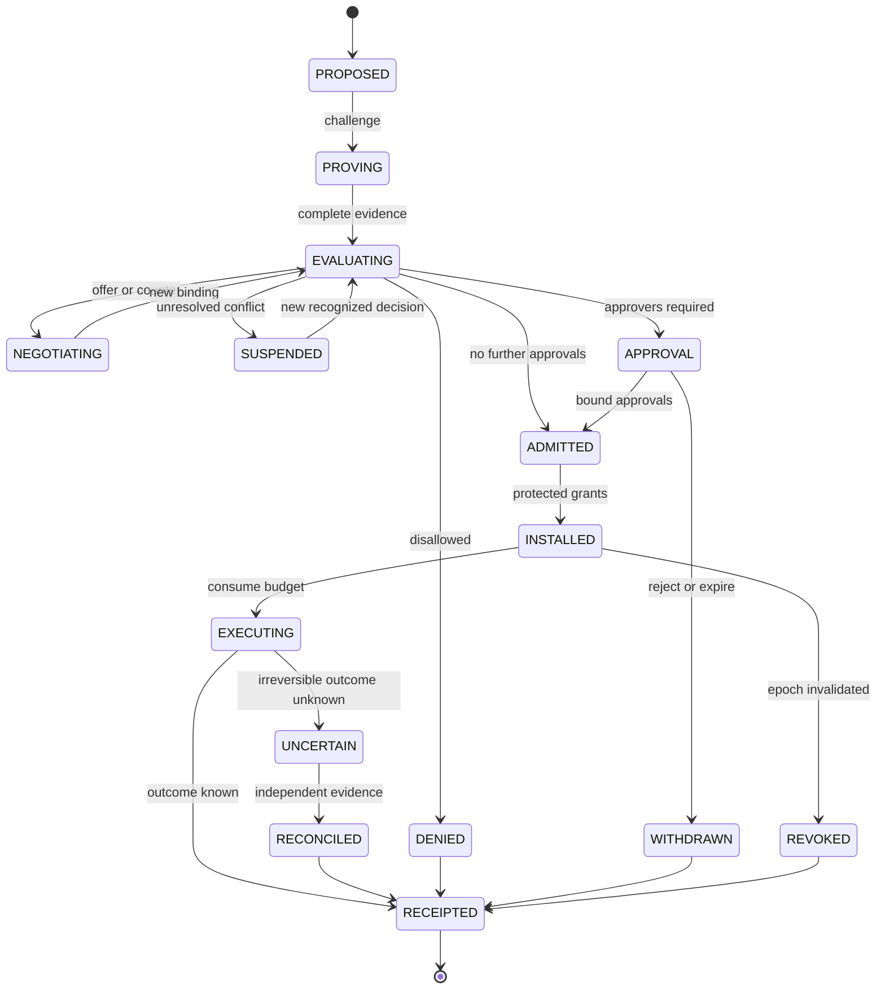
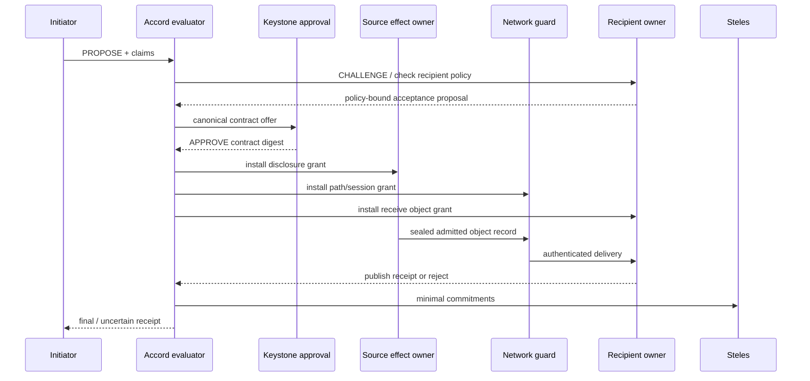

# ASKA v5 — PACT negotiation, admission, and contract lifecycle

**PACT** means **Protocol for Authority, Consent, and Transactions**. It negotiates a concrete operation among independently authoritative participants and hands a validated, immutable decision to local enforcers. The full signed proof graph stays in the control plane; a compact binding serves the data plane.

## 1. Actor roles

- **Proposer:** states a desired effect and relevant supporting claims; can be an AI agent but has no implicit installation rights.
- **Claim issuer:** asserts a scoped fact or instrument.
- **Evaluator:** interprets an applicable profile and emits candidate decision + reason graph.
- **Approvers:** independently endorse the exact contract when applicable.
- **Installer:** checks current state and compiles local grants that cannot expand the decision.
- **Source/effect owner:** authorizes exact input and irreversible output under current state.
- **Receiver:** independently accepts incoming operation and its destined object.
- **Witness:** commits minimal material and provides audit proofs without deciding the operation.

## 2. Message families

| Message | Authorship | Mandatory contents | Typical response |
|---|---|---|---|
| `PROPOSE` | initiating principal | op ID, exact requested method/target/recipient, purpose, budget | `CHALLENGE` / `OFFER` / `REJECT` |
| `CHALLENGE` | evaluator/receiver | nonce, proof requests, profile/assurance conditions | `EVIDENCE` |
| `EVIDENCE` | issuer/proposer | scoped claims, status proofs, attestation with provenance | `OFFER` / `SUSPEND` |
| `OFFER` | evaluator | contract candidate, expiry, restrictive obligations, transcript digest | `COUNTER` / `APPROVE` / `REJECT` |
| `COUNTER` | authorized party | tighter or differently justified proposal; new digest | fresh `OFFER` |
| `APPROVE` | independent approver | bound contract digest, role, freshness | admission check |
| `ADMIT` | admission authority | immutable contract/decision proof and grants requested | `INSTALL` / `REJECT` |
| `INSTALL` | local installer | local grant IDs, epochs, object binding, capacity | `READY` |
| `REVOKE` | qualified authority | valid revocation scope, generation, reason/notice | drained/reconciled state |
| `RECEIPT` | performing owner | effect outcome evidence and notice status | archive / contest |

A profile caps rounds, evidence sizes, pending memory, cryptographic work, and lifetime of provisional state. Neither party can force endless proof retrieval or unlimited signing work.

## 3. Main state machine

Every transition is checked for operation binding, expiry and allowed actors. Replacing `OFFER` terms invalidates approvals of the old digest. Reusing an operation ID with different semantic content MUST fail except through a profile-defined versioned amendment that produces a distinct digest.

## 4. Recommended ordered protocol

1. **First contact:** discover an endpoint and permitted realm roots through the plane's encounter rules; use only bounded admission resources. Encounter connection is not session acceptance.
2. **Propose:** specify data selector and named effect; the UI or issuer signs the proposal under its actual role.
3. **Evidence:** fetch only required status and credential material, favoring disclosure-minimizing proofs.
4. **Evaluate:** pin policy and profile versions, resolve restrictions and independent recipient acceptability.
5. **Counter:** narrow or change terms; all parties observe new digest and constraints.
6. **Approve:** collect physically protected human approval or institution-issued quorum, where required. No false equivalence between a legal duty and voluntary consent.
7. **Install:** local protection binds grant generation, live object version, physical interface, budget, expiry and receipt requirements.
8. **Execute:** source snapshots and effect handlers enforce under current state. Lost links or partitions do not magically preserve validity.
9. **Account:** create receipts for observable phases and guarded notice, even when requests fail or plaintext is unavailable.

## 5. Multiple independent commits

A cross-realm operation may need:

`source authorized release` → `transport admitted` → `receiver authenticated and accepted` → `receiver published` → `downstream effect durably committed`.

These commits cannot generally be made perfectly atomic across disconnected institutions. A remote acknowledgment could be lost after effect completion. Profiles MUST define `unknown/uncertain` outcomes, idempotent operation IDs, reconciliation sources and compensation policies. An unsigned “success” from the network gateway cannot be considered settlement evidence.

## 6. Concurrency, expiry and replay

- Negotiation `operation_id` and `transcript_nonce` are unique within a declared scope.
- Signing keys and replay epochs are separate across planes and roles.
- A monotonic local lease protects short-lived grant expiry when wall-clock time is adversarial.
- A recovered endpoint MUST NOT replay an old grant if its installation epoch, object generation, or consumed-use counter may have rolled back.
- Repeated negative evidence probes are budgeted: allow rate limits, cool-off, and privacy-safe error codes.
- Grant expiry and revocation do not recall plaintext already released; final state records that limitation explicitly.

## 7. Bilateral contract installation example

## 8. Failure result codes

`invalid_encoding`, `invalid_issuer`, `inapplicable_profile`, `stale_claim`, `revoked_claim`, `conflict_unresolved`, `missing_approval`, `denied_flow`, `wrong_plane`, `cannot_enforce_obligation`, `no_reserved_resources`, `recipient_refused`, `identity_unavailable`, `operation_not_possible`, `witness_unavailable`, `path_unavailable`, `uncertain_external_effect`. These are classes; implementations publish a versioned enum registry and redaction policy to avoid leaking confidential evaluation details through denial messages.
