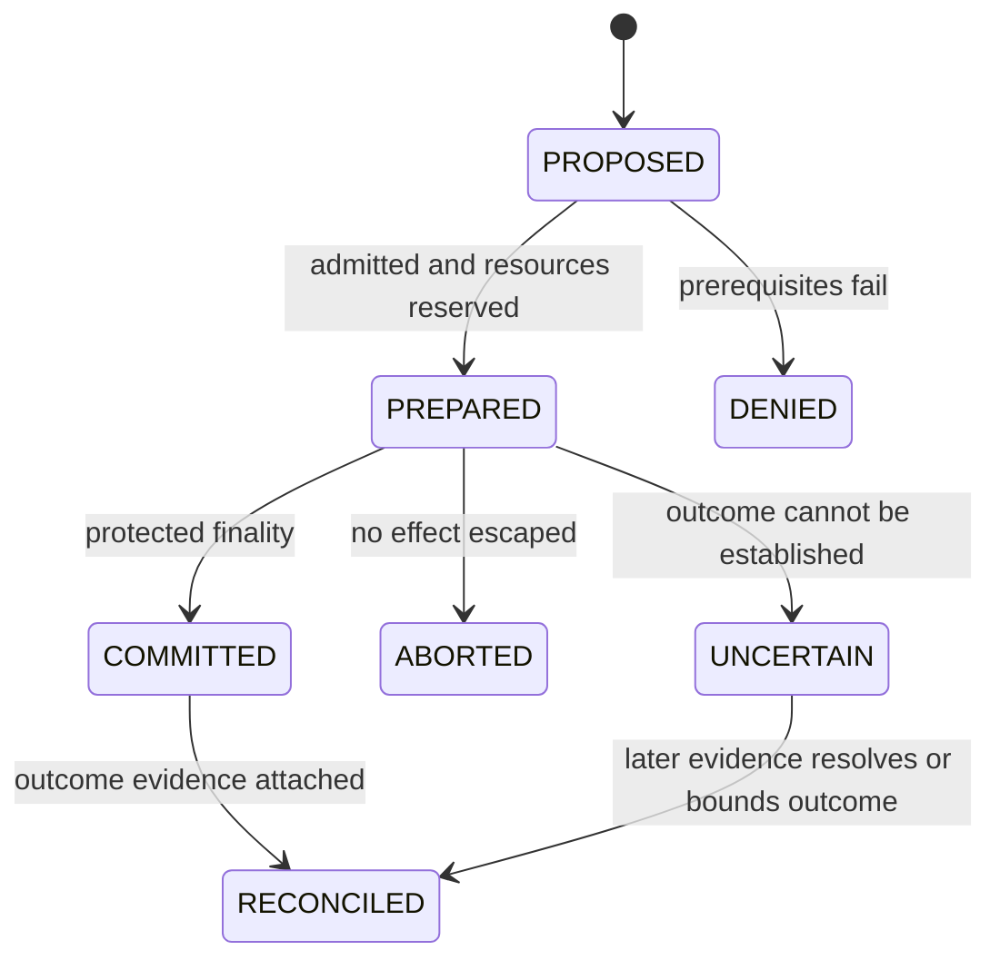

# ASKA v6 — Unified execution, data and effect contract

**Status:** proposed normative target. Requirements describe obligations; they do not certify an implemented machine.

## 1. One contract at every consequence boundary

A protected action names a source, a target, an operation and the finality point at which the consequence becomes externally meaningful. The same framework applies to a memory ownership transfer, durable object update, network emission, screen presentation, actuator command, telemetry release or recipient publication. Local computation that cannot affect another boundary still has resource, lifetime and information-flow constraints.

The action descriptor contains `(effect_id, source_ref, subject_ref, target_ref, operation, input_commitment, output_contract, recipient_ref, grant_ref, policy_epoch, budget_ref, path_constraint, idempotency_key)`. Object references use `(realm_id, owner_id, object_id, generation)`. Raw addresses and untrusted descriptors are implementation details; they cannot replace protected identity attachment.

[Chapter 32](32_claim_contract_grant_receipt_schemas.md) owns wire-object schemas. This chapter owns the semantic contract to which encodings, instruction interfaces and distributed protocols must refine.

## 2. Authority predicates

At the consequence boundary, the owner checks:

`MayEffect(e) = LiveIdentity(e) ∧ SourceAuthority(e) ∧ FlowOrRelease(e) ∧ ReceiverPermission(e) ∧ StableBinding(e) ∧ Budget(e) ∧ PathPermission(e) ∧ RequiredObligations(e)`.

Each conjunct has its own protected evidence. A session certificate cannot substitute for source release. A consent record cannot substitute for a device safety interlock. A standing protective grant is a valid source of authority within its admitted scope; the guard need not ask for an interactive human decision on each alarm.

The check must be linearized with the local effect where possible. If revocation and finality race, the local owner defines the ordering. A check cached before a revocation is not automatically valid afterward. A remote system's finality is outside that local linearization point and needs an explicit protocol and uncertainty treatment.

## 3. Canonical effect states

| State | Exact assertion | Forbidden inference |
|---|---|---|
| PROPOSED | Untrusted request exists | Permission was granted |
| PREPARED | Named checks/reservations completed, finality not yet established | Irreversible action occurred |
| COMMITTED | A named local finality point was crossed | Remote acceptance, durable persistence or physical completion unless that is the named point |
| RECONCILED | Later evidence or correction is attached to the operation | Earlier evidence can be silently rewritten |
| DENIED | Operation rejected under stated decision context | All related proposals or persons are malicious |
| ABORTED | No externally consequential effect escaped this prepared operation | A committed physical action was undone |
| UNCERTAIN | Available evidence cannot establish the relevant outcome | Retry is harmless or failure definitely occurred |

A receipt is immutable evidence of a stage. A later transition creates a new linked receipt; it does not mutate a claim of what the earlier observer saw. An operation can have a committed network-emission receipt and an uncertain bank-settlement receipt because these are different finality points.

## 4. Stable representation and ownership

Preparation freezes the relevant input snapshot and exact output commitment or names a trusted transformation contract with bounded output. The protected owner captures destination, generation, label and grant references together. Worker mutation of the original descriptor after capture cannot change the prepared operation. Caches, scatter/gather segments, accelerator buffers and queued DMA are included in the snapshot boundary.

Copying creates a distinct object while preserving applicable restrictions. Immutable sharing prohibits every writer, including devices and maintenance paths, for the loan lifetime. Exclusive handoff removes source write authority before publishing destination ownership. A transfer does not merely rename an address: both endpoint generations and the admission epoch are part of the transition.

Retirement cancels pending authority, blocks new work, drains or invalidates in-flight transactions, and sanitizes resources before assignment to a new lifetime. An unresolved device request can force quarantine of a bank; availability pressure cannot justify assigning that bank while a stale writer remains possible.

## 5. Effect-specific finality

| Operation | Candidate protected finality | Required post-effect evidence |
|---|---|---|
| Object update | Owner's atomic durable commit record under declared media contract | Recovery reads the same committed version |
| Message handoff | Receiver owner installs object reference and consumes acceptance | Receipt binds receiver generation and visibility |
| Network release | Last protected transmitter accepts fixed authorized bytes for emission | Physical capture if claiming actual wire emission |
| Display | Protected scanout accepts region/content generation | Independent display observation if claiming human-visible pixels |
| Print/removable export | Protected device owner releases fixed job/bytes | Device result and external limits |
| Actuator | Safety controller accepts an admitted command | Sensor evidence of physical position/outcome, or uncertainty |
| Security freeze | Egress owner disables the admitted scope in its live table | State readback and continuity of necessary safety channels |
| Telemetry | Export owner releases labeled event fields to named observer | Sequence/drop record and recipient retention contract |

An implementation can select a different finality point only by stating its guarantees and refining all dependent receipts. A software return value by a compromised guest is not an independent finality point.

## 6. Idempotence and crash ordering

An idempotency key identifies one logical effect under a particular owner, contract and generation. Reusing it with different bound parameters is rejected. The owner either stores the committed result and returns that result for retries, or reports that it cannot establish the earlier outcome. Deduplication state has a declared retention horizon longer than any accepted retry horizon; when that cannot be guaranteed, a fresh operation requires explicit resolution.

For local state, reserve resources, record the prepared intent as required, recheck live authority, perform atomic consumption and commit, then emit receipt. For remote or irreversible effects, the protocol must identify the uncertainty interval between command transmission and trustworthy completion evidence. Blind replay within that interval is forbidden where it could duplicate harm. Compensation is a separately authorized effect; it is not time reversal.

Promise Keeper-style reconciliation associates admitted intent, owner transition, observed consequence and declared tolerance. It can detect a mismatch between a promised file write and a recovered object version, or between a valve command and observed position. It cannot infer physical completion from command issuance, or trust a compromised sensor merely because the sensor signed its report.

## 7. Leases and obligations

A resource lease bounds time, quantity and scope. Its expiry blocks future admission and finality according to a defined owner-clock contract. If time continuity is uncertain, the owner cannot extend rights by interpreting a reset clock as earlier time. Offline operation may use an admitted local counter or conservative expiry rule; the contract must state the residual staleness.

Obligations can include notice, evidence retention, safe actuator sequencing, receiver confirmation and witness commitment. An obligation that must precede finality is a precondition. A deferred obligation has its own owner, deadline, retry budget and failure receipt. A system cannot promise notice to an unreachable person as already delivered.

## 8. Composition limits

[DStar's exporter model](https://usenix.org/events/nsdi08/tech/full_papers/zeldovich/zeldovich.pdf), particularly its distributed trust and label mapping, supplies a relevant comparison for bilateral enforcement. [Fabric's object and transaction design](https://www.cs.cornell.edu/andru/papers/fabric-sosp09.pdf) supplies another for labeled persistent objects. ASKA selects a physical ownership/effect contract; it does not inherit those systems' proofs or performance simply by adopting similar abstractions.

Composition succeeds only when every producer guarantee satisfies its consumer's assumptions. An authenticated object with a missing ownership generation does not satisfy a generation-sensitive receiver. A precise authorization proof with an unknown physical output path does not establish complete mediation. [Chapter 55](55_formal_properties_and_state_models.md) defines the refinement obligations and [Chapter 54](54_end_to_end_traces_and_incident_walkthroughs.md) exercises these boundaries.

## Normative requirements and acceptance obligations

**R-05-01 — Complete effect predicate.** Every consequential finality point MUST enforce all applicable MayEffect predicates with protected current evidence.

**Acceptance T-05-01:** Vary each predicate independently while the others hold; each missing predicate denies finality, and the fully valid action completes.

**R-05-02 — Canonical state meaning.** Owners MUST use the canonical effect states with a named finality point and MUST NOT report ABORTED after an effect escaped.

**Acceptance T-05-02:** Crash before and after each finality point and check state/receipt claims against independent observations.

**R-05-03 — Stable binding.** Preparation MUST bind immutable input/output, destination, generation and authority for the effect lifetime.

**Acceptance T-05-03:** Mutate descriptors, buffers and destinations after preparation; the committed effect is the captured one or is denied.

**R-05-04 — Replay-safe outcomes.** Idempotency consumption MUST be ordered with local finality; unresolved remote outcomes MUST remain explicit.

**Acceptance T-05-04:** Retry an operation before/after crash and with changed parameters; no duplicate local effect or fabricated remote success is permitted.

**R-05-05 — Lifetime-safe ownership.** Reassignment MUST follow authority retirement, draining/invalidation and sanitization across all writers.

**Acceptance T-05-05:** Delay DMA and cache writeback until a new allocation; no old-generation access reaches its new contents.

**R-05-06 — Reconciliation without invented truth.** Post-effect reconciliation MUST distinguish command, owner commit, independent observation and uncertainty.

**Acceptance T-05-06:** Give a valid command receipt but false or absent sensor result; final receipt preserves the unresolved physical outcome.

**R-05-07 — Explicit deferred obligations.** Every deferred obligation MUST name an owner, bounded schedule, failure outcome and permitted release scope.

**Acceptance T-05-07:** Lose notice/witness connectivity through deadline; record pending or failed delivery without claiming completed notice.

