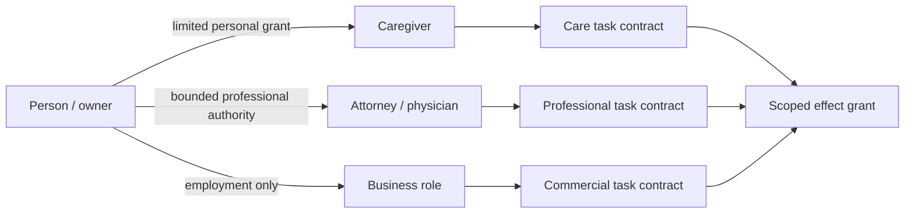

# ASKA v5 — Identity, relationships, privacy, and delegation

## 1. Identity is contextual

A person's legal identity, household identity, employer identity, temporary service identity and pseudonymous public identity have different evidence and disclosure requirements. An ASKA endpoint MUST NOT insist on one global stable identifier for all planes. Identifiers belong to realms, are pairwise or scoped when feasible, and are exposed only under current contracts. Proving adulthood, role qualification, residence or membership need not disclose the person's complete birth date, address or cross-plane activity history.

| Plane | Typical identity expression | Dangerous default to forbid |
|---|---|---|
| Sanctum | self/household rooted keys; relative or caregiver credentials | automatic export of private relationship graph |
| Polis | jurisdiction-dependent civil identity and eligibility proofs | exposing ballot choice when proving eligibility |
| Agora | professional roles, accounts, contract-specific pseudonyms | linking work identity to private medical and family data |
| Wilder | pseudonymous, disposable or minimal first-contact identifiers | reusing protected realm root or permanent personal certificate |
| Steles | selective audit roles and event commitments | plaintext event feed with globally linkable subject identifiers |

## 2. IDENT module

IDENT represents `credential`, `holder_binding`, `issuer`, `scope`, `claim_type`, `expiry`, `status_or_revocation`, `proof_disclosure`, and optionally remote attestation appraisal. A credential is not an execution grant. A verifier checks evidence under its appraisal policy; the protected local enforcer separately checks a transaction's allowed effect. Attester, verifier and relying-party roles are deliberately distinct, consistent with [RFC 9334](https://www.rfc-editor.org/rfc/rfc9334).

A certificate chain must be interpreted according to its declared purpose, not as a universal social rank. The same hardware may attest a device implementation profile while still having no jurisdiction to certify a person's medical competence. For actual identity-proofing procedures, a deployment can align with [NIST SP 800-63-4](https://pages.nist.gov/800-63-4/) where applicable. ASKA does not declare its own IAL/AAL/FAL names to be NIST equivalents.

## 3. RELATE module

RELATE models named typed relationships rather than one expandable “trust score.” A relationship record includes `participants`, `relationship_type`, `issuer_or_attestors`, `evidence`, `effective_date`, `context`, `delegable_rights`, `negative_rights`, `revocation`, `notice`, and (when needed) `capacity_or_event_trigger`.

**Examples:** household management, parent/guardian, professional client, limited legal representative, estate executor, durable financial attorney, emergency caregiver, employee, municipal official, corporate director, healthcare proxy, fiduciary. These roles overlap without inheriting powers automatically. Parenthood is not itself a blanket power of attorney; employment does not grant rights over a personal vault; an institution's office badge is not a master cryptographic key.

## 4. Safe delegation

A valid delegation carries: grantor authority proof, grantee context, exact verbs and object classes, permitted recipients, jurisdictions, validity, max budget, whether subdelegation is allowed, and a revocation path. Combining delegation edges intersects the rights and accumulates obligations. Sharing a budget among several delegates requires protected shared counters, not duplicated local allowance. Nondelegable duties, custody limitations and guardian restrictions must remain explicit.



## 5. Capacity, caregiving, and succession

Conditional relationships must name who can assert activation and how its validity can be challenged. Examples include independently attested clinical incapacity, a declared medical emergency, a valid guardianship act, or a verified death event. An AI guess is not a capacity determination. A succession mechanism must be able to hold estate instructions while restricting premature access, and should support multiple independent beneficiaries or trustees with different roles.

**Illustrative emergency relationship:**

```yaml
kind: aska.accord.relationship
relationship_type: emergency_medical_caregiver
parties: {subject: person:private-alias, caregiver: person:care-alias}
activation: {issuer_type: licensed_clinician, event: acute_emergency}
permissions: [receive_medication_summary, receive_location_for_emergency]
prohibitions: [export_full_identity_vault, transfer_financial_assets]
validity: {max_duration: PT72H, revoke_on: emergency_resolution}
obligations: [prompt_notice_when_safe, steles_private_commitment]
```

## 6. Revocation and timing

Revocation states may be `active`, `pending`, `revoked`, `expired`, `suspended`, or `disputed`. Stale status checks have profile-declared maximum age. A cached relationship record cannot guarantee continued right to access after revocation has taken effect at the local enforcer. Offline fallback must be narrowly defined and visible; it cannot silently ignore a changed restriction.

## 7. Privacy and anti-correlation

Separation into planes is not anonymity. Devices can still leak via link addresses, time, traffic volume, third-party analytics, payment records, and shared community infrastructure. Use distinct pairwise credentials, unlinkable tokens where feasible, traffic padding as a declared optional service, and per-plane storage partitions. If traffic characteristics remain observable, the assurance profile must say so. Proofs of selective disclosure do not prevent every inference from a sequence of lawful transactions.

## 8. Approval and disputes

A delegation changing financial, medical, family, or estate control should require the policy's specified trusted approval and independent proofs. The user interface should explain who gains what, for how long, how to revoke, who may see the activity, and what already-shared data cannot be recovered. Where an institution can impose an obligation irrespective of user consent, record that separate legal basis without mislabeling it as voluntary approval.
