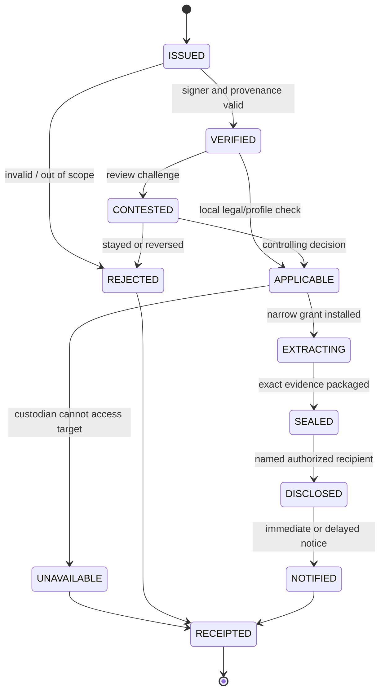
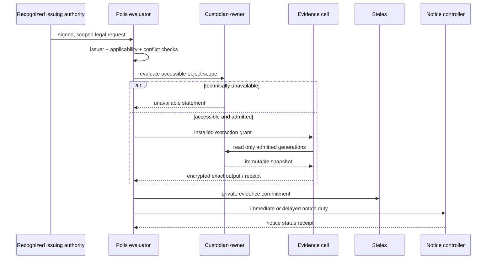

# ASKA v5 — Legal process, contested authority, and emergencies

## 1. Boundaries of LEGAL

The **LEGAL** module expresses lawful institutional process as a typed, contested and technically bounded transaction. It supports requests by courts, qualified public agencies, custodians and designated independent reviewers, subject to the applicable legal profile. It does **not** posit that cryptographic proof of issuance is proof of legality, that every country has identical rights, or that possession of an order creates new technical decryption capabilities. The default threat model treats the enforcing institution, applicant and custodian as potentially overreaching within real powers.

## 2. Legal request schema

A request includes `request_id`, `issuing_institution`, `authorized_applicant`, `basis_and_kind`, `jurisdiction`, `subject_selector`, `requested_object_set`, `time_interval`, `specific_effects`, `recipient`, `custodian`, `preservation/retention`, `prohibition/exclusions`, `execution_deadline`, `review/appeal_path`, `notice_rule`, `sealed_evidence_ref`, and signed issuer/procedure proof. A profile may require a threshold approval, magistrate signature, independent reviewer, or special emergency prerequisites. **No single threshold is a universal constitutional rule.**

## 3. Technical state machine

## 4. Scoped extraction

Execution occurs in a specifically admitted evidence operation, isolated from unrelated applications and keys. It evaluates current object ownership and source disclosure authority rather than connecting the requesting agency directly to a private object store. A compromised evidence parser cannot traverse all Sanctum memory or mint another effect. If the object is held only by a party without decryptable access, the technically honest result is `UNAVAILABLE`, with a signed corresponding receipt. This cannot be hidden under a supposed “warrant proof” that gives imaginary plaintext.

## 5. Notice, delay and contestation

Notice states: `not_required_under_profile`, `due_now`, `legally_delayed_until`, `delivery_attempted`, `delivered`, `sealed_by_court`, `deadline_unmet`, `disputed`. A Steles commitment can make later tampering detectable but **cannot** guarantee a person receives notice while their device is offline, inaccessible or under coercive control. A legal profile must define who is responsible for deadlines and how missed notice is reported. Cryptographic delay functions may help with some timing commitments but are not a substitute for real-world clocks, appeals or statutory process.

## 6. Emergency procedure

Emergency service calls, disaster alerts, temporary caregiving authority, evacuation routing, and critical-infrastructure actuation may require special procedures. Any profile-specific emergency procedure must declare a separate activation predicate, exact scope, maximum duration and resources, independent signing/oversight roles, audit/notice rules, and post-event review. It must not reconfigure all planes into a permanent unrestricted civic mode. Critical Polis service should retain reserved paths where its availability model requires them; a failed upstream carrier can still prevent global delivery.

## 7. Interaction with privacy and evidentiary duties

An evidentiary hold may restrict deletion of an in-scope record; it should not automatically authorize transfer of the entire owner store. Copies, hashes, chain-of-custody entries, redactions and derivative AI summaries retain their applicable confidentiality restrictions. Receipts can prove which effect controller emitted a bundle under which contract, but do not prove the original data or testimony is true. Institutional retention and access to sealed records require separate controls.

## 8. Representative LEGAL processing flow

## 9. Legitimacy and misuse limits

Lawful-process code is a human-governed compliance layer, not a machine that solves constitutional theory. A corrupt institution or mistaken court can authorize harmful in-scope actions. Technical designs can narrow, expose, and make actions challengeable, but cannot guarantee political virtue. Profiles should make rights and exceptions visible rather than burying them in “secure” firmware configuration.
