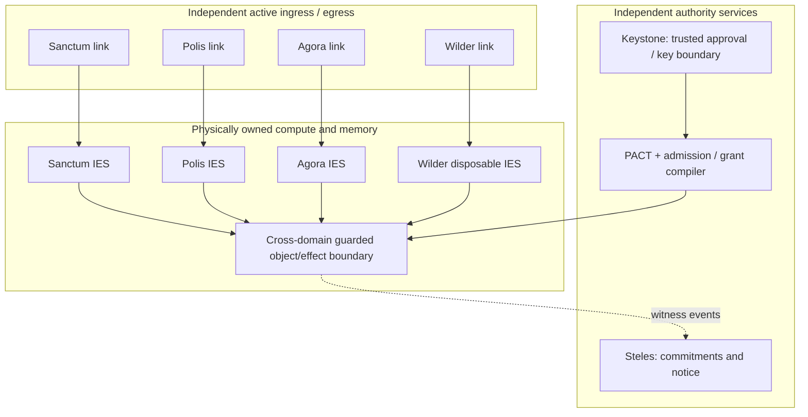

# ASKA v5 — 4 + 1 societal planes and protected Keystone

## 1. Reference assignment

ASKA's native endpoint has four independently guarded active communication planes and an out-of-band witness plane. These names represent **the authority relation** governing a transaction; they are not proof that everyone in a named category is benevolent. A private physician interaction may be Sanctum, while billing the physician may be Agora and sending a legally compelled record may be Polis. The same organization can legitimately participate in different planes only through separate scoped operations.

| Plane | Primary constituency | Expected route and execution constraints | Failure example to contain |
|---|---|---|---|
| Sanctum | self, household, intimate representatives | owner-scoped identities, tight egress, private objects, independently gated personal transceiver | compromised advertisement leaks private family vault |
| Polis | civic government, courts, public-service institutions | declared institutional profile, protected civic ingress, reviewable effect owner, independent acceptance | stolen agency credential triggers universal export |
| Agora | employers, service contracts, banks, commerce | agreement-bound methods, accounting budgets, recipient-bound settlement and business records | web parser triggers bank payment |
| Wilder | anonymous/unknown peers, arbitrary public websites and legacy Internet | dedicated quarantine ingress, disposable parsers, hostile data, zero inherited trust | remote code execution crosses into private signing root |
| Steles | independent witnesses, auditors and protected notice commitments | separate collection/update roles, minimal encrypted/private evidence, append/commit semantics | audit operator becomes unrestricted observer |

## 2. Path count and assurance

**Four plus one is a selected native reference design**, not an unconditional mathematical theorem. A higher-assurance installation might require distinct facilities for election services, health custody, research networks, multiple legal authorities, or geographically independent witness replication. A prototype may emulate four roles over shared transport, but it **does not conform** to a physical separation requirement merely through VLAN labels or end-to-end encryption.

Independent endpoints may also coexist in one enclosure without having independently trusted root/update/supply chains; that common-cause dependency must be recorded. A community node aggregating multiple plane paths may be a shared failure point; no diagram depicting it should be mistaken for an all-disjointness proof.

## 3. Keystone is not a sixth network

**Keystone** is the protected local root for user consent, local policy, boot measurements, constrained key custody and safe-stop/recovery entry. It is deliberately distinct from Polis (institutional civic authority) and Steles (evidence witnessing). It does **not** receive a generic `read_all_objects` privilege, and an optional independently rooted management path does not authorize arbitrary application use. Different devices may distribute Keystone functions across tamper-resistant hardware, dedicated display/input controller, recovery trustees and policy installers, preserving their declared separation.

## 4. Endpoint interaction architecture

The diagram abstracts many implementation blocks. It must not be implemented as one omnipotent software `G` service with simultaneous unrestricted access to every plane. A crossing uses source and destination owners whose physical and administrative independence is preserved.

## 5. Local policy and release flows

- **Sanctum → Polis:** taxes, civic application, or in-scope evidence requires a named data release and separate Polis recipient acceptance.
- **Wilder → Sanctum:** content passes a disposable parser, validated transformation and explicit import; raw untrusted code never inherits a Sanctum pointer.
- **Agora → Polis:** regulated financial or employee reporting follows a reviewed institutional obligation and exact output schema.
- **Polis → Sanctum:** a signed civic notice is still data; it cannot command the user's root to open unrelated personal files.
- **Any plane → Steles:** bounded event commitments and receipts, never an unlimited copy of traffic.

## 6. Physical witness vs cryptographic root

Steles may include protected monotonic counters, tamper-evident local records, independent replication and optional physical microstructure attestations. Exotic passive sensing, quantum-entangled storage and speculative fabrication approaches are **research options**, not mandatory trust anchors. Cryptographic evidence cannot ensure a fully offline witness will be remotely published. Keystone must be able to block effects where a profile requires witness availability, or admit a clearly marked degraded operation when its profile explicitly allows that.
