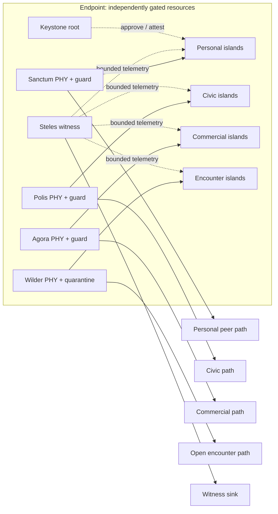

# ASKA v5 — Physical substrate and hardware

## ASKA v5 physical integration

Four active **societal planes** (Sanctum, Polis, Agora, Wilder) are separate network and execution purposes. **Steles** is an independent witness plane, and **Keystone** is the separately protected local user/cryptographic authority. The endpoint must show which physical interfaces, ingress FIFOs, DMA engines, memory controllers, clock/reset domains, guardians, and management roots serve each purpose. The active planes are **not** automatically four worldwide carrier networks; their local independent ingress/egress responsibilities persist even when a declared lower-assurance deployment must use a shared upstream.

The canonical high-assurance endpoint has physically disjoint ingress, transmit, and guard resources per active plane, plus a separate witness collection path. A shared external neighborhood node may carry multiple plane-labeled logical links, but cannot be counted as providing independent physical paths without disjoint hardware, queues, failure domains, and management authority in the claimed scope. The drawing in the README illustrates roles and connections, not a proof of disjointness. A sovereignty-critical function can require independent equipment outside a single die or enclosure.

---

## Detailed technical contract

**Requirements:** R03, R04, R07, R11, R12, R16, R17, R19, R21.

The target machine assigns each physical resource set to a security domain. A design may share resources within one domain, or report sharing as an approximation to the target. In either case, its evaluation must name the shared resources and their effects. Higher manufacturing density can reduce the cost of segregation. It does not establish the boundary.

## Physical ownership

An island owns its execution engines, writable memory banks, local cache/scratchpad, and submission endpoints for an admitted lifetime. Foreign workloads have no direct addressing path to that memory. Cross-island access terminates at bounded message or object-transfer guards. A larger computation can own several adjacent engines and banks as one declared compromise domain.

The reference organization avoids a global coherent writable address space between mutually distrusting islands. One owner may use local coherence inside its domain. External memory uses a domain-dedicated controller/bank path or a protected memory service that transfers objects; the implementation must disclose a shared controller's timing and failure dependencies.

The boundary inventory records wires and pinouts, ports, DMA paths, package-level JTAG/debug access, reset lines, clock trees, power rails, thermal coupling, boot storage, management, and observation channels. The configuration controller changes an authorized circuit or resource assignment only after it quiesces and sanitizes the affected resources. An untrusted routing table cannot manufacture a new memory path.

| Profile | Resources and remaining dependencies | Use |
|---|---|---|
| P0: shared logical | Hardware access checks with shared cores/cache/controllers | Comparison or intermediate realization; does not satisfy native physical ownership |
| P1: spatial island | Exclusive engine and private writable memory, guarded endpoints; package utilities may remain shared | Minimum native cross-trust execution profile |
| P2: independent root domain | Separate physical enforcement, boot/update authority, keys, and management; declared shared facilities | Sovereign policy, recovery, and boundaries needing resistance to one management compromise |
| P3: controlled physical environment | P2 plus a specified enclosure, probing/fault threat model, physical controls, and tested leakage limits | High-consequence deployment requiring physical-attack assurance |

These profiles declare resources and threats. They are not certification levels. P2 does not imply P3. Two P2 domains may still share a supplier defect. The dependency record in [22](22_governance_updates_and_recovery.md) determines their claimed independence.

## Exposed connections and physical bypass

An attachable endpoint must terminate at its mandatory guard. Admission checks may use port identity, device enrollment, and attestation as evidence. Attaching equipment grants no access by itself. Unused interfaces remain electrically disabled or terminate in a bounded encounter domain. Hot-plug, alternate device modes, management links, and maintenance boot paths must not expose plaintext or raw DMA around that boundary.

Record the last guarded point for every exposed signal and the physical intervention needed to bypass it. A rogue bridge on the outside remains subject to admission and release policy; a tap on an unprotected plaintext bus can violate confidentiality directly. P3 claims require apparatus-specific enclosure, probing, emanation, and device-replacement evidence. Adding an identity chip does not establish those physical-attack claims for P1. [19](19_cross_domain_security_and_release.md) supplies the corresponding adversarial cases.

## Link events and protected continuity

When the guard detects link loss, it blocks new emission on that path and invalidates partial link frames. It records detection and enforcement delays. It cannot recall a prefix that the transmitter already emitted. Protected session state remains separate from carrier state. Before resuming, the local guard must establish continuity of keys, nonce allocation, replay state, endpoint generations, policy bindings, leases, and any required physical-path evidence. The detailed recovery rules are in [20](20_admission_transport_and_protected_delivery.md).

A carrier flap alone does not require destroying session keys. The guard must retire the affected data contract if it cannot establish key custody, nonce allocation, or replay state. After a security-relevant reset, device replacement, or lost path binding, admission must reevaluate the corresponding installation or evidence. Each implementation records which events invalidate which state and how the guard blocks use while that decision is pending. Carrier detection cannot establish that no passive optical or electrical tap exists. P3 physical claims require their own evidence.

## Packaging choices

A planar many-island die offers short local wires and a uniform manufacturing flow, but concentrates fabrication, power, and management risk. A chiplet package can place compute, memory, and guards on different processes; its substrate and common test/debug infrastructure remain shared. Independently packaged modules cost more links and space but can reduce common physical and administrative failure paths.

The selected target permits all three at different boundaries: dense P1 islands for routine work, P2 modules for sovereign services, and physically separate network appliances where shared package management would violate R11. The target requires neither a fixed die count nor a mature-node “security chiplet”.

3D integration could place private memory closer to its engine and shorten object-transfer paths. Imec/EVG reported a 200 nm-pitch wafer-to-wafer hybrid-bonding test vehicle in 2026. That test vehicle demonstrates a bonding process. It establishes neither a working ASKA memory fabric nor a production yield estimate. [Primary report](https://www.imec-int.com/en/press/imec-and-ev-group-demonstrate-wafer-wafer-hybrid-bonding-200nm-interconnect-pitch-and-record).

Backside connectivity and CFET research could change routing area, local memory placement, and power distribution. They also introduce testability, thermal, defect, and repair questions. [Imec's connectivity research](https://www.imec-int.com/en/articles/path-high-density-front-and-backside-wafer-connectivity) is a trajectory to investigate, not a dated promise of affordable isolation. [DARPA NGMM](https://www.darpa.mil/events/2025/ngmm-summit) documents an enabling 3D heterogeneous-integration program; ASKA does not treat the program's targets as achieved results.

## Electrical and optical communication

Short electrical links are candidates within an island or package. Dedicated optical links are candidates between independently rooted modules and purpose fabrics. Co-packaged optical I/O may let memory-rich or compute-rich modules sit farther apart without making every transfer traverse a conventional server network stack.

Intel reported an optical compute-interconnect chiplet demonstration with live CPU data in 2024. That demonstration supports an optical-I/O study. It establishes neither ASKA path security nor a replacement for digital guards. [Intel demonstration](https://www.intel.com/content/www/us/en/newsroom/news/intel-unveils-first-integrated-optical-io-chiplet.html).

Domains can remain coupled through a shared laser, fiber, wavelength mux, photonic switch, or control circuit. Separate wavelengths on one fiber do not satisfy a requirement for separate physical facilities. The topology contract names which resources must be distinct. An optical path still needs endpoints that authenticate peers, receivers that check framing and detect faults, and a gate before irreversible transmission.

## Alternative computing substrates

| Direction | Evidence and opportunity | Required ASKA research |
|---|---|---|
| Digital near-memory compute | Moves computation toward data; object owners could run bounded operations locally | Protect authority, persistence, and abort semantics without exposing raw remote memory |
| Analog in-memory inference | IBM reports a fabricated phase-change-memory inference chip | Quantization, drift, calibration, weight retention, and clearing; keep policy decisions outside approximate computation |
| Neuromorphic/event-driven engines | Loihi 2 is a research processor for event-driven workloads | Bound state and event channels; define repeatability, fault behavior, and confinement |
| Reversible computation | Research investigates reduced dissipative costs | Account for control, ancillary state, error correction, I/O, and secure erasure; no assumption of free reset |
| New typed/dataflow ISA | Existing spatial processor work establishes a viable research direction | Prove authority/lifetime semantics and implement toolchains; physical reachability still needs guards |

Sources: [IBM AIMC paper record](https://research.ibm.com/publications/a-64-core-mixed-signal-in-memory-compute-chip-based-on-phase-change-memory-for-deep-neural-network-inference), [Loihi 2 technical brief](https://www.intel.com/content/dam/www/central-libraries/us/en/documents/neuromorphic-computing-loihi-2-brief.pdf), [Sandia reversible-computing research](https://www.sandia.gov/news/publications/hpc-annual-reports/article/stretching-the-thermodynamic-limits-of-hpc-efficiency/), [TRIPS](https://www.cs.utexas.edu/~cart/trips/overview.html).

These technologies could run confined accelerators while separate guards enforce authority. An erroneous inference produces a bad proposed result; it must not rewrite a grant.

## Physical limits and acceptance work

Private memory increases area and data movement; 3D stacking adds heat and defect interactions; optical transmission still pays serialization and conversion costs. Propagation across distance, cooling, memory endurance, finite energy, and finite verification throughput remain constraints even if fabrication improves substantially.

A substrate study must measure useful work per area/energy, isolation granule, data movement, thermal interference, sanitation latency, and fault containment. Inject shared reset, supply droop, link errors, and configuration failures. Observe forbidden memory and egress effects externally. Check the manufactured or synthesized paths the gate is supposed to control. A gate symbol in a netlist is insufficient evidence.

**Unproven hypothesis H03:** future integration can provide enough private memory and inexpensive guarded links for default granular physical execution. **Open research:** manufacturable boundary verification, safe field replacement, analog-state sanitation, and measurable independence among physically adjacent islands. If those mechanisms remain expensive, realization reports must state the cost or mark the requirement unmet. Cost does not waive the target.
