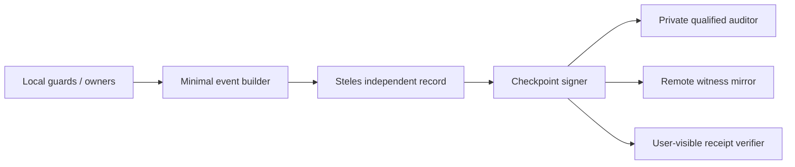

# ASKA v5 — Steles witness, audit, receipts, and accountable notice

## 1. Witness, not universal observer

Steles is a protected out-of-band **witness role**. It can prove that an authorized event, grant, receipt, update or notice commitment was recorded at a given witness sequence/epoch, under defined assumptions. It cannot be granted blanket plaintext access to every plane simply because accountability matters. Steles does not judge the righteousness of an action, infer events that its sensors cannot see, or guarantee dissemination during a network partition.

## 2. Local witness record

A witness record SHOULD contain: `witness_epoch`, `sequence`, `event_class`, `operation_commitment`, `actor_role_commitment`, `profile_hash`, `phase`, `outcome_commitment`, `event_time_or_monotonic_interval`, `predecessor_hash`, `audit_disclosure_class`, `log_root`, and a signature or authentication tag protected by an independent key root. The witness need not learn the associated raw data or full actor identity. The evidence material can be encrypted to a qualified holder under a separate access contract.

```text
Record_n = Canonical(
  plane-scoped event type, operation H, contract H,
  receipt H, monotonic counter n, previous_record H,
  policy_revision H, encryption/audience descriptor
)
Hash_n = H("ASKA-STELES-v5" || Hash_(n-1) || Record_n)
```

`H` here is a selected cryptographic digest, not a mandatory specific hash algorithm. A hash chain makes alteration detectable to a verifier holding a trustworthy checkpoint, **not** impossible for an attacker controlling all unanchored history. Durable key custody, anti-rollback and independent checkpoints matter.

## 3. Receipt classes

| Class | Claim the receipt supports | What it does not prove |
|---|---|---|
| `REQUESTED` | proposal entered a named protected service | request was allowed or understood by human |
| `APPROVED` | named approver confirmed exact digest | outcome took place |
| `INSTALLED` | grants were placed in protected tables | operation was used |
| `SOURCE_RELEASED` | source emitted exact admitted representation | remote recipient accepted it |
| `RECEIVER_PUBLISHED` | receiver owner published admitted object | downstream business workflow completed |
| `EFFECT_COMMITTED` | owner durably/irreversibly committed action | semantic correctness, morality or successful external consequences |
| `DENIED` | recorded gate denied attempted operation | every covert attempt was detected |
| `UNAVAILABLE` | target information inaccessible through named path | target information does not exist anywhere |
| `NOTICE` | notification state change under profile | user actually read and understood a notice |

## 4. Local and remote witness paths



The out-of-band physical path must not be silently replaced by an ordinary Agora cloud API if the deployment claims independent witnessing. Remote mirrors provide additional corroboration but introduce metadata disclosure and connectivity dependencies. Replica quorum is profile-specific and requires an availability analysis. A bounded Steles queue should fail visibly rather than filling and being silently discarded.

## 5. Privacy classes and minimization

Events are assigned a witness disclosure class: `local_private`, `party_only`, `qualified_auditor`, `institutional_sealed`, or `public_aggregate`. A public transparency commitment may contain only a salted/secret commitment to avoid dictionary attacks on predictable low-entropy data. Different public audiences may require distinct salt domains. Witness readers, credential issuers and Steles firmware updaters are independently constrained; an audit reader cannot change prior commitments.

## 6. Notice protocol

Notifications may be immediate, condition-triggered, institution-delivered or legally delayed. A delayed notice contract records the rule, authorized delay issuer, earliest/publication time, latest required disclosure time, encryption audience, storage/replication status and challenge route. A local notification controller acts according to qualified clock and reachability assumptions. If the deadline passes while fully offline or inaccessible, the system records `deadline_unmet_or_unconfirmed` and retries under bounded policy. It must never claim that time alone guarantees a human receives a message.

## 7. Audit of exceptional and emergency access

A contested legal operation may create a sealed private receipt commitment accessible later to a qualified reviewer. Emergency access likewise generates a constrained event trace, not an indiscriminate feed of the subject's medical data. Independent review should be able to reconstruct why an operation was admitted and what exact effect it caused, without handing every reviewer all private data unrelated to the case.

## 8. Operational failure handling

| Failure | Required response |
|---|---|
| Local Steles storage full | refuse witness-required effects or enter explicitly authorized degraded mode |
| Witness key compromise | suspend assertions that depended on it; rotate root, preserve historical qualification and issue incident receipt |
| Offline witness replication | retain protected local chain and queue only bounded allowed proofs |
| Clock rollback | do not shorten lease or accelerate delayed notice based solely on untrusted wall time |
| Disagreement between replicas | preserve signed forks for investigation and freeze any profile-required consistency claim |
| Hardware tamper alarm | record measured evidence, isolate affected keys and treat physical sensor meaning cautiously |

## 9. Evidence strength and research

Digital hash chains, monotonic counters, secure elements, offline signatures and independent auditors have known implementation patterns. 3D microstructures, radiative sensing and other advanced physical witnessing are **candidate enhancements** requiring reproducible fabrication, aging, tamper, extraction and false-positive studies. They are not assumed to be immutable by declaration.
