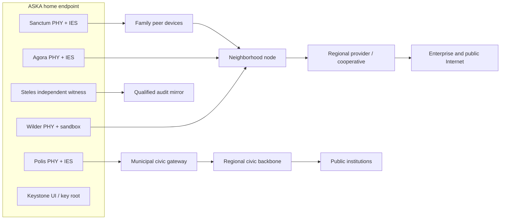

# ASKA v5 — Reference deployments: person, community, enterprise, and civic networks

## 1. Deployment manifest

Every ASKA site publishes an implementation-specific manifest: supported Accord modules, active plane interfaces, Keystone and Steles roots, path/queue ownership, independent update and recovery roles, profile hashes, admitted transport profiles, available routing/security features, power/reset dependencies, revocation clocks, and the exact **assurance claims** supported by evidence. A diagram alone is insufficient. Shared upstream fibers, routers, antennas and provider facilities must be listed rather than quietly counted as independent links.

## 2. Household endpoint and neighborhood cooperative

A representative home has a portable or fixed ASKA endpoint, local personal peers, a community access node, a municipal service interface and regional transit. Sanctum may communicate with household devices on a peer mesh; Polis may use an independently provisioned municipal or emergency channel; Agora reaches authorized enterprise providers; Wilder reaches the open Internet only through quarantine. Steles commits evidence locally and optionally mirrors minimal proofs to an independent cooperative witness.

Security interpretation: a shared N node provides **resilience and local exchange**, not proof that AG and WI have independent downstream carriage. The manifest must declare how much isolation is physically enforced beyond their dedicated ingress and local guard. The four active endpoints remain independent where the native reference requires it.

## 3. Community node

A neighborhood node should have:

- named trust domains and dedicated control interfaces for community routing vs policy issuance;
- bounded first-contact/encounter queues and reserved established-service capacity;
- per-plane routing state with proof of selected physical links;
- local service caching under each content owner's restrictions, not a general decrypted proxy;
- independent failure detection and safe reconfiguration;
- explicit outage policies, including local-only operation and deferred receipts;
- upstream diversity and physical facility register.

The community cooperative may assign capacity and operate links; it cannot change the data-owner's release authority. Its route controller may be compromised without creating a new executable grant at an endpoint.

## 4. Building/campus and school

A campus can attach student, staff, civic, commercial and public-visitor realms. Distinct information realms need distinct admission and output policy even if a school has one governance entity. A public browsing kiosk is a Wilder endpoint; it cannot place raw traffic into staff personal keys. School administration or public benefits systems may use Polis services under a signed institutional profile. Student records and parent/guardian rights need typed RELATE credentials and retention policies, not identity inheritance from the campus Wi-Fi SSID.

## 5. Enterprise and bank

A business has high-throughput Agora paths, restrictive customer and employee data owners, and named civic obligations. Example: a payroll pipeline obtains a one-use employee-data grant, prepares bounded bank instructions, emits settlement under an independently accepted recipient contract, and commits tax reporting through a separate Polis grant. If its AI workflow is compromised, the accepted bank account set, maximum debit, employee confidentiality labels and recipient permits remain enforced by the local effect owner.

## 6. Civic institution

A municipal office may maintain physically reserved Polis ingress, service-specific access controls, dedicated witness collection and separate operator roles. Public notice issuance is not legal evidence extraction; election operator access is not tax authority. A city does not necessarily control household Keystone or Steles devices. Legal exceptions are explicit profile-specific operations, with independently reviewed evidence and notice.

## 7. Critical infrastructure

Power, water, emergency dispatch, transportation, public health or military deployments can require greater disjointness than a civil household. Specify which commands are permissible through Polis, which maintenance flows use separately governed channels, and which open-world data must pass a unidirectional or transform-verified import. An interface label does not turn a network into an air gap; all hardware bypasses, maintenance ports, portable media and physical displays belong in the path register.

## 8. Failure and recovery playbooks

| Scenario | Required local behavior | External dependency |
|---|---|---|
| Wilder flood | bounded quarantine use; protect reserved Sanctum/Polis resources | shared upstream may still saturate |
| Neighborhood node failure | preserve local authority; attempt alternative admitted route | physical alternate link must exist |
| Lost Polis upstream | queue or mark unavailable; no forged civic acknowledgment | regional institution reachability |
| Witness mirror offline | local bounded witness record or defined fail-closed | local Steles space and anti-rollback |
| Keystone unavailable | protected stop or limited previously admitted operations | local safety design |
| Root/update compromise | isolate affected scope; independent recovery custodians decide | shared supplier dependencies |

## 9. Physical bill-of-assurance checklist

For each claimed independent plane, record: cable/radio spectrum, PHY, NIC/controller, DMA buffers, interconnect switch, RAM, CPU/IES resources, cryptographic engine, key root, management interface, clock, power, cooling, firmware update/boot chain, reset, provider POP, facility, and governance. Mark each `private`, `separately guarded but shared`, `shared without a guarantee`, or `outside observer model`. Only then claim what a flood, compromise or natural disaster cannot affect.
