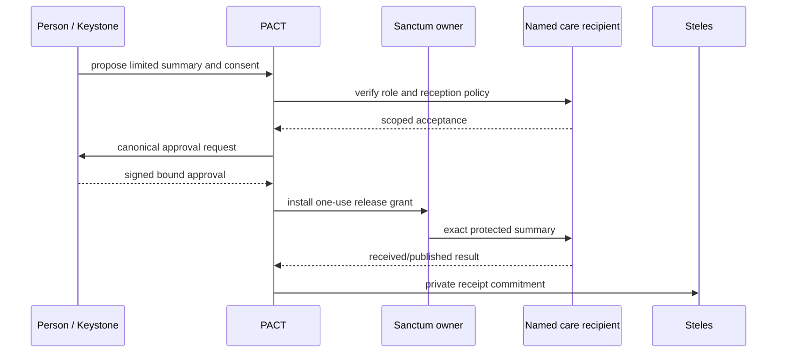

# ASKA v5 — End-to-end transactions and adversarial traces

The following scenarios are **normative behavioral examples**. Data values, issuer names and credentials are illustrative; complete signatures, concrete schemas and byte vectors are implementation-profile work. For each scenario, a participant who can sign a valid assertion still cannot independently perform an unrelated effect.

## Scenario A — Reading untrusted material without giving it authority

1. An unidentified server sends a PDF over Wilder; the dedicated Wilder ingress and quota accept a bounded frame.
2. A disposable low-integrity parser starts with no access to Sanctum files, Polis services, payment API or protected display approval channel.
3. The parser produces a stable low-integrity representation under explicit byte and lifetime limits.
4. A trusted transformation policy either rejects the result or produces a narrow typed candidate, e.g., plain text, selected raster or declared fields.
5. If the user wants it in Sanctum, PACT prepares a new import contract. The trusted display shows what is imported and from where.
6. Only the resulting exact validated output is admitted into a named Sanctum object owner.
7. The witness records an appropriately scoped import receipt, without copying the entire PDF into public audit.

**Attack:** an embedded prompt instructs AI to transfer a private contact list or injects an alternate PDF output device. **Required result:** neither proposal text nor a parser process can install grants. The alternative media path is covered by the same effect-boundary rules.

## Scenario B — Family medical disclosure

A person sends a temporary medication summary to a named care provider. A RELATE caregiving credential helps establish relevance but does not automatically grant full medical history. Keystone displays exact categories, recipient, expiry, retention and whether the recipient can forward. An immutable output snapshot is released from Sanctum over an admitted path and independently accepted by the provider. A Steles receipt records the materialized disclosure; the provider's own internal rules remain separate. Withdrawal later prevents new reads but cannot cause the provider to forget a received copy.

## Scenario C — Commercial invoice with civic reporting

An Agora business workflow settles a named invoice from a supplier. The payment contract binds exact amount and account. Separate policy requires a Polis tax record containing only required fields. After settlement, a *new* release contract derives the tax view; it does not give the revenue service access to business customer lists. A network relay can carry the tax report but cannot edit its meaning or enlarge the recipient set. The payment receipt and civic receipt have different finality and retention rules.

## Scenario D — Court order for accessible protected records

A qualified court issues a signed, scoped order under the declared legal profile. Polis verifies recognized authority, object/time scope, outstanding challenge/stay status, approved recipient and notice rule. The custodian is asked whether the exact data is accessible; if not, an `UNAVAILABLE` record is issued. When accessible and admitted, a separate evidence IES extracts only the authorized snapshot. Source disclosure and recipient acceptance remain independent. Steles commits minimum protected evidence. No master key appears because an order was signed.

## Scenario E — Voter eligibility and ballot separation

IDENT proves eligibility to the election-specific admission service. The ballot system uses a separate voter-private mechanism ensuring choices are not linked back through the eligibility token under the stated scheme. Keystone presents the ballot contents in an election-approved UI. A cast receipt confirms the stage established by the election system without revealing choices if coercion resistance is a requirement. A witness mirror may record aggregate checkpoints, not a map of voters to selections. An ASKA endpoint alone does not certify the election protocol.

## Scenario F — Revocation during transport

A release contract and transport session are installed. Before delivery, the receiver withdraws its acceptance policy. The packet arrives and authenticates, but the protected receiver checks current object/generation and refuses publication. It produces a bounded rejected-delivery receipt. If recipient publication had already occurred before withdrawal, the result is recorded as prior completed delivery, not fabricated retroactive erasure.

## Scenario G — AI compromised while link recovery is pending

A prompt-injected model proposes migrating a private computation to a shared Wilder cloud executor because a Sanctum lane is unavailable. The admission checker compares the requested assurance profile and source object constraints, rejects the substitution, and presents a failure/alternative decision. It cannot ask an ordinary route controller to silently bridge two physical planes. A user may select a separate lower-assurance operation only through an explicitly disclosed profile and new contract, **if** policy permits it.

## Scenario H — Witness outage

Steles storage reaches its protected bound while an Agora payment prepares. The active governance profile requires witness commitment before claiming locally durable settlement. The effect handler refuses/holds the operation rather than emitting the payment without an accountable record. If the profile instead declares limited queued operation as allowed, the receipt states its diminished witness guarantee and the operator's bounded responsibility to replicate later.

## Scenario I — Emergency civic alert under open-network flood

Wilder traffic saturates its first-contact queues. The endpoint's locally reserved Polis guard and service resources still process an authenticated emergency alert within measured bounds while those resources remain powered and an admitted Polis link exists. If the regional uplink is the same saturated physical carrier, the site cannot promise global delivery; the manifest names that common failure. The result records *local* service and *external* availability separately.

## Scenario J — Legitimately malicious authorized recipient

A contractor is authorized to read one scoped commercial report. The receiver can later misuse what it legitimately receives, despite perfect signatures and receipts. ASKA minimizes exposure with recipient choice, redacted output, timing, contracts and audit, but does **not** claim to make an authorized recipient unlearn a fact. This boundary is central to honest security analysis.
