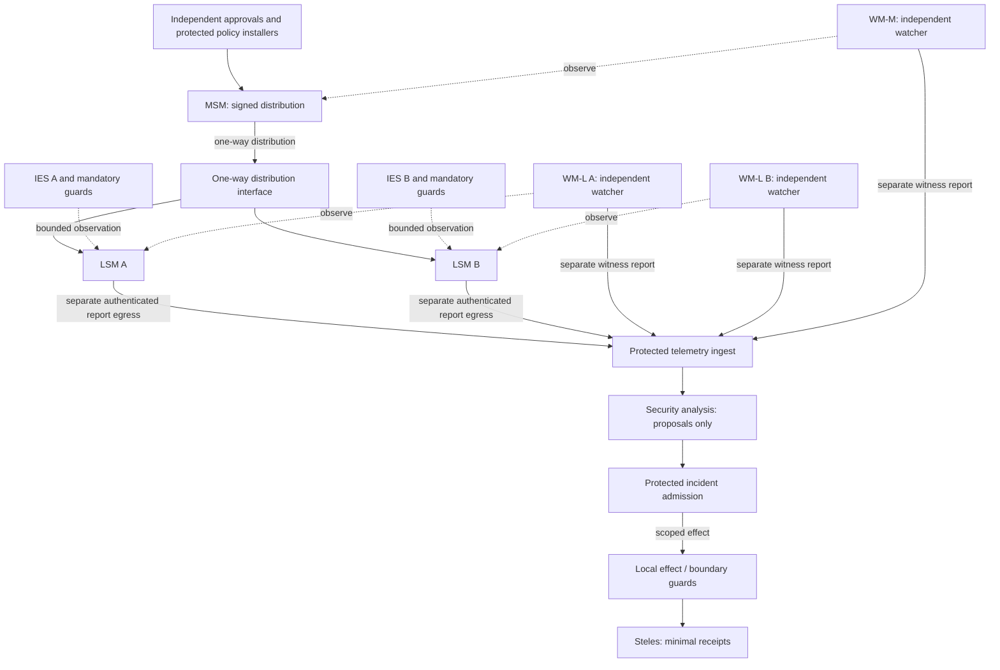

# ASKA v6 — Independent security meshes and execution oversight

**Status:** normative target architecture; physical independence, detection quality, and response safety require implementation-specific evidence. This chapter specifies the security-observation subsystem of the complete authority-enforcing machine. [36](36_passive_hardware_observation_and_provenance.md) specifies sensing; [37](37_watcher_independence_and_meta_monitoring.md) specifies independent oversight; [39](39_response_containment_and_recovery_contract.md) specifies response.

## 1. Architectural requirement

The monitored workload MUST NOT be able to modify, uninstall, impersonate, authorize new privileges for, or silently disable the security mechanism that observes it merely because that workload controls its operating system, hypervisor, process memory, driver interface, or update agent. Security execution, observation, decision, and effect enforcement occupy separately named authority domains. In the high-assurance native profile, monitored workload software and observer software do not share a writable memory address space, privileged kernel, firmware update authority, or unrestricted DMA path.

**Out-of-band is a relative claim.** An observer is out-of-band *with respect to a named workload* only when the workload cannot execute the observer, alter its policy, or write its protected state through any declared path. A tap outside the guest OS but inside a shared hypervisor is not independent of that hypervisor. A hardware gate may be inline with the event it mediates while its *decision authority* remains outside the workload. Neither an external probe nor an isolated AI process is automatically protected against failures of shared silicon, power, firmware, fabrication, or management.

The objective is not to remove every privileged mechanism: memory/DMA guards and egress enforcement must be on the mandatory access path. The objective is to keep the code responsible for security decisions from inheriting the monitored workload's privileged software failure domain. Prevention, observation, diagnosis, response, and witness recording are distinct guarantees and must be reported separately.

## 2. Named domains and separation

| Component | Function | Owns | Must never inherit |
|---|---|---|---|
| **IES** (isolated execution stack) | Bounded application, service or managed legacy workload | Its assigned compute, writable memory and grant handles | Observer keys, unrestricted physical routing, another IES's memory |
| **External guards** | Mandatory memory, DMA, message, effect and egress checks | Protected policy tables, identities, counters and local enforcement | General parser/agent authority to rewrite policy |
| **LSM** (local security mesh) | Site/IES-associated security telemetry intake and bounded local alert processing | Local secure channels, observation budget and status | Protected workload state modification via observation paths |
| **MSM** (master security mesh) | Distribute protected, approved security configuration and aggregate authorized security posture | Narrow scoped distribution authority | Automatic root rights over all LSMs, planes or organizations |
| **WM-L** (local watcher mesh) | Independently observe one LSM and its declared sensors and control boundary | Observer-specific evidence, independently protected telemetry | LSM's credentials, policy writer or intervention grants |
| **WM-M** (master watcher mesh) | Observe MSM distribution and management functions | Independent review and status channel | MSM's update root, plaintext data lake or unbounded veto |
| **Security analysis service** | Correlate telemetry, construct hypotheses and propose bounded actions | Time-limited analysis context and model-specific budgets | Direct policy installation, user consent or cross-realm disclosure |
| **Response controller** | Validate incident evidence and invoke installed protective actions | Preapproved narrowing templates, bounded actuation handles | Root rotation, blanket erasure, new disclosure or permission expansion without separate approval |
| **Steles** | Witness selected commitments, receipt phases and notices | Protected minimal-evidence log and disclosure policy | Real-time observer privileges or arbitrary sensor plaintext |

The first five named domains may occupy independent boards, chiplets or protected hardware partitions. A deployment MUST identify which are actually independent, which share resources, and which compromise of a shared component defeats the property. Neither a visual diagram nor virtualization alone proves independence.

## 3. Directional trust topology

The high-assurance reference separates *policy distribution*, *sensor reporting*, *observer reporting*, and *authorized intervention*. The MSM distributes signed, narrow policy material to LSM ingress interfaces over a one-way physical signaling path. LSMs do not send acknowledgments, data, or telemetry back through this distribution interface. A unidirectional path does not make the sender's configuration trustworthy; local LSM admission guards still validate issuer, scope, generation, expiry and local policy.

Arrows labeled *observe* are logical evidence transfer relationships, not permission to write the observed component. The diagram leaves physical media unspecified: the deployment manifest defines actual pins, fibers, DMA permissions, bus masters, crossing guards and power/reset domains. A reporting flow is never silently treated as a command or policy distribution channel. A one-way MSM→LSM interface remains unidirectional even when the overall system has separate telemetry and control channels in the opposite direction.

**Feedback-loop rule:** analysis may propose a new signed policy package, but it cannot route that proposal backwards through the reporting channel into an MSM or LSM as an executable command. Review, authorization and installation happen in independent domains with immutable contract bindings; approved material uses the dedicated distribution path. A report field named `policy_update` is inert evidence.

## 4. Hierarchy without inherited administrative omnipotence

The master role is an aggregation and scoped distribution role, not the owner of all local security. An MSM compromise may corrupt its own reports or suppress outgoing configuration. It must not, by that fact alone, extract local secrets, modify installed base policy, remove local minimum protections or control watcher roots. LSMs hold immutable minimum policies and can reject a validly signed but out-of-scope change; local realms may require separate consent for cross-domain effects. Protected root change and independently rooted recovery follow [22](22_governance_updates_and_recovery.md).

Each LSM is also separated from neighboring LSMs. Local intake A cannot read or reconfigure B through telemetry aggregation. Cross-site correlation uses scoped, privacy-filtered reports with origin and category commitments. An MSM must not be granted raw access to all user memory in order to correlate anomalies. Likewise a WM-L must not share an unrestricted maintenance bus or signer with the LSM it watches.

## 5. Security event and proposal contract

An observation is not an authorization. Security reports bind `sensor_identity`, `observer_identity`, `observation_profile`, source cell/IES generation or opaque scope, `event_type`, event sequence, time basis, loss counters, confidentiality category, evidence commitment, and an explicit *confidence/visibility class*. The ingest checks freshness, schema, identity and resource limits before any analysis. A missing event is not a statement that an event did not occur.

A security-analysis proposal binds the claimed incident, supporting report commitments, proposed effect template, resources, maximum blast radius, expiry, and uncertainty. Execution requires a separate live grant at the local effect owner under [03](03_authority_calculus_and_conflicts.md)–[05](05_pact_negotiation_and_states.md). A model's confidence score never mints such a grant. Steles may witness minimal digests, without becoming an unrestricted telemetry archive.

## 6. Failure and service rules

The native design MUST publish per-domain heartbeat and loss accounting where physically possible. It MUST distinguish `NO_EVENT`, `NO_DATA`, `SENSOR_FAILED`, `TELEMETRY_PARTITIONED`, `OBSERVER_DISAGREES`, `POLICY_EXPIRED`, and `RESPONSE_REJECTED`. A disconnected sensor cannot be represented as a healthy quiet endpoint; a partitioned MSM must not silently cause broad privilege increases. Protective denial or continued restricted service follows the affected contract's availability profile and is logged as a distinct effect, not a universal fail-closed rule.

A compromised workload may continue to perform exactly the operations it was granted; isolation does not eliminate authorized abuse. A compromised gate may defeat the protections rooted in that gate. A compromised observer may blind its own scope or manufacture evidence. The complete system therefore treats compromise of the observer as a normal test case, not as an excluded event.

## 7. Required evidence

For each independent security domain an implementation reports: physical wiring and memory ownership, bus-master permissions, interrupt and debugging reachability, boot chain, firmware and model update signers, reset and clock roots, supervisory policy, key custody, telemetry/export interfaces, response authority, failure-injection results, and measured service degradation. Conformance tests in [43](43_security_mesh_formal_model_and_test_vectors.md) require genuine hostile software on the observed machine, fake sensor reports, compromised observers, and an outage or signed bad update at the distribution source. Every claimed out-of-band boundary must identify exactly **out of whose authority** it lies.
