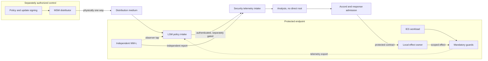

# ASKA v6 — Security-mesh physical fabrics and control-plane reachability

**Status:** native high-assurance topology contract; actual wire-level separation is a property of a specific deployment, not an implication of network labels. This chapter complements the societal purpose networks in [18](18_network_fabrics_and_gateways.md).

## 1. Distinguish purposes

ASKA separates **application purpose fabrics** (Sanctum, Polis, Agora, Wilder), **sensitive key and policy services** (Sovereign Trust Network, STN), **authenticated inter-domain transport** (Authenticated Trust Network, ATN, when used), **security configuration distribution**, **security telemetry intake**, **watcher oversight**, **incident response**, and **Steles witness**. These terms describe responsibilities. They do not by themselves establish physical disjointness or new authority.

A high-assurance endpoint MAY combine selected low-consequence reporting roles behind an admitted multiplexer, but it cannot claim physical separation for those roles if they share a switch, transceiver, unguarded BMC, host NIC, power/reset root or management agent that permits cross-domain effect. The native security-mesh profile requires an explicit reachability graph at the granularity of DMA masters, buses, ports, PHYs, optical/radio links, packet buffers, switch forwarding, interrupts and management commands.

## 2. Reference directionality

The Master Security Mesh (MSM) has a **one-way configuration distribution** link to each Local Security Mesh (LSM) ingress. Local reporting uses a distinct egress toward a telemetry intake service, governed by ordinary source-disclosure and recipient-acceptance checks. Watcher meshes have their own protected report interfaces. A response request reaches a local effect owner through an approved, separately bounded control path; it is not sent as arbitrary bytes on the observer tap or through the opposite direction of the distribution diode.

The physical graph MUST include return electrical paths, test/debug pins, sidebands, link maintenance, device firmware downloads, cloud-management APIs, remote-reset services and clocking. An apparent one-way application protocol over a full-duplex NIC is **not** a physical diode. A diode prevents signaling in one direction but does not prevent a malicious source from sending bad configuration in the permitted direction. Local cryptographic and semantic admission remains mandatory.

## 3. Mesh confidentiality and information separation

A sensor event can reveal sensitive workload behavior even without raw payload bytes. The source guard assigns a confidentiality category to the event, and the LSM exports only authorized fields to named recipients. A report crossing Sanctum→site security or Agora→enterprise SOC is a disclosure operation, with its own data restrictions, retention and recipient policy. If categories must be downgraded, an independently authorized transformer performs a bound, reviewable release. Neither the STN nor the MSM is a global sink for private plaintext.

The STN provides high-assurance placement for selected protected key and policy services, with independent control, recovery and physical link assumptions. ATN is a transport role for admitted authenticated communication; it carries no automatic right to export data between realms. The Dynamic Trust Gateway (DTG) is a **mediated transaction boundary**, not a transparent bidirectional bridge. It separately enforces source release, permitted representation, path authority and receiver effect. A security event may traverse the DTG only when all its own checks succeed.

## 4. LSM and MSM distribution contract

A `MESH_CONFIG` bundle is a canonical, signed object containing target LSM identities and generations, minimum and maximum policy scope, package revision, resource budget, expiry, dependencies and a rejection policy. A receiver checks the complete object before installing it in protected state. MSM authority to *distribute* does not imply permission to mint new rights, alter local root trust, or disable independent WM-L sensors. Packages not individually intended for a receiver must not be accepted just because they arrived on the distribution fabric.

MSM distributions SHOULD be designed to allow offline local safe service when link integrity is lost. No LSM must acknowledge receipt on the one-way link. An independent telemetry path can report observed policy generation to analysis, but its existence does not redefine the directionality of the distribution link. The deployment's threat graph must treat the distinct paths separately and include potential shared source hardware.

## 5. Physical independence profiles

| Profile | Architecture condition | Allowed claim |
|---|---|---|
| `NATIVE_PHYSICAL` | Separate claimed paths have independent transceivers, buffers, mandatory guards and scoped management; site-specific shared dependencies enumerated | Physical path separation up to explicitly named edges and facilities |
| `PARTITIONED_DEVICE` | Single board/chip includes hardware-owned regions with local guards but shared package/power/clock | Independent logical effect scopes with declared shared physical failure modes |
| `SOFTWARE_ISOLATED` | Host hypervisor, kernel namespace, containers or overlays supply separation | Software-defined containment conditional on named privileged infrastructure |
| `EXTERNAL_WITNESS_ONLY` | Remote observer verifies digest/receipt from shared host, no independent hardware event source | Evidence attestation under host/anchor assumptions; no passive RAM-inspection claim |

Only `NATIVE_PHYSICAL` under a suitable dependency analysis satisfies a deployment claim of distinct physical fabrics at the specified edges. A system may use a weaker profile for prototyping, but must not report a stronger property as demonstrated.

## 6. Failure and bypass analysis

Test alternate cables, switch uplinks, programmable FPGA paths, BMCs, USB peripherals, debug interfaces, shared accelerators, physical memory mirrors and emergency management ports. A bridge plugged into a guarded interface does not create new application authority. A probe placed **after the last mandatory enforcement element** can observe or emit traffic outside the model; that is a physical bypass or tampering case, not a proof the gate still controls that link. All output devices, screens, printers and removable media remain in the cross-domain path register [19](19_cross_domain_security_and_release.md).

Attackers can drop or flood a physical link. No physical fabric promises availability without admitted load, reserved resources, scheduling and surviving links. A security report storm must not exhaust reserved Polis safety traffic; a large AI analysis transfer must not block protected update or witness channels. If paths share a region or upstream carrier, their common outage is named rather than treated as statistically independent.

## 7. Packaging, service and verification

A design may use distinct chiplets, interposer channels, optical links, independent appliances, or a heterogeneous mix. The mandatory checks must remain in the right location: local bus/DRAM protection for memory; requester-identity enforcement for DMA; port ownership and egress rules at physical transmit; protected keys outside ordinary drivers; and independently guarded installers for configuration. Package-level isolation claims must include cache/coherence, reset, clock, thermal, fault injection and power integrity, not just a block diagram.

For deployment, publish a **port and reachability ledger**: physical connector, linked root, supported operations, direction, logical role, programmable routing state, firmware updater, key custody, observations and alternate paths. Inspect physical diagrams, netlists or board traces where possible; exercise hostile DMA masters and link-flap traffic on real hardware. [46](46_security_mesh_assurance_profiles_and_registries.md) defines the manifest; [43](43_security_mesh_formal_model_and_test_vectors.md) defines required negative tests.
