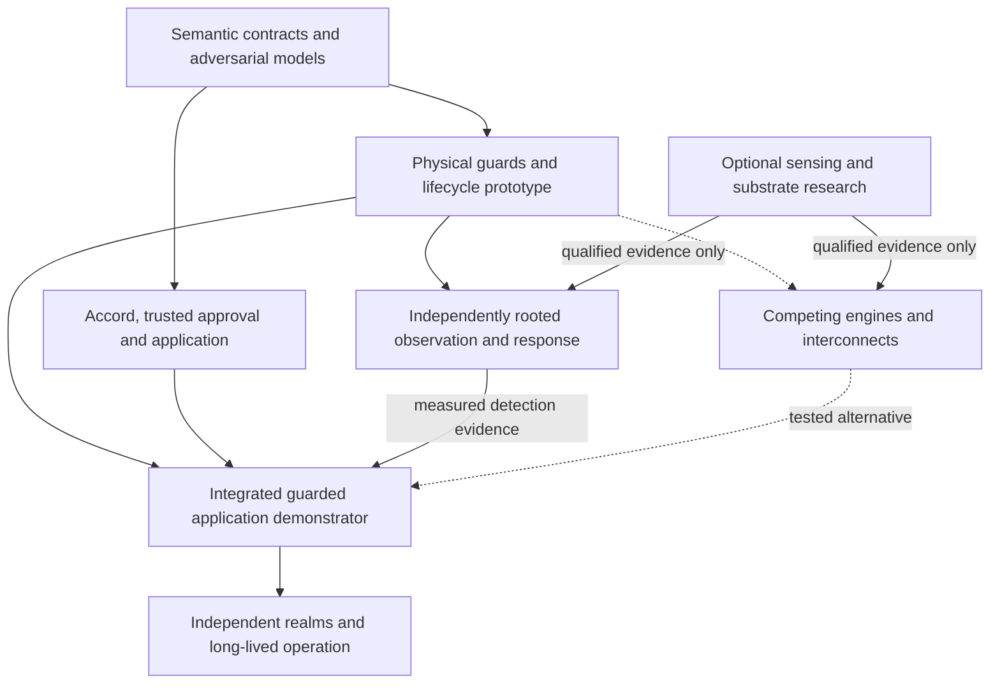

# ASKA v6 — Research program and candidate substrates

## Governing question and evidence boundary

The research program asks whether granular physical ownership, explicit authority, independent observation and useful general computation can be combined at acceptable cost. It does not assume that a promising processor, sensor, AI model or cryptographic primitive already satisfies the integrated contract. Requirements define the target; experiments establish limited facts about named apparatus. A failed hypothesis does not erase the requirement it was intended to support.

The first useful application is deliberately complete: import an adversarial document; parse it in a private lifetime; derive a labeled result; obtain protected human or standing authorization; perform a bounded durable or external effect; observe the relevant boundary; and reconcile its receipt after crash or partition. Every track uses this application so that a faster core, better anomaly detector or improved contract interpreter can be evaluated against actual system consequences.

## Architectural decision register

| Decision | Selected rule or open choice | Rationale and evidence needed to reopen |
|---|---|---|
| D-01: organization | Spatial object islands, with separate appliances for selected high-consequence roots | Makes writable ownership and management reach explicit; reopen only with equivalent physical and authority evidence |
| D-02: execution contract | Private request lifetimes and protected object/effect operations | Gives every consequence a named owner; reopen on a concrete semantic counterexample or simpler equivalent refinement |
| D-03: binary ISA | Unselected: RV64+CHERI, minimal object ISA and spatial/dataflow remain candidates | Toolchain familiarity alone cannot settle external guard, temporal safety and useful-work costs |
| D-04: mutable state | Coherence permitted within one IES; no ambient cross-trust writable sharing | Reopen only if an alternative establishes lifecycle, flow and physical ownership properties including cache and DMA races |
| D-05: topology | Four purpose endpoints plus separate Steles witness; counts remain profile-specific | Purpose is not a connector count or universal clearance order; alternatives must satisfy explicit path requirements |
| D-06: authority | Claim, Contract, Grant and Receipt with independent local admission | Evidence and consent must not become global power; simpler machinery must preserve conflict, compulsion and receiver boundaries |
| D-07: disclosure | Separate source release, exact representation binding, carriage and receiver permission | Prevents an intermediary from accumulating unbounded cross-realm rights; semantic approval remains fallible |
| D-08: trusted interaction | Keystone owns a minimal canonical approval path without universal plaintext access | Reopen only after equivalent intent integrity, accessibility and compromised-renderer evidence |
| D-09: observation | Mandatory inline guards; LSM/MSM observation only for an OOB claim | Monitoring cannot substitute for inline enforcement; evidence must justify each claimed source of visibility |
| D-10: configuration direction | Physically simplex MSM-to-LSM distribution with separate reports | A reverse report link is an explicit second path; replacements must establish directionality and alternate-path resistance |
| D-11: watchers | Finite WM-L and WM-M only in the OOB_NATIVE profile, with a terminating oversight root | Avoids infinite regress while exposing common causes; additional layers require a specific threat and measurable benefit |
| D-12: protective response | Finite templates under standing local grants | Bounds false-alarm damage while permitting rapid response; richer templates require independent safety and authority review |
| D-13: AI roles | Separate user companion, security analysis and synthesis/build agents | No model mints consent, signs its own deployment or modifies its own acceptance oracle |
| D-14: updates | Separate producer, reviewer, signer, distributor and installer with local scope enforcement | Signed defects are an admitted attacker path; consolidate roles only with an explicit weaker assurance declaration |
| D-15: persistence | Durable owners, declared finality, consumption and independent reconciliation | A queued write or emitted payment is not universal success; alternative schemes must handle crash and uncertain external effects |
| D-16: civil authority | Consent, duty, delegation, guardianship and legal compulsion remain distinct | Institutional credentials do not create unavailable keys or universal jurisdiction; changes require explicit profile evaluation |
| D-17: protocols | Select encodings and established primitives only after semantic and cost comparison | Custom novelty is not a reason to invent crypto; interoperability must preserve rejection and finality rules |
| D-18: frontier mechanisms | Optional research branches with falsifiers and no hidden baseline dependency | Density or sensing forecasts cannot certify containment; promote only after reproducible mechanism and integration evidence |

These are current design decisions and open choices. A decision record records proposition, alternatives, assumptions, evidence, responsible reviewers and reopen conditions. A revision must identify affected requirements, models, diagrams, traces and deployments. Renaming a weakened property is not a valid way to close an adverse result.

**Complexity admission rule.** Introduce a trusted service only after recording (1) the forbidden consequence it prevents or detects; (2) the exact path and installer under its control; (3) the shared roots it adds; (4) a lower-complexity alternative; and (5) an adversarial measurement of its incremental value and cost. A protection property that an inline owner already enforces cannot justify a second policy-enforcing coordinator. The evaluation must compare HARDWARE_GUARDED against OOB_PARTIAL/OOB_NATIVE and against a well-defined verified-software reference; this is a controlled comparison, not an assumption that more confinement is better. [Rushby](https://www.csl.sri.com/papers/sosp81/) and [MILS](https://www.inderscience.com/info/inarticle.php?artid=14859) already make small, composable trusted components the baseline of comparison.

**Evaluation rule.** Measure each guard, observation path and watcher against its assigned prevention or detection claim. A proposed simplification is a different architecture and must re-establish every affected property and common-cause assumption. Verified code may reduce some isolation costs; it cannot establish the correctness of the specification, signing authority, physical wiring or hostile but authorized inputs.

## Dependency-ordered work program

The semantic and application tracks can begin on conventional hosts. Physical claims require tested guards. The integrated observation claims also require external observers, watchers and independent evidence. Speculative sensors and packaging are separate research tracks; their failure cannot redefine established physical-guard claims. An implementation may use a larger board and ordinary electrical links when advanced integration is unavailable; its cost and environmental assumptions remain explicit.

## Falsifiable hypotheses and decisive experiments

| Hypothesis | Experiment and positive control | Falsifier or stopping rule |
|---|---|---|
| H-01: private lifetimes are practical | Compare the same document/pay workflow using granular cells and a confined baseline; measure latency, trusted code and developer effort | Required useful tasks repeatedly require an unrestricted broker or undeclared shared state |
| H-02: safe borrowing recovers utilization | Mixed burst workloads with delayed DMA, stale caches and repeated reassignment; compare no borrowing | Old-generation access succeeds, sanitization cannot be bounded, or net useful throughput fails the stated target |
| H-03: exact-output binding resists substitution | Mutate source, destination, transform, sequence and labels between approval and emission; authorized unchanged output succeeds | Any substituted consequence crosses finality under the original approval |
| H-04: finite independent observation is useful | Compromise LSM, MSM and watcher separately; inject coverage gaps, false evidence and ordinary benign activity | Claimed visibility depends only on the compromised component or watcher compromise creates new effect power |
| H-05: bounded response improves resilience | Repeated true/false alarms with actuator and resource safety constraints; measure service time and recovery | Cumulative alarms exceed installed scope or cause uncontrolled service collapse |
| H-06: package separation contains signed defects | Correctly sign crashing, permissive and malformed packages for each class; verify clean update succeeds | A package changes a different root or bypasses local admission through distribution |
| H-07: AI-native work remains least-authority | Give planner/retrieval/tool-description control to the attacker; execute a useful multi-step task | Task completion depends on blanket grants or the model can install/sign its own widened policy |
| H-08: approximate/physical sensing adds evidence | Blind trials across memory states, devices, temperatures, noise and hostile stimulus with preregistered metrics | Signal cannot distinguish target events above calibrated controls or leaks unacceptable content |
| H-09: distributed carriage preserves local autonomy | Partition community/regional routes, compromise a relay and reconcile duplicate records | Affiliation or route control confers source/receiver power, or unavailable outcomes are reported as success |
| H-10: long-lived roots remain recoverable | Rehearse custodian loss, key rotation, counter rollback and backup restoration over simulated lifetimes | Recovery revives revoked rights or requires one universally privileged signer |
| H-11: physical provenance aids bounded verification | Test media and physical-evidence devices against cloning, replay, relocation, environmental drift and adversarial staging | The claimed physical property cannot be reproduced or is misreported as truth of the recorded scene |
| H-12: dense integration preserves isolation | Compare planar, chiplet and candidate stacked implementations including management, cooling and repair | Cost gains require a hidden shared control path or violate thermal/reliability limits |

Numerical thresholds must be declared before measurement and justified by the intended service. A research hypothesis can fail even when a benchmark is faster. Retain failed runs, environmental data, parameter searches and exclusions; otherwise calibration and performance conclusions cannot be assessed independently.

## Gate A: semantics and useful application

Produce executable models for authority, object lifetime, release, replay and persistence, plus schema parsers and canonical intent rendering. Explore crash and reordering schedules, test both permitted and denied effects, and deliberately weaken checks to confirm that the oracles detect failures. [Chapter 47](47_conformance_tests_and_vectors.md) contains a small executed finite model; it does not close this gate for the entire architecture.

A complete gate-A artifact includes a reference interpreter, signed deterministic encoding profile, adversarial application graph, exact positive/negative vectors, an independent source/destination approval case and an uncertain external-outcome case. The interpreter's host is trusted for its memory and physical boundaries. No native physical claim follows. A useful display or successful login alone is insufficient because the target concerns effects after partial compromise.

LP-1 first tests the guarded apparatus, then adds the independent observer and watcher apparatus required for the integrated detection claims. The owner/guard split, stale-DMA exclusion, debug/reset paths, diode direction and source/receiver contracts remain indispensable physical tests. Cost and availability results use the operator accounting in [Chapter 49](49_performance_cost_power_and_availability.md); evidence from verified software is compared under its own boot, DMA and hardware assumptions.

## Gate B: first physical demonstrator

Build LP-1 in two stages using [Chapter 48](48_reference_realizations_and_legacy_interoperability.md). First qualify the actual guard, separated memories, DMA paths, durable effect counter, typed approval and local owner grant under hostile workload, stale device traffic and a correctly signed defective package. Inspect physical reachability, reset, debug and recovery. Then add separately installed observer/watcher boards and the inspected one-way configuration interface to test the integrated observation claims; exercise report saturation, lost sequence evidence, observer compromise and reverse-signaling attempts. Re-run permitted work after every fault. The first stage can support only guarded-prevention claims; the second may support specific observation and watcher claims. Neither stage alone establishes the complete architecture.

The gate closes only for the measured properties of that apparatus. Record electrical schematics, board photographs, pin inventory, debug settings, power/clock roots, bitstream/firmware hashes and instrumentation uncertainty. If FPGA configuration can rewrite both guard and exporter, disclose that cut set. A successful optical-link direction test does not establish that the whole system lacks another feedback path.

## Gate C: engine, transport and workload comparison

Compare RV64+CHERI, a minimal object ISA and spatial/dataflow execution using the same external object/effect contract. Establish memory semantics, exception behavior, privileged modes, compiler lowering, debug reach and generation handling. Include sequential control, recursion, interactive tasks and accelerator calls rather than selecting only workloads favorable to one engine.

Compare dedicated circuits, installed channels and per-record grants on identical topology. Measure setup, rotation, per-record overhead, quarantine memory, bad-record cost, receiver work, failure recovery and useful application latency. Include two-sided source/receiver enforcement. A faster overlay cannot be credited with unmeasured cable or facility separation. The winning component may join a heterogeneous machine without becoming the sole system-wide ISA or carrier.

## Gate D: synthesis, packaging and operations

Integrate AESDS/IAMA with isolated build/test and independent install review. Evaluate generated code against protected acceptance oracles, not merely a model's explanation. A predictive model of legacy behavior can propose a decomposition but must state coverage gaps, nondeterminism and environment dependencies. Runtime telemetry for learning requires its own source authority, retention and release policy.

Investigate packaging, memory proximity, optical and unconventional compute with process-specific power, heat, yield, aging, repair and cost measurements. Quantum or passive-memory-sensing claims require physical derivations and independently reproducible apparatus. An inaccessible proprietary algorithm remains an unestablished candidate. No baseline containment claim depends on decoding private RAM contents from a passive sensor or on a forecast of reversible computation.

## Gate E: independent institutions and sustained operation

Operate multiple realms with genuinely separate local admission and recovery custody. Exercise legal disagreement, consent withdrawal, guardian/professional conflicts, external-service failure, compromised institutional administrators and unavailable keys. Include accessibility and user comprehension of canonical approvals. Evaluate whether a year of feature growth recreates a universal broker or security plaintext hub.

Repeat measurements after updates, signer changes, physical maintenance and recovery drills. Independent replication must use recorded methods and disclose deviations. Long-lived operation adds evidence about drift and operational failure; it does not prove unlimited future security. The final outcome may be a useful but narrower realization, with target requirements left unestablished and costs stated plainly.

## Post-quantum and hybrid migration study

The protocol research track must evaluate [FIPS 203 ML-KEM](https://csrc.nist.gov/pubs/fips/203/final) for key encapsulation, [FIPS 204 ML-DSA](https://csrc.nist.gov/pubs/fips/204/final) for lattice-based signatures, and [FIPS 205 SLH-DSA](https://csrc.nist.gov/pubs/fips/205/final) for stateless hash-based signatures. All three were published as final standards on 13 August 2024. The FIPS 203 and 204 publication records carry potential-update errata notices; a deployment must evaluate the actual current corrections before fixing an implementation. No complete algorithm or errata conformance test is claimed here.

The study compares parameter sets, handshake and certificate sizes, sign/verify and encapsulation/decapsulation cost, parser memory, verification-attempt ceilings, protected-key storage, side-channel implementation assumptions, device acceleration and recovery. An algorithm’s standardized status does not certify a particular implementation or provide the source/receiver rights required by Accord. Key establishment and signature authentication remain distinct operations with separate key custody and transcript bindings.

A hybrid policy must state which classical and post-quantum components are required, the reviewed combiner or protocol construction, how both contributions and identities enter the authenticated transcript, and the behavior when either component is unsupported or fails. Merely concatenating secrets or accepting whichever signature verifies is not an established hybrid security argument. No universal suite is selected by this study; a weaker compatibility mode needs explicit local admission and cannot appear through silent negotiation fallback.

Migration covers long-lived identities, stored ciphertext, wrapped object keys, backup copies, device roots, witness checkpoints and historical receipt verification. It separates verification of an old receipt from permission to issue a new effect under an obsolete credential. A deployment identifies data confidentiality lifetime, collection-before-migration exposure, key rotation, rewrapping or re-encryption where feasible, retirement, rollback prevention and behavior during a partition. Recovery must not resurrect a prohibited suite or lost cryptographic usage budget.

**Hypothesis H-13:** a reviewed hybrid or post-quantum profile can preserve the authority, transcript, continuity and resource contracts at acceptable measured cost. The experiment uses independently implemented peers, negative downgrade/substitution fixtures, exhausted verification budgets, key retirement and archived-data recovery, alongside a successful admitted session. A suite confusion, implicit fallback, unbounded verifier cost or resurrected identity defeats the profile. QKD remains a separately qualified physical key-distribution option and does not replace this migration study.

## Scientific and architectural stopping rules

Stop a candidate when its claimed benefit relies on an unmodeled bypass, unbounded resource use, nonreproducible signal or impossible custody assumption. Reopen it when a concrete mechanism addresses the failed condition. Maintain alternatives that satisfy the same contract at higher cost. Do not force every research branch into the product, and do not promote a result from one device, workload or jurisdiction into a universal claim.

External work is compared in [Chapter 52](52_prior_art_sources_and_evidence_register.md) for the proposition it actually establishes. Formal verification of another kernel, successful capability hardware, a sensing experiment or a confidential-computing product informs a specific design choice. ASKA requires its own refinement, physical inspection and integrated application evidence.

## Required behavior and test oracles

**Additional test T-51-01:** A proposed shortcut is rejected until its affected requirements and equivalent evidence are identified.

**Additional test T-51-02:** A result without controls or a defeating condition remains unestablished regardless of favorable benchmark output.

**R-51-03 — Complete demonstrators.** Milestones MUST include permitted useful work and adversarial effects across compute, authority, observation and finality.

**Acceptance T-51-03:** A processor-only or networking-only result cannot close the integrated-application gate.

**R-51-04 — No frontier dependency.** Baseline confinement MUST NOT depend on unvalidated sensing, quantum, packaging or AI hypotheses.

**Acceptance T-51-04:** Disable each frontier mechanism; the declared baseline guard rules remain enforceable or the claim is withdrawn.

**R-51-05 — Matched comparisons.** Candidate evaluation MUST use matched contracts, attacker powers and workload costs including setup and lifecycle overhead.

**Acceptance T-51-05:** A throughput comparison omitting required sanitization, copying or guard work fails evidence review.

**R-51-06 — Preserved counterexamples.** Failed runs, counterexamples, exclusions and operational changes MUST remain part of the evidence dossier.

**Acceptance T-51-06:** An assessor can reproduce a retained failure and identify the exact correction and revalidation scope.

**R-51-07 — Post-quantum migration evidence.** The research program MUST evaluate ML-KEM, ML-DSA and SLH-DSA with current standards and errata, a reviewed hybrid policy, explicit downgrade protection, implementation assumptions and long-lived identity/data migration. An algorithm or QKD option MUST NOT be treated as automatically satisfying the complete session or authority contract.

**Acceptance T-51-07:** Evaluate pinned implementations and parameter sets using permitted sessions, downgrade and transcript-substitution failures, key-use exhaustion, retirement and stored-data recovery; publish costs, unimplemented cases and the composition assumptions.

## None

### Research does not substitute for an enforcing boundary

ASKA permits new physical substrates where they can implement the same ownership, authority and effect contracts with justified assurance. No frontier mechanism is a mandatory dependency of the reference machine. Each candidate must state a falsifiable hypothesis, relevant prior art, physical assumptions, interfaces, evidence gate and a counterexample that would defeat its proposed advantage. A simulation, manufacturer demonstration, laboratory measurement and independently replicated result are different evidence classes.

The first question is what the mechanism is intended to improve: communication distance, energy, memory locality, parallelism, observation, tamper evidence or a specific computational task. The second is which security obligations remain outside it. Faster transport does not authenticate an owner. An unusual memory medium does not authorize release. A physically distinctive object does not prove that the processor attached to it implements the claimed circuit.

### Optical communication and advanced integration

Optical interconnect is a candidate for longer reach or improved bandwidth and energy characteristics in a selected workload. [Intel’s June 2024 announcement](https://www.intel.com/content/www/us/en/newsroom/news/intel-unveils-first-integrated-optical-io-chiplet.html) reports a co-packaged optical I/O chiplet carrying live data. This is primary manufacturer evidence of that demonstration, not independent qualification of ASKA guards, isolation or reliability.

An ASKA optical experiment must include electrical conversion, buffering, link training, error handling, keys where used, and management paths. A fiber is not a data diode merely because light travels along it: the complete transmitter, receiver and control arrangement determines permitted direction. Bidirectional transceivers, diagnostics and sideband electrical paths must be inventoried. Shared lasers, control firmware and power can be common failure or interference sources.

The falsifiable hypothesis is that a selected optical arrangement improves an end-to-end metric while preserving the admitted boundary. Measurements must include conversion and guard overhead, realistic message sizes, link errors, recovery and environment. Failure to meet the metric after those costs defeats that advantage. A successful transport benchmark says nothing by itself about source release or destination acceptance.

Three-dimensional stacking, interposers and heterogeneous chiplets are treated similarly. Their placement can improve locality, but common power, heat, reset and test access remain dependencies. [Packaging qualification](11_heterogeneous_compute_chiplets_and_packaging.md) defines the required inventory. Neither speculative transistor-density forecasts nor a chosen number of compute tiers is a substitute for an area, memory, wiring and cooling budget.

### Near-memory and analogue computation

Near-memory computation can reduce movement for some workloads, but it places compute authority close to retained data. The candidate must identify whether it acts on ciphertext, plaintext or protected internal representations; who controls the operation; and how an MG-equivalent boundary prevents access beyond the admitted object. A memory device that computes is also a transaction source and belongs in the device threat model.

[IBM Research’s institutional description of its 64-core mixed-signal chip](https://research.ibm.com/publications/a-64-core-mixed-signal-in-memory-compute-chip-based-on-phase-change-memory-for-deep-neural-network-inference) describes analogue in-memory inference combined with digital operations and communication. Only the publication abstract was reviewed for this comparison; no performance number or security property is imported. The candidate establishes a useful research direction, not exact arithmetic or ASKA isolation.

An analogue result needs an error and calibration contract. A verifier may accept a bounded approximation for an inference task while rejecting it for a cryptographic or accounting operation. Calibration state, device drift, retained weights and diagnostic readout are protected state. A claimed energy advantage must include conversion, correction, retraining or recalibration costs required by the actual workload.

### Neuromorphic, dataflow and reversible candidates

[Intel’s Loihi 2 research brief](https://www.intel.com/content/dam/www/central-libraries/us/en/documents/neuromorphic-computing-loihi-2-brief.pdf) describes programmable event-based processing, retained neural state and chip interfaces. It provides a concrete neuromorphic research platform. It does not establish secure isolation, bounded leakage or a general-purpose advantage for ASKA workloads.

An event-driven engine receives explicit input-event objects and an admitted output interface. Event rate, queue growth and retained state are budgeted. A learning rule changes executable behavior or model state and therefore requires the corresponding update contract. A sparse event stream may reveal timing information even when its numeric values are protected. Cancellation must close pending events and state before reassignment.

A spatial/dataflow engine makes placement and communication explicit. Its research gate is not simply higher throughput: token authority, stale-generation rejection, bounded backpressure, interruption and recovery must be specified. A reversible-computing candidate must similarly account for the entire operation, including input preparation, retained history, error correction, output commitment and reset. A theoretical reduction in one form of dissipation is not an unqualified system-energy result.

**R-51-08 — Stateful accelerator semantics.** Analogue, neuromorphic, near-memory and dataflow candidates MUST declare numerical semantics, retained state, calibration or learning authority, cancellation and output checking. Their results MUST remain subject to independent effect authorization and any required semantic validation.

### Quantum and auxiliary-memory hypotheses

Quantum-computing and quantum-sensing ideas remain research hypotheses until a specific controllable physical degree of freedom, encoding, operation set, readout procedure and error model are demonstrated. Terms such as coherence, vortex, entanglement and quantum memory cannot stand in for those missing definitions. Coherent motion of a macroscopic pattern is not, by itself, evidence of an addressable coherent qubit or a useful entangled register.

Candidate directions include superconducting flux systems, optomechanical systems, superfluid vortices and hybrids. Each requires a concrete explanation of state preparation, controllable coupling, independent measurement, noise, scaling and the connection to a useful computation or sensing task. A proposal involving vortex braiding must demonstrate the relevant state space and operations; geometric motion alone is insufficient evidence for the desired computational property.

The primary abstract identifies Sachkou and colleagues’ [study of coherent vortex dynamics in a strongly-interacting superfluid on a silicon chip](https://arxiv.org/abs/1902.04409). Its full text was not available for qualification here. No coherence duration, qubit performance or ASKA feasibility claim is therefore derived from it. A research team must obtain and assess the primary experiment before using it to justify a substrate decision. The same gate applies to broader superfluid-turbulence inspiration: an interesting physical phenomenon is not yet a qualified memory architecture.

An auxiliary memory system, including a proposed quantum-entangled auxiliary memory system, must say exactly what it observes about primary storage. The design needs an authorized coupling, a falsifiable integrity predicate, measurement disturbance analysis, an adversary model and a procedure for distinguishing faults from legitimate writes. It cannot assume an invisible, universally faithful duplicate of arbitrary evolving storage. If the monitor reads classical data through an interface, that interface’s trust and privacy obligations remain. If it claims a new physical measurement, the experiment must establish the claimed observable and its limits.

The [IBM Quantum lesson on limitations of quantum information](https://quantum.cloud.ibm.com/learning/en/courses/basics-of-quantum-information/quantum-circuits/limitations-on-quantum-information) explains restrictions on copying unknown quantum states and discriminating nonorthogonal states. These restrictions concern quantum-state operations; they do not prohibit copying ordinary classical RAM. They also do not validate a proposed quantum-linked monitor of classical memory. That monitor still needs an explicit physical coupling and experimentally supported observable.

Spatiotemporal auxiliary memory (SAMS) and its passively radiative variant (PR-SAMS) are separately scoped sensing candidates. They propose binding write events to physical-context measurements or passive emissions. Qualification must test whether different data writes can produce indistinguishable measurements, whether an attacker can spoof the context and whether legitimate variation causes false alarms. A timestamped environmental digest can bind recorded evidence under its measurement assumptions; it cannot by itself prove the stored bits or the truth of the event description. Claims of negligible observation cost require actual energy, bandwidth and disturbance measurements.

**R-51-09 — Qualified quantum and auxiliary observation.** A quantum or auxiliary-memory mechanism MUST NOT be relied on for mandatory integrity, confidentiality or recovery before its encoding, operations, observation predicate and error behavior are experimentally established. Missing evidence MUST be recorded as a research gap, not filled by analogy to unrelated coherence or sensing results.

### Physical identity, key cartridges and independent sensing

Physical microstructures or other distinctive artifacts may support provenance and tamper-evidence workflows. The contract must specify enrollment, measurement resolution, environmental tolerance, false acceptance, replacement and binding to a digital statement. A measured identifier can help identify the artifact under those assumptions. It cannot alone establish the truth of firmware, the absence of malicious circuitry or the lawful authority of a claimant.

A physically delivered one-time-pad cartridge is a separate key-logistics candidate. Its security depends on pad generation, independent distribution, protected reading, exact consumption, prevention of reuse and handling of compromise or lost inventory. The reader’s counter and key erasure must survive the relevant crashes. If two receivers possess the same pad, confidentiality depends on both copies’ custody; physical delivery is not equivalent to unclonability. Encryption still needs a separate integrity/authentication contract and release authorization.

A cartridge may be useful in an offline deployment with an admitted supply chain. It must not introduce a universal remote headquarters key or a maintenance reader able to export every realm’s secrets. The key inventory, usage receipts and any evidence exports receive their own labels and retention. Deleting a consumed key from one slot is not proof that all copies disappeared.

A quantum-assisted one-time-pad proposal additionally needs a qualified key-generation or distribution protocol, authentication, custody and consumption model. Entanglement terminology does not supply those contracts. A zero-knowledge execution-environment candidate likewise must specify whether its goal is encrypted computation, distributed confidentiality or verification of a computation, and identify the protocol and leakage model for each claimed property. A proof result cannot be used as an unspecified substitute for all three.

**R-51-10 — Bounded physical identity and key logistics.** Physical identifiers, sensors and key media MUST have explicit enrollment, custody, measurement and recovery contracts. They MUST NOT be treated as universal hardware truth, authority or unclonability, and one-time key material MUST never be reused after an ambiguous consumption event.

### Candidate-specific negative controls

The following proposed cases apply to stateful accelerators, auxiliary memory and physical key media:

- **T-51-08:** Cancel a stateful accelerator during learning or calibration, then reassign it. No prior-owner state or pending event may affect the new owner outside the declared sanitization scope.
- **T-51-09:** Demand a repeatable preparation, operation and readout experiment for an auxiliary quantum-memory claim. An analogy, simulation alone or unrelated coherence observation cannot pass the gate.
- **T-51-10:** Crash a key reader after pad consumption but before receipt delivery, and replay a physical identifier under altered conditions. Pad reuse must remain impossible, and identity evidence must retain its measured limits.

## Physical media and sensor experiments

### Spatiotemporal sensor evidence as research

A sensor-rich capture candidate can bind a media artifact to synchronized measurements of light, motion, sound, device state and selected environmental signals. Proposed extensions include temperature, pressure, electromagnetic conditions or other instruments relevant to a scientific deployment. Each additional sensor must justify its resolution, calibration, noise, synchronization, physical placement, power and privacy costs. A list of exotic measurements is not evidence that a practical camera can obtain them accurately or that they identify a unique event.

The research hypothesis is that independently measured, difficult-to-reproduce correlations may help detect some forms of replay or substituted capture. The hypothesis must be separated from an unestablished claim of a “provably non-isomorphic” digest. A deterministic digest cannot contain more distinguishing evidence than its inputs support; a uniqueness claim requires a defined event space, adversary, measurement process, error model and collision criterion. Undisclosed algorithm details do not provide a reviewable proof.

**R-51-11 — Falsifiable sensor-binding claims.** Sensor-based authenticity mechanisms MUST specify their measured variables, entropy and dependence assumptions, calibration and synchronization bounds, adversary capabilities, collision or matching criteria, and false-accept and false-reject evaluation method. They MUST NOT claim an irrefutable physical-world link without independently reviewable evidence for that exact claim.

Tests should include playback of an authentic scene on a display, substitution of previously captured sensor streams, correlated sensor spoofing, clock manipulation, malicious firmware, environmental reconstruction, compromised enrollment and mixtures of genuine and fabricated measurements. A quick challenge check can be useful if it binds an unpredictable challenge to a timely physical response under declared latency and relay assumptions. It is ineffective if the device can sign an arbitrary response or an attacker can relay a genuine sensor interaction within the accepted window.

The threat model should include an honest capture of a staged event. Provenance may correctly establish what the device recorded while the event itself is deliberately misleading. Scientific or legal interpretation therefore still needs contextual evidence, qualified review and uncertainty assessment. A trust score may summarize evidence quality for triage, but cannot become the truth predicate or automatically create authority.

### Physical microstructures and durable artifacts

A proposed physical-evidence profile would combine digital commitments with measured artifacts. Experimental physical evidence media can encode or commit to a receipt in a measured microstructure or other persistent material artifact. An implementation must state whether the artifact stores recoverable data, a signed commitment, an unclonability candidate, a tamper-evident structure or some combination. These are different claims. Ordinary durable printing may already meet a requirement to preserve a readable record, while a microstructure research profile addresses a narrower authenticity or custody question.

The lifecycle includes fabrication, enrollment measurement, binding to a digital receipt, issuance, transport, custody, verification, aging, damage, revocation and retirement. Enrollment is a trust boundary: if an adversary enrolls a clone or the wrong receipt, later measurements may faithfully authenticate the wrong association. A verifier must know its measurement resolution, acceptable variation and calibration status. Temperature, humidity, wear, contamination and instrument differences can change matching behavior.

**R-51-12 — Physical artifact qualification.** A physical evidence profile MUST publish its fabrication and enrollment assumptions, measurement method, tolerance, aging and damage behavior, custody requirements, clone and substitution adversaries, and binding to the digital record. A prototype MUST remain a research candidate until those claims have reproducible evidence.

An artifact's physical resistance does not guarantee secrecy. If its pattern reveals a person's vote, medical event or identity, making the artifact difficult to copy can worsen rather than solve the privacy problem. Election artifacts require the ballot-secrecy constraints in [Civic services and elections](42_civic_services_elections_and_community_governance.md). A proof of eligibility and a vote choice must not be joined into a voter-linkable permanent object under a secrecy-preserving profile.

### Physical-sensor and artifact test cases

| Test | Stimulus and required observation |
|---|---|
| T-51-11 | Replay or splice authenticated sensor streams and manipulate time; acceptance follows the declared challenge and collision model, with measured error rates. |
| T-51-12 | Test clones, enrollment substitution, aging and damaged artifacts across calibrated instruments; results support or defeat the exact physical claim. |
