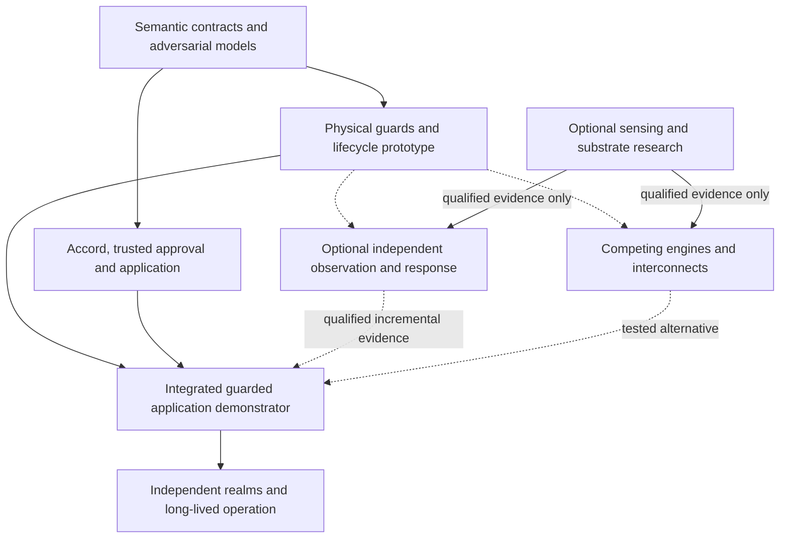

# ASKA v6 — Research program and architectural decisions

## 1. Governing question and evidence boundary

The research program asks whether granular physical ownership, explicit authority, independent observation and useful general computation can be combined at acceptable cost. It does not assume that a promising processor, sensor, AI model or cryptographic primitive already satisfies the integrated contract. Requirements define the target; experiments establish limited facts about named apparatus. A failed hypothesis does not erase the requirement it was intended to support.

The first useful application is deliberately complete: import an adversarial document; parse it in a private lifetime; derive a labeled result; obtain protected human or standing authorization; perform a bounded durable or external effect; observe the relevant boundary; and reconcile its receipt after crash or partition. Every track uses this application so that a faster core, better anomaly detector or improved contract interpreter can be evaluated against actual system consequences.

## 2. Architectural decision register

| Decision | Selected rule or open choice | Rationale and evidence needed to reopen |
|---|---|---|
| D-01: organization | Spatial object islands, with separate appliances for selected high-consequence roots | Makes writable ownership and management reach explicit; reopen only with equivalent physical and authority evidence |
| D-02: execution contract | Private request lifetimes and protected object/effect operations | Gives every consequence a named owner; reopen on a concrete semantic counterexample or simpler equivalent refinement |
| D-03: binary ISA | Unselected: RV64+CHERI, minimal object ISA and spatial/dataflow remain candidates | Toolchain familiarity alone cannot settle external guard, temporal safety and useful-work costs |
| D-04: mutable state | Coherence permitted within one IES; no ambient cross-trust writable sharing | Reopen only if an alternative establishes lifecycle, flow and physical ownership properties including cache and DMA races |
| D-05: topology | Four purpose endpoints plus separate Steles witness; counts remain profile-specific | Purpose is not a connector count or universal clearance order; alternatives must satisfy explicit path requirements |
| D-06: authority | Claim, Contract, Grant and Receipt with independent local admission | Evidence and consent must not become global power; simpler machinery must preserve conflict, compulsion and receiver boundaries |
| D-07: disclosure | Separate source release, exact representation binding, carriage and receiver permission | Prevents an intermediary from accumulating unbounded cross-realm rights; semantic approval remains fallible |
| D-08: trusted interaction | Keystone owns a minimal canonical approval path without universal plaintext access | Reopen only after equivalent intent integrity, accessibility and compromised-renderer evidence |
| D-09: observation | Mandatory inline guards; LSM/MSM observation only for an OOB claim | Monitoring cannot substitute for inline enforcement; evidence must justify each claimed source of visibility |
| D-10: configuration direction | Physically simplex MSM-to-LSM distribution with separate reports | A reverse report link is an explicit second path; replacements must establish directionality and alternate-path resistance |
| D-11: watchers | Finite WM-L and WM-M only in the OOB_NATIVE profile, with a terminating oversight root | Avoids infinite regress while exposing common causes; additional layers require a specific threat and measurable benefit |
| D-12: protective response | Finite templates under standing local grants | Bounds false-alarm damage while permitting rapid response; richer templates require independent safety and authority review |
| D-13: AI roles | Separate user companion, security analysis and synthesis/build agents | No model mints consent, signs its own deployment or modifies its own acceptance oracle |
| D-14: updates | Separate producer, reviewer, signer, distributor and installer with local scope enforcement | Signed defects are an admitted attacker path; consolidate roles only with an explicit weaker assurance declaration |
| D-15: persistence | Durable owners, declared finality, consumption and independent reconciliation | A queued write or emitted payment is not universal success; alternative schemes must handle crash and uncertain external effects |
| D-16: civil authority | Consent, duty, delegation, guardianship and legal compulsion remain distinct | Institutional credentials do not create unavailable keys or universal jurisdiction; changes require explicit profile evaluation |
| D-17: protocols | Select encodings and established primitives only after semantic and cost comparison | Custom novelty is not a reason to invent crypto; interoperability must preserve rejection and finality rules |
| D-18: frontier mechanisms | Optional research branches with falsifiers and no hidden baseline dependency | Density or sensing forecasts cannot certify containment; promote only after reproducible mechanism and integration evidence |

These are current design decisions and open choices. A decision record records proposition, alternatives, assumptions, evidence, responsible reviewers and reopen conditions. A revision must identify affected requirements, models, diagrams, traces and deployments. Renaming a weakened property is not a valid way to close an adverse result.

**Complexity admission rule.** Introduce a trusted service only after recording (1) the forbidden consequence it prevents or detects; (2) the exact path and installer under its control; (3) the shared roots it adds; (4) a lower-complexity alternative; and (5) an adversarial measurement of its incremental value and cost. A protection property that an inline owner already enforces cannot justify a second policy-enforcing coordinator. The evaluation must compare HARDWARE_GUARDED against OOB_PARTIAL/OOB_NATIVE and against a well-defined verified-software reference; this is a controlled comparison, not an assumption that more confinement is better. [Rushby](https://www.csl.sri.com/papers/sosp81/) and [MILS](https://www.inderscience.com/info/inarticle.php?artid=14859) already make small, composable trusted components the baseline of comparison.

**Retirement rule.** Remove an added security tier or specialized board from the selected profile when it yields no independently measured detection/prevention benefit at acceptable failure, power, latency and operational cost. The integration gate also records whether available verified software meets the same specified contract. Proof of software behavior does not discharge physical DMA, debug or reset assumptions; it can eliminate redundant confinement layers when those assumptions and contracts are otherwise met.

## 3. Dependency-ordered work program

The semantic and application tracks can begin on conventional hosts. Physical claims wait for an actual boundary. Sensor or packaging research runs alongside these tracks and cannot block or silently redefine baseline admission. An implementation may use a larger board and ordinary electrical links when advanced integration is unavailable; its cost and environmental assumptions remain explicit.

## 4. Falsifiable hypotheses and decisive experiments

| Hypothesis | Experiment and positive control | Falsifier or stopping rule |
|---|---|---|
| H-01: private lifetimes are practical | Compare the same document/pay workflow using granular cells and a confined baseline; measure latency, trusted code and developer effort | Required useful tasks repeatedly require an unrestricted broker or undeclared shared state |
| H-02: safe borrowing recovers utilization | Mixed burst workloads with delayed DMA, stale caches and repeated reassignment; compare no borrowing | Old-generation access succeeds, sanitization cannot be bounded, or net useful throughput fails the stated target |
| H-03: exact-output binding resists substitution | Mutate source, destination, transform, sequence and labels between approval and emission; authorized unchanged output succeeds | Any substituted consequence crosses finality under the original approval |
| H-04: finite independent observation is useful | Compromise LSM, MSM and watcher separately; inject coverage gaps, false evidence and ordinary benign activity | Claimed visibility depends only on the compromised component or watcher compromise creates new effect power |
| H-05: bounded response improves resilience | Repeated true/false alarms with actuator and resource safety constraints; measure service time and recovery | Cumulative alarms exceed installed scope or cause uncontrolled service collapse |
| H-06: package separation contains signed defects | Correctly sign crashing, permissive and malformed packages for each class; verify clean update succeeds | A package changes a different root or bypasses local admission through distribution |
| H-07: AI-native work remains least-authority | Give planner/retrieval/tool-description control to the attacker; execute a useful multi-step task | Task completion depends on blanket grants or the model can install/sign its own widened policy |
| H-08: approximate/physical sensing adds evidence | Blind trials across memory states, devices, temperatures, noise and hostile stimulus with preregistered metrics | Signal cannot distinguish target events above calibrated controls or leaks unacceptable content |
| H-09: distributed carriage preserves local autonomy | Partition community/regional routes, compromise a relay and reconcile duplicate records | Affiliation or route control confers source/receiver power, or unavailable outcomes are reported as success |
| H-10: long-lived roots remain recoverable | Rehearse custodian loss, key rotation, counter rollback and backup restoration over simulated lifetimes | Recovery revives revoked rights or requires one universally privileged signer |
| H-11: physical provenance aids bounded verification | Test media/MDATS devices against cloning, replay, relocation, environmental drift and adversarial staging | The claimed physical property cannot be reproduced or is misreported as truth of the recorded scene |
| H-12: dense integration preserves isolation | Compare planar, chiplet and candidate stacked implementations including management, cooling and repair | Cost gains require a hidden shared control path or violate thermal/reliability limits |

Numerical thresholds must be declared before measurement and justified by the intended service. A research hypothesis can fail even when a benchmark is faster. Retain failed runs, environmental data, parameter searches and exclusions; otherwise calibration and performance conclusions cannot be assessed independently.

## 5. Gate A: semantics and useful application

Produce executable models for authority, object lifetime, release, replay and persistence, plus schema parsers and canonical intent rendering. Explore crash and reordering schedules, test both permitted and denied effects, and deliberately weaken checks to confirm that the oracles detect failures. [Chapter 56](56_conformance_tests_and_vectors.md) contains a small executed finite model; it does not close this gate for the entire architecture.

A complete gate-A artifact includes a reference interpreter, signed deterministic encoding profile, adversarial application graph, exact positive/negative vectors, an independent source/destination approval case and an uncertain external-outcome case. The interpreter's host is trusted for its memory and physical boundaries. No native physical claim follows. A useful display or successful login alone is insufficient because the target concerns effects after partial compromise.

The LP-1 acceptance dossier must identify the **minimum** guarded apparatus and then measure extra monitors/watchers against it, rather than assuming every tier before the first falsifiable hardware experiment. The owner/guard split, stale-DMA exclusion, debug/reset paths, diode direction and source/receiver contracts remain indispensable physical tests. Cost and availability results use the operator accounting in [Chapter 58](58_performance_cost_power_and_availability.md); evidence from verified software is compared under its own boot, DMA and hardware assumptions.

## 6. Gate B: first physical demonstrator

Build LP-1 in two stages using [Chapter 57](57_reference_realizations_and_legacy_interoperability.md). First qualify the actual guard, separated memories, DMA paths, durable effect counter, typed approval and local owner grant under hostile workload, stale device traffic and a correctly signed defective package. Inspect physical reachability, reset, debug and recovery. Then add separately installed observer/watcher boards and the inspected one-way configuration interface **only for OOB claims**; exercise report saturation, lost sequence evidence, observer compromise and reverse-signaling attempts. Re-run permitted work after every fault. The first stage can close only a HARDWARE_GUARDED claim; the second supplies evidence for its distinct observation proposition.

The gate closes only for the measured properties of that apparatus. Record electrical schematics, board photographs, pin inventory, debug settings, power/clock roots, bitstream/firmware hashes and instrumentation uncertainty. If FPGA configuration can rewrite both guard and exporter, disclose that cut set. A successful optical-link direction test does not establish that the whole system lacks another feedback path.

## 7. Gate C: engine, transport and workload comparison

Compare RV64+CHERI, a minimal object ISA and spatial/dataflow execution using the same external object/effect contract. Establish memory semantics, exception behavior, privileged modes, compiler lowering, debug reach and generation handling. Include sequential control, recursion, interactive tasks and accelerator calls rather than selecting only workloads favorable to one engine.

Compare dedicated circuits, installed channels and per-record grants on identical topology. Measure setup, rotation, per-record overhead, quarantine memory, bad-record cost, receiver work, failure recovery and useful application latency. Include two-sided source/receiver enforcement. A faster overlay cannot be credited with unmeasured cable or facility separation. The winning component may join a heterogeneous machine without becoming the sole system-wide ISA or carrier.

## 8. Gate D: synthesis, packaging and operations

Integrate AESDS/IAMA with isolated build/test and independent install review. Evaluate generated code against protected acceptance oracles, not merely a model's explanation. A predictive model of legacy behavior can propose a decomposition but must state coverage gaps, nondeterminism and environment dependencies. Runtime telemetry for learning requires its own source authority, retention and release policy.

Investigate packaging, memory proximity, optical and unconventional compute with process-specific power, heat, yield, aging, repair and cost measurements. Quantum or passive-memory-sensing claims require physical derivations and independently reproducible apparatus. An inaccessible proprietary algorithm remains an unestablished candidate. No baseline containment claim depends on decoding private RAM contents from a passive sensor or on a forecast of reversible computation.

## 9. Gate E: independent institutions and sustained operation

Operate multiple realms with genuinely separate local admission and recovery custody. Exercise legal disagreement, consent withdrawal, guardian/professional conflicts, external-service failure, compromised institutional administrators and unavailable keys. Include accessibility and user comprehension of canonical approvals. Evaluate whether a year of feature growth recreates a universal broker or security plaintext hub.

Repeat measurements after updates, signer changes, physical maintenance and recovery drills. Independent replication must use recorded methods and disclose deviations. Long-lived operation adds evidence about drift and operational failure; it does not prove unlimited future security. The final outcome may be a useful but narrower realization, with target requirements left unestablished and costs stated plainly.

## Post-quantum and hybrid migration study

The protocol research track must evaluate [FIPS 203 ML-KEM](https://csrc.nist.gov/pubs/fips/203/final) for key encapsulation, [FIPS 204 ML-DSA](https://csrc.nist.gov/pubs/fips/204/final) for lattice-based signatures, and [FIPS 205 SLH-DSA](https://csrc.nist.gov/pubs/fips/205/final) for stateless hash-based signatures. All three were published as final standards on 13 August 2024. The FIPS 203 and 204 publication records carry potential-update errata notices; a deployment must evaluate the actual current corrections before fixing an implementation. No complete algorithm or errata conformance test is claimed here.

The study compares parameter sets, handshake and certificate sizes, sign/verify and encapsulation/decapsulation cost, parser memory, verification-attempt ceilings, protected-key storage, side-channel implementation assumptions, device acceleration and recovery. An algorithm’s standardized status does not certify a particular implementation or provide the source/receiver rights required by Accord. Key establishment and signature authentication remain distinct operations with separate key custody and transcript bindings.

A hybrid policy must state which classical and post-quantum components are required, the reviewed combiner or protocol construction, how both contributions and identities enter the authenticated transcript, and the behavior when either component is unsupported or fails. Merely concatenating secrets or accepting whichever signature verifies is not an established hybrid security argument. No universal suite is selected by this study; a weaker compatibility mode needs explicit local admission and cannot appear through silent negotiation fallback.

Migration covers long-lived identities, stored ciphertext, wrapped object keys, backup copies, device roots, witness checkpoints and historical receipt verification. It separates verification of an old receipt from permission to issue a new effect under an obsolete credential. A deployment identifies data confidentiality lifetime, collection-before-migration exposure, key rotation, rewrapping or re-encryption where feasible, retirement, rollback prevention and behavior during a partition. Recovery must not resurrect a prohibited suite or lost cryptographic usage budget.

**Hypothesis H-13:** a reviewed hybrid or post-quantum profile can preserve the authority, transcript, continuity and resource contracts at acceptable measured cost. The experiment uses independently implemented peers, negative downgrade/substitution fixtures, exhausted verification budgets, key retirement and archived-data recovery, alongside a successful admitted session. A suite confusion, implicit fallback, unbounded verifier cost or resurrected identity defeats the profile. QKD remains a separately qualified physical key-distribution option and does not replace this migration study.

## 10. Scientific and architectural stopping rules

Stop a candidate when its claimed benefit relies on an unmodeled bypass, unbounded resource use, nonreproducible signal or impossible custody assumption. Reopen it when a concrete mechanism addresses the failed condition. Maintain alternatives that satisfy the same contract at higher cost. Do not force every research branch into the product, and do not promote a result from one device, workload or jurisdiction into a universal claim.

External work is compared in [Chapter 62](62_prior_art_sources_and_evidence_register.md) for the proposition it actually establishes. Formal verification of another kernel, successful capability hardware, a sensing experiment or a confidential-computing product informs a specific design choice. ASKA requires its own refinement, physical inspection and integrated application evidence.

## Normative requirements and acceptance obligations

**R-60-01 — Decision discipline.** Each architectural choice MUST record alternatives, assumptions, evidence and an explicit reopening criterion.

**Acceptance T-60-01:** A proposed shortcut is rejected until its affected requirements and equivalent evidence are identified.

**R-60-02 — Falsifiable experiments.** Research claims MUST specify a hypothesis, controls, measurements, falsifier and scope before promotion to established evidence.

**Acceptance T-60-02:** A result without controls or a defeating condition remains unestablished regardless of favorable benchmark output.

**R-60-03 — Complete demonstrators.** Milestones MUST include permitted useful work and adversarial effects across compute, authority, observation and finality.

**Acceptance T-60-03:** A processor-only or networking-only result cannot close the integrated-application gate.

**R-60-04 — No frontier dependency.** Baseline confinement MUST NOT depend on unvalidated sensing, quantum, packaging or AI hypotheses.

**Acceptance T-60-04:** Disable each frontier mechanism; the declared baseline guard rules remain enforceable or the claim is withdrawn.

**R-60-05 — Matched comparisons.** Candidate evaluation MUST use matched contracts, attacker powers and workload costs including setup and lifecycle overhead.

**Acceptance T-60-05:** A throughput comparison omitting required sanitization, copying or guard work fails evidence review.

**R-60-06 — Preserved counterexamples.** Failed runs, counterexamples, exclusions and operational changes MUST remain part of the evidence dossier.

**Acceptance T-60-06:** An assessor can reproduce a retained failure and identify the exact correction and revalidation scope.

**R-60-07 — Post-quantum migration evidence.** The research program MUST evaluate ML-KEM, ML-DSA and SLH-DSA with current standards and errata, a reviewed hybrid policy, explicit downgrade protection, implementation assumptions and long-lived identity/data migration. An algorithm or QKD option MUST NOT be treated as automatically satisfying the complete session or authority contract.

**Acceptance T-60-07:** Evaluate pinned implementations and parameter sets using permitted sessions, downgrade and transcript-substitution failures, key-use exhaustion, retirement and stored-data recovery; publish costs, unimplemented cases and the composition assumptions.
