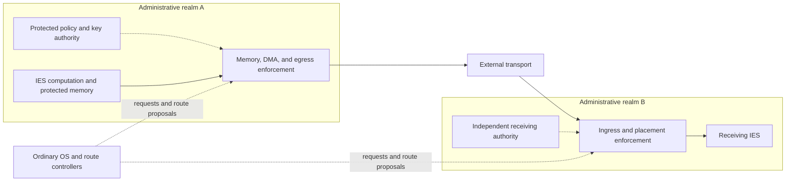

# ASKA 2.0 — Research Architecture

**ASKA 2.0 · 20 October 2026 · Conceptual design and research questions**

ASKA explores a computer architecture in which the boundaries of authority are part of the machine: execution, memory, devices, internal communication, and external networking enforce explicit limits on what each participant may access, disclose, or cause. Its central unit is the **Isolated Execution Stack (IES)**, a proposed hardware-enforced compartment spanning computation and its relevant resources.

The long-term vision includes heterogeneous IES cells, protected on-chip and external fabrics, independently governed receiving systems, and constrained autonomous software. The immediate research question is smaller and concrete:

> Can a system preserve the meaning of an authorization as data moves from protected computation, through memory and devices, into a network message, and into another independently governed machine—even when ordinary operating systems and routing controllers are compromised?

An affirmative answer would require more than an authenticated connection. It would require an account of where authority and data classification originate, how they survive each representation change, and which components remain trusted.

This is an independent architecture investigation. ASKA 2.0 contains **no fabricated silicon, implemented ASKA protocol, measured performance results, or completed security proof**. It claims no new cryptographic primitive or completed ISA. A new ISA remains a research option if the required execution semantics justify one. Existing instruction sets and components are comparison points and possible building blocks.

## The architecture in one view

The diagram hides an essential distinction. Authenticated encryption can protect a message over untrusted transport. Preventing that message from traversing a particular physical port requires enforcement at that port and an accurate account of the topology. These are separate claims, developed separately below.

## Reading the set

| Document | Question it answers |
|---|---|
| [01 — Vision, problem, and threat model](01_vision_problem_and_threat_model.md) | What is ASKA trying to change, and against which adversary? |
| [02 — IES execution and authority](02_ies_execution_and_authority.md) | What makes an IES a security boundary, and where does its authority come from? |
| [03 — The protected handoff](03_protected_handoff.md) | How could a buffer become an authorized message without losing its restrictions? |
| [04 — Network transport and independent realms](04_network_transport_and_realms.md) | What must travel on the wire, what state remains, and what can a receiver independently refuse? |
| [05 — Costs, limits, and unresolved questions](05_costs_limits_and_open_questions.md) | Where can the architecture become too expensive, too restrictive, or incorrect? |
| [06 — Research plan and evidence](06_research_plan_and_evidence.md) | What useful work can be done before hardware, and what would falsify a candidate? |
| [07 — Prior art and sources](07_prior_art_and_sources.md) | Which ideas already exist, and what comparisons remain necessary? |
| [08 — Defensive structural disclosure](08_defensive_structural_disclosure.md) | Which precise structural relationships and alternatives are disclosed for public examination and reuse? |

Read 01–03 for the core argument. Read 05 before deciding whether its costs could be acceptable. Document 06 is a starting point for contributing an analysis, counterexample, or experiment.

Document 08 is an open defensive structural disclosure. It retains 35 numbered, claim-form statements for precision; no patent application is being filed as part of this release. Formal wording does not establish novelty, patentability, or additional technical evidence.

## What ASKA 2.0 commits to

ASKA retains the hardware-first IES direction. An ordinary host kernel is not the final authority over an IES boundary. A routing controller may select permitted routes; it cannot create permission merely by installing a route. A receiving realm retains its own decision. Recovery, debug, and device access must obey explicit boundaries too.

The architecture does **not** yet commit to one core design, a universal label format, a new Internet protocol, or dedicated hardware for every logical process. Those decisions depend on the properties and costs established through research. A small experiment can test an architectural requirement without fixing the final machine around that apparatus.

The first candidate uses coarse compartment labels and a bounded message handoff. This gives the discussion a mechanism to examine. It is not evidence that the full IES vision is feasible, nor a decision to reduce ASKA to a network adapter.

## How to interpret claims

**Existing work** is attributed to sources. **Proposed mechanisms** describe designs to investigate. **Derived examples** show arithmetic under stated assumptions. **Open questions** identify missing decisions or evidence. None of these categories implies a measured ASKA result.

A worthwhile outcome could be a better architecture, a useful component, a precise counterexample, or evidence that an existing system already satisfies the desired contract. The investigation does not depend on being first to imagine isolation, capabilities, hardware messaging, or distributed information-flow control.

The earlier repository, including its original README, is preserved in [ASKA_v1](ASKA_v1/ARCHIVE_NOTICE.md). It is historical material; its patent-portfolio language, performance assertions, and proposed specifications are not evidence of granted patents or validated results. The ASKA 2.0 documents at the repository root describe the current research position.

## License and reuse

The original documentation and diagrams in this repository are licensed under [Creative Commons Attribution 4.0 International](LICENSE), including the historical archive except where separate terms are identified. You may share and adapt this material, including commercially, with attribution and an indication of changes. Third-party quotations, linked publications, and other separately attributed material retain their own terms.

Suggested attribution: **Paul Lowndes and ASKA contributors, ASKA 2.0**, with a link to [this repository](https://github.com/nshkrdotcom/ASKA) and the commit used. This is a copyright license, not a public-domain dedication or a patent license. See [Document 08](08_defensive_structural_disclosure.md) for the defensive-publication intent and its limits.

## Contributing

Useful contributions include concrete counterexamples, missing references, corrected assumptions, and small models or measurements that test a stated property. Cite the relevant document and distinguish a proposal from an observed result. Original documentation contributions are accepted under the repository's CC BY 4.0 license; identify any third-party material and its terms.
