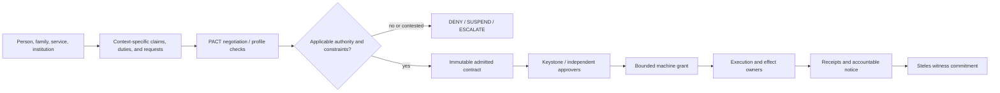
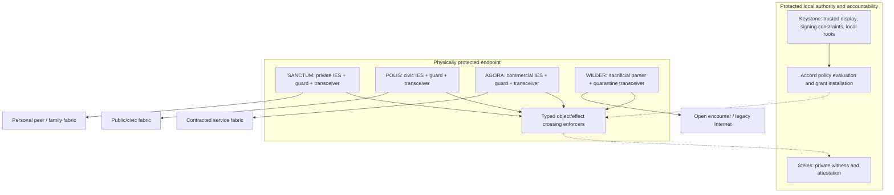
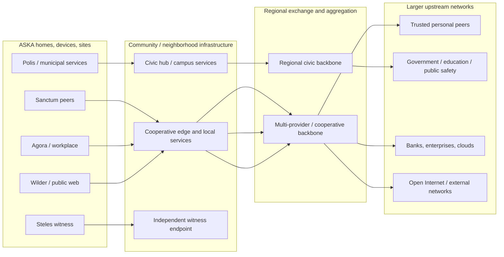

<h1 align="center">ASKA v5</h1>

<strong>Authority-centered computing, sovereign endpoints, and purpose-separated networks</strong>

<em>Formal architecture and protocol specification · 23 October 2026</em>

> **Architecture status:** ASKA v5 specifies a unified target and a testable research program. It is not a claim of a finished implementation, validated high-assurance hardware, legal adjudication by software, or universal immunity to compromise. Normative architectural obligations and open implementation questions are explicitly distinguished in the chapters.

## Executive vision

ASKA treats the computer and the network as a **single system of enforceable authority**, not two independent security appliances. Human intention, private relationships, legal and civic obligations, commerce, open Internet interaction and physical networking are expressed through explicit contracts. Those contracts bind what a particular computer may calculate, read, disclose, transport, store, publish or actuate. The architecture is native to AI-mediated interaction, but **AI never receives universal administrator, issuer or signer status**.

The protocol family is named the **ASKA Accord Suite**. Its foundation is **Claim → Contract → Grant → Receipt**, negotiated by **PACT** (*Protocol for Authority, Consent, and Transactions*) and enforced by independently protected object and effect owners. It complements a **4 + 1** endpoint: four active societal planes—**Sanctum**, **Polis**, **Agora**, **Wilder**—plus **Steles**, an out-of-band witness plane. **Keystone** supplies separately protected local consent, trusted interaction and key-policy anchoring. The four planes are not a hierarchy of who is “more trusted.”

ASKA connects these endpoints through household, campus, neighborhood/cooperative, regional and upstream networks. Those networks may provide local resilience and distributed services, but **path membership alone never authorizes data release**. Where independent physical paths are claimed, real transceiver, FIFO, DMA, switch, management, power and upstream dependencies must support the claim. A high-level topology illustration does not prove physical disjointness.

## The three architectural visions

### Vision I — Society speaks in bounded authority contracts

A claim establishes evidence, not a universal right. An authority contract resolves an **operation-specific** decision under applicable institutional procedures. Local hardware checks the executable grant at final effect points. Receipts expose what was requested, admitted, performed or left uncertain.

### Vision II — A native 4 + 1 endpoint with independent execution

An IES owns a physical execution/memory scope. A cell runs a bounded lifetime; durable effects go through independently owned services. A network/CPU/AI compromise cannot create a foreign object's right merely by changing a pointer, route, descriptor or prompt. Where shared hardware exists, the deployment discloses reduced physical guarantees.

### Vision III — Endpoints form communities, regions, and an upstream Internet

**Topology rule:** shared community or regional switches can be availability, observation or physical common-cause dependencies. A site cannot claim fully disjoint end-to-end carriage unless the installed links, equipment and management satisfy that stronger property. Distinct authority planes still require independently enforced object and effect rights even where a transport segment is shared.

## Core components at a glance

| ASKA component | Purpose | Authority it cannot inherit |
|---|---|---|
| **Sanctum** | Personal, family, medical/professional intimate space | civic or commercial rights by mere proximity |
| **Polis** | Civic identity, duties, notices, elections, lawful process | unrestricted personal or commercial reading |
| **Agora** | Enterprise, employment, contracts, settlement and services | family/identity/civic signing authority |
| **Wilder** | Arbitrary Internet and untrusted content quarantine | protected object writes or unilateral cross-plane export |
| **Steles** | Independent private audit commitments and attestation | universal plaintext observer or policy installer |
| **Keystone** | Protected root for local intent/consent, key custody and recovery | institutional judicial or commercial decision rights |
| **PACT / Accord** | Negotiation and claim-to-contract evaluation | raw execution power before independent grant installation |
| **IES / cells** | Native private compute and memory with bounded lifetimes | other domains' data or output devices without explicit effects |
| **DTG / guarded crossing** | Source-controlled release and independent recipient authorization | ownership of both realms or transparent unrestricted bridging |

## Documentation index

The root contains the complete numbered technical set. Begin with 01–05, then read the protected endpoint and networking chapters 10–20, followed by the institutional, validation, deployment and research chapters.

| Document | Scope |
|---|---|
| [01_system_architecture.md](01_system_architecture.md) | Complete architecture, trust boundaries, system transaction |
| [02_requirements_and_threat_model.md](02_requirements_and_threat_model.md) | Stable R01–R24 and A01–A16 requirements; adversary and observation model |
| [03_authority_calculus_and_conflicts.md](03_authority_calculus_and_conflicts.md) | Conflict-aware authority evaluation, proof graphs, non-expanding delegation |
| [04_accord_objects_and_schemas.md](04_accord_objects_and_schemas.md) | Accord objects, PACT modules, signed data binding and control/data records |
| [05_pact_negotiation_and_states.md](05_pact_negotiation_and_states.md) | Protocol message families, transcript and lifecycle state machine |
| [06_identity_relationships_and_delegation.md](06_identity_relationships_and_delegation.md) | Contextual credentials, care roles, family, professional delegation |
| [07_governance_profiles_and_institutions.md](07_governance_profiles_and_institutions.md) | Jurisdiction, institutional authority, assurance, exceptional access declarations |
| [08_legal_process_and_emergencies.md](08_legal_process_and_emergencies.md) | Scoped legal requests, unavailable data, notice, challenge, emergencies |
| [09_civic_services_and_elections.md](09_civic_services_and_elections.md) | Public services, eligibility, election integration and resilient Polis |
| [10_societal_planes_and_keystone.md](10_societal_planes_and_keystone.md) | Sanctum/Polis/Agora/Wilder/Steles and independent Keystone |
| [11_physical_substrate_and_hardware.md](11_physical_substrate_and_hardware.md) | Physical ownership, chiplets, guards, interfaces and fabric substrate |
| [12_execution_and_instruction_semantics.md](12_execution_and_instruction_semantics.md) | Cells, IES, object operations, instruction research and scheduling |
| [13_memory_ownership_and_lifecycle.md](13_memory_ownership_and_lifecycle.md) | Memory/DMA transfer, freshness, reuse, revocation, reset |
| [14_persistence_and_effects.md](14_persistence_and_effects.md) | Durability, effects, commit and crash semantics |
| [15_authority_and_information_flow.md](15_authority_and_information_flow.md) | Capabilities, confidentiality, integrity and exact-output release |
| [16_native_applications_and_development.md](16_native_applications_and_development.md) | Native app composition, manifests, toolchains and protected APIs |
| [17_ai_environment_and_trusted_interaction.md](17_ai_environment_and_trusted_interaction.md) | AI orchestration without ambient authority; protected approval and display |
| [18_network_fabrics_and_gateways.md](18_network_fabrics_and_gateways.md) | Community topology, physical fabrics, ATNs/STNs and guarded boundaries |
| [19_cross_domain_security_and_release.md](19_cross_domain_security_and_release.md) | Separable source release and recipient effects; media and insider bridges |
| [20_admission_transport_and_protected_delivery.md](20_admission_transport_and_protected_delivery.md) | First contact, bilateral admission, replay, encryption and receive publication |
| [21_steles_witness_and_notice.md](21_steles_witness_and_notice.md) | Private witness commitments, receipts, qualified notice and evidence strength |
| [22_governance_updates_and_recovery.md](22_governance_updates_and_recovery.md) | Scoped administrators, software evolution, independent recovery and root changes |
| [23_compromise_and_failure_cases.md](23_compromise_and_failure_cases.md) | Full-path hostile workloads, insider misuse, management and network failures |
| [24_deployment_reference_designs.md](24_deployment_reference_designs.md) | Home, community, campus, enterprise, civic and industrial configurations |
| [25_validation_and_cost_models.md](25_validation_and_cost_models.md) | Assurance, cost accounting, formal research and physical measurements |
| [26_architectural_tradeoffs_and_decisions.md](26_architectural_tradeoffs_and_decisions.md) | Architecture alternatives, decisions, reopening and implementation tradeoffs |
| [27_conformance_tests_and_vectors.md](27_conformance_tests_and_vectors.md) | T01–T24 adversarial tests, fixtures, coverage and reporting |
| [28_research_program_and_realizations.md](28_research_program_and_realizations.md) | Staged implementation, prototype goals and long-term research |
| [29_traceability_and_conformance.md](29_traceability_and_conformance.md) | Requirements-to-design/evidence map and review requirements |
| [30_sources_and_evidence.md](30_sources_and_evidence.md) | External standards, prior art, and research evidence limits |
| [31_glossary_and_term_registry.md](31_glossary_and_term_registry.md) | Stable vocabulary, protocol names and extension policy |
| [32_end_to_end_transaction_traces.md](32_end_to_end_transaction_traces.md) | Ten worked whole-system transaction and attack scenarios |
| [33_formal_properties_and_model_sketch.md](33_formal_properties_and_model_sketch.md) | State transitions, safety/liveness obligations and refinement |
| [34_interoperability_and_migration.md](34_interoperability_and_migration.md) | Standards interop, legacy isolation and rollout staging |

## Normative interpretation

- **MUST / MUST NOT:** target obligations; conforming implementations provide evidence under a declared threat and physical profile.
- **SHOULD / MAY:** recommendations or profile-specific decisions that cannot override a MUST.
- **Research / hypothesis:** mechanisms or proofs not yet established; a concept is not a measurement.
- **Profile-specific:** applicable institution, jurisdiction, legal procedure, device threat model or cryptographic selection must be explicitly pinned for the operation.

ASKA does not assert that signed legal orders are always just; a legitimate authority's signature does not unlock technically unavailable encrypted data. A cryptographic log does not guarantee public transparency while offline; a data path does not grant permission for release; and a successfully compromised but confined application may still abuse whatever rights were deliberately assigned to it.

## Historical documents

For historical context only, the documentation repositories may be placed beside this root content as [v1](./v1/), [v2](./v2/), [v3](./v3/), and [v4](./v4/). They are not part of this archive, and the specification chapters above are self-contained.
