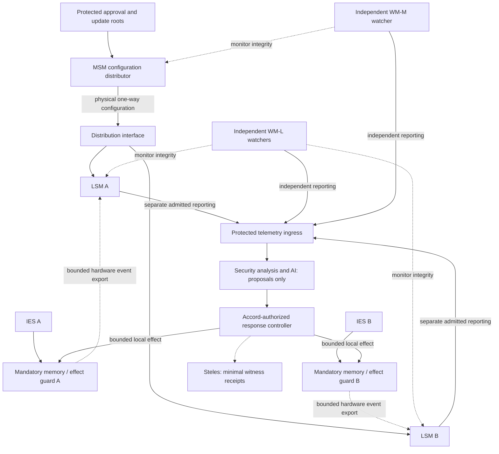
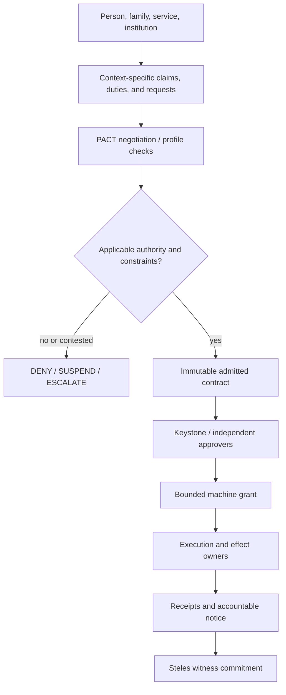
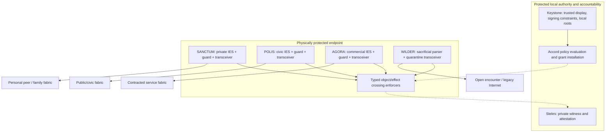
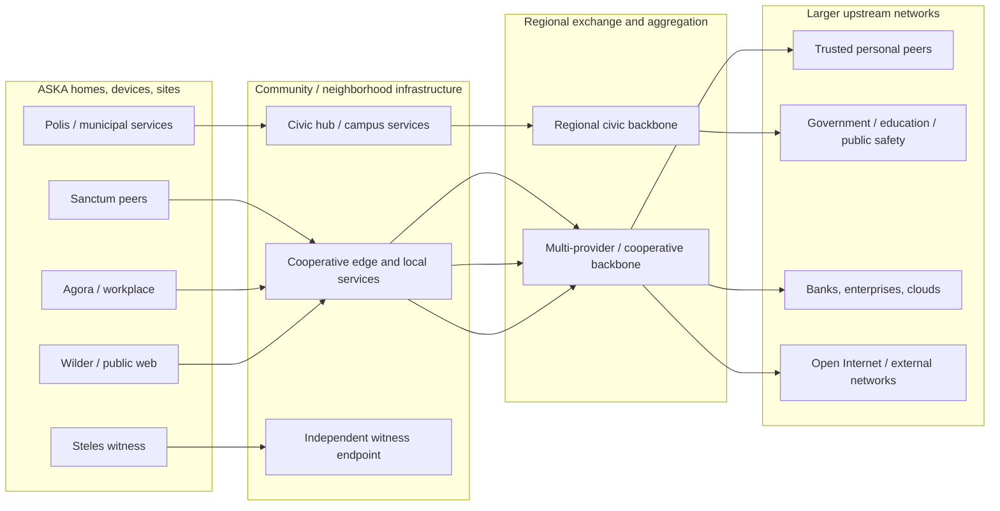

<h1 align="center">ASKA v6</h1>

<strong>Authority-enforcing computing, independent security meshes, sovereign endpoints and purpose-separated networks</strong>

<em>Formal architecture and protocol specification · 4 November 2026</em>

> **Architecture status:** ASKA v6 specifies a unified target and a testable research program. It is not a claim of a finished implementation, validated high-assurance hardware, legal adjudication by software, or universal immunity to compromise. Normative architectural obligations and open implementation questions are explicitly distinguished in the chapters.

## Executive vision

ASKA treats the computer and the network as a **single system of enforceable authority**, not two independent security appliances. Human intention, private relationships, legal and civic obligations, commerce, open Internet interaction and physical networking are expressed through explicit contracts. Those contracts bind what a particular computer may calculate, read, disclose, transport, store, publish or actuate. The architecture is native to AI-mediated interaction, but **AI never receives universal administrator, issuer or signer status**.

Independently rooted security meshes provide observation and bounded response to compromise, while mandatory hardware guards continue enforcing least authority without depending on the correctness of a privileged workload agent. A signed security update is never assumed safe solely because its issuer is valid.

The protocol family is named the **ASKA Accord Suite**. Its foundation is **Claim → Contract → Grant → Receipt**, negotiated by **PACT** (*Protocol for Authority, Consent, and Transactions*) and enforced by independently protected object and effect owners. It complements a **4 + 1** endpoint: four active societal planes—**Sanctum**, **Polis**, **Agora**, **Wilder**—plus **Steles**, an out-of-band witness plane. **Keystone** supplies separately protected local consent, trusted interaction and key-policy anchoring. The four planes are not a hierarchy of who is “more trusted.”

ASKA connects these endpoints through household, campus, neighborhood/cooperative, regional and upstream networks. Those networks may provide local resilience and distributed services, but **path membership alone never authorizes data release**. Where independent physical paths are claimed, real transceiver, FIFO, DMA, switch, management, power and upstream dependencies must support the claim. A high-level topology illustration does not prove physical disjointness.

## The four architectural visions

### Vision I — Security must not depend on the integrity of the system it protects

ASKA treats compromise as an expected condition. Applications, operating systems, privileged endpoint agents, security observers, analyst models, update producers and network administrators may fail. A surviving boundary must continue to constrain what the compromised component can read, disclose or cause. Security is not achieved by placing a universally privileged third-party agent inside a monitored kernel and assuming its updates cannot fail.

The native **independent security-mesh** architecture separates **mandatory guards** from **observers**, **analysis**, **intervention** and **witness evidence**. Local Security Meshes (**LSMs**) observe named hardware and guarded events without executing inside the protected workload; a Master Security Mesh (**MSM**) distributes independently admitted configuration to LSMs over a **physically one-way** connection. Separately rooted watcher meshes (**WM-L**, **WM-M**) oversee local and master security functions. Bounded, independently admitted reporting paths feed a security-analysis service. AI and rule engines propose actions, but protected local effect owners alone apply them after exact-contract and safety checks. **Steles is a witness, not a universal sensor**, and **Keystone is not a security analyst**.

**Three distinct engineering claims:** a hardware guard may sit *inline* with a memory or effect operation; its privilege is nonetheless outside the workload OS. An observer may be *out-of-band* with respect to the workload without being immune to its own firmware or physical-root failures. A passive sensor can only claim visibility for events it can actually observe—external RAM traffic cannot reveal every cache or register operation. The complete system measures missing observations, false alarms, update propagation, useful work retained and independent recovery. No 'compromise-free' component or universally safe update is presumed.

The normative contracts appear in [35](35_independent_security_mesh_architecture.md)–[46](46_security_mesh_assurance_profiles_and_registries.md). They join the Accord, native physical execution, purpose networks and societal governance as part of one architecture, not as a detached monitoring product.

### Vision II — Society speaks in bounded authority contracts

A claim establishes evidence, not a universal right. An authority contract resolves an **operation-specific** decision under applicable institutional procedures. Local hardware checks the executable grant at final effect points. Receipts expose what was requested, admitted, performed or left uncertain.

### Vision III — A native 4 + 1 endpoint with independent execution

An IES owns a physical execution/memory scope. A cell runs a bounded lifetime; durable effects go through independently owned services. A network/CPU/AI compromise cannot create a foreign object's right merely by changing a pointer, route, descriptor or prompt. Where shared hardware exists, the deployment discloses reduced physical guarantees.

### Vision IV — Endpoints form communities, regions, and an upstream Internet

**Topology rule:** shared community or regional switches can be availability, observation or physical common-cause dependencies. A site cannot claim fully disjoint end-to-end carriage unless the installed links, equipment and management satisfy that stronger property. Distinct authority planes still require independently enforced object and effect rights even where a transport segment is shared.

## Core components at a glance

| ASKA component | Purpose | Authority it cannot inherit |
|---|---|---|
| **Sanctum** | Personal, family, medical/professional intimate space | civic or commercial rights by mere proximity |
| **Polis** | Civic identity, duties, notices, elections, lawful process | unrestricted personal or commercial reading |
| **Agora** | Enterprise, employment, contracts, settlement and services | family/identity/civic signing authority |
| **Wilder** | Arbitrary Internet and untrusted content quarantine | protected object writes or unilateral cross-plane export |
| **Steles** | Independent private audit commitments and attestation | universal plaintext observer or policy installer |
| **LSM / MSM** | Protected local observation and independent one-way master configuration distribution | an observed OS privilege or universal policy-install root |
| **WM-L / WM-M** | Independently rooted oversight of local/master security meshes | the watched component's update keys or broad response authority |
| **Security analysis / response owner** | Correlate bounded evidence; independently authorize finite containment methods | AI-generated consent, blanket fleet control or unreviewed firmware deployment |
| **Keystone** | Protected root for local intent/consent, key custody and recovery | institutional judicial or commercial decision rights |
| **PACT / Accord** | Negotiation and claim-to-contract evaluation | raw execution power before independent grant installation |
| **IES / cells** | Native private compute and memory with bounded lifetimes | other domains' data or output devices without explicit effects |
| **DTG / guarded crossing** | Source-controlled release and independent recipient authorization | ownership of both realms or transparent unrestricted bridging |

## Documentation index

The root contains the complete 46-chapter technical specification. Begin with 01–05 and 35–41 for governing authority and independent security boundaries; read 10–20 for the protected endpoint and networking, then the institutional, validation, deployment, operations and research chapters.

| Document | Scope |
|---|---|
| [01_system_architecture.md](01_system_architecture.md) | Complete architecture, trust boundaries, system transaction |
| [02_requirements_and_threat_model.md](02_requirements_and_threat_model.md) | Stable R01–R24 and A01–A16 requirements; adversary and observation model |
| [03_authority_calculus_and_conflicts.md](03_authority_calculus_and_conflicts.md) | Conflict-aware authority evaluation, proof graphs, non-expanding delegation |
| [04_accord_objects_and_schemas.md](04_accord_objects_and_schemas.md) | Accord objects, PACT modules, signed data binding and control/data records |
| [05_pact_negotiation_and_states.md](05_pact_negotiation_and_states.md) | Protocol message families, transcript and lifecycle state machine |
| [06_identity_relationships_and_delegation.md](06_identity_relationships_and_delegation.md) | Contextual credentials, care roles, family, professional delegation |
| [07_governance_profiles_and_institutions.md](07_governance_profiles_and_institutions.md) | Jurisdiction, institutional authority, assurance, exceptional access declarations |
| [08_legal_process_and_emergencies.md](08_legal_process_and_emergencies.md) | Scoped legal requests, unavailable data, notice, challenge, emergencies |
| [09_civic_services_and_elections.md](09_civic_services_and_elections.md) | Public services, eligibility, election integration and resilient Polis |
| [10_societal_planes_and_keystone.md](10_societal_planes_and_keystone.md) | Sanctum/Polis/Agora/Wilder/Steles and independent Keystone |
| [11_physical_substrate_and_hardware.md](11_physical_substrate_and_hardware.md) | Physical ownership, chiplets, guards, interfaces and fabric substrate |
| [12_execution_and_instruction_semantics.md](12_execution_and_instruction_semantics.md) | Cells, IES, object operations, instruction research and scheduling |
| [13_memory_ownership_and_lifecycle.md](13_memory_ownership_and_lifecycle.md) | Memory/DMA transfer, freshness, reuse, revocation, reset |
| [14_persistence_and_effects.md](14_persistence_and_effects.md) | Durability, effects, commit and crash semantics |
| [15_authority_and_information_flow.md](15_authority_and_information_flow.md) | Capabilities, confidentiality, integrity and exact-output release |
| [16_native_applications_and_development.md](16_native_applications_and_development.md) | Native app composition, manifests, toolchains and protected APIs |
| [17_ai_environment_and_trusted_interaction.md](17_ai_environment_and_trusted_interaction.md) | AI orchestration without ambient authority; protected approval and display |
| [18_network_fabrics_and_gateways.md](18_network_fabrics_and_gateways.md) | Community topology, physical fabrics, ATNs/STNs and guarded boundaries |
| [19_cross_domain_security_and_release.md](19_cross_domain_security_and_release.md) | Separable source release and recipient effects; media and insider bridges |
| [20_admission_transport_and_protected_delivery.md](20_admission_transport_and_protected_delivery.md) | First contact, bilateral admission, replay, encryption and receive publication |
| [21_steles_witness_and_notice.md](21_steles_witness_and_notice.md) | Private witness commitments, receipts, qualified notice and evidence strength |
| [22_governance_updates_and_recovery.md](22_governance_updates_and_recovery.md) | Scoped administrators, software evolution, independent recovery and root changes |
| [23_compromise_and_failure_cases.md](23_compromise_and_failure_cases.md) | Full-path hostile workloads, insider misuse, management and network failures |
| [24_deployment_reference_designs.md](24_deployment_reference_designs.md) | Home, community, campus, enterprise, civic and industrial configurations |
| [25_validation_and_cost_models.md](25_validation_and_cost_models.md) | Assurance, cost accounting, formal research and physical measurements |
| [26_architectural_tradeoffs_and_decisions.md](26_architectural_tradeoffs_and_decisions.md) | Architecture alternatives, decisions, reopening and implementation tradeoffs |
| [27_conformance_tests_and_vectors.md](27_conformance_tests_and_vectors.md) | T01–T24 adversarial tests, fixtures, coverage and reporting |
| [28_research_program_and_realizations.md](28_research_program_and_realizations.md) | Staged implementation, prototype goals and long-term research |
| [29_traceability_and_conformance.md](29_traceability_and_conformance.md) | Requirements-to-design/evidence map and review requirements |
| [30_sources_and_evidence.md](30_sources_and_evidence.md) | External standards, prior art, and research evidence limits |
| [31_glossary_and_term_registry.md](31_glossary_and_term_registry.md) | Stable vocabulary, protocol names and extension policy |
| [32_end_to_end_transaction_traces.md](32_end_to_end_transaction_traces.md) | Ten worked whole-system transaction and attack scenarios |
| [33_formal_properties_and_model_sketch.md](33_formal_properties_and_model_sketch.md) | State transitions, safety/liveness obligations and refinement |
| [34_interoperability_and_migration.md](34_interoperability_and_migration.md) | Standards interop, legacy isolation and rollout staging |
| [35_independent_security_mesh_architecture.md](35_independent_security_mesh_architecture.md) | Security-mesh separation; LSM/MSM, one-way distribution, watchers and response domains |
| [36_passive_hardware_observation_and_provenance.md](36_passive_hardware_observation_and_provenance.md) | Passive sensing, RAM/SSD limitations, provenance, loss and sensor privacy |
| [37_watcher_independence_and_meta_monitoring.md](37_watcher_independence_and_meta_monitoring.md) | Who watches the watchers: WM-L, WM-M, trust cut sets and oversight |
| [38_security_analysis_ai_and_signal_quality.md](38_security_analysis_ai_and_signal_quality.md) | Security AI, multi-agent detection, false-alarm filtering and legacy comparison |
| [39_response_containment_and_recovery_contract.md](39_response_containment_and_recovery_contract.md) | Bounded containment templates, protected effect owners and incident lifecycle |
| [40_update_supply_chain_and_evolution.md](40_update_supply_chain_and_evolution.md) | Security software evolution, supply-chain independence and staged update safety |
| [41_security_mesh_physical_fabrics.md](41_security_mesh_physical_fabrics.md) | Physical one-way distribution, separate telemetry and security fabric topology |
| [42_secure_storage_and_cryptographic_services.md](42_secure_storage_and_cryptographic_services.md) | Protected storage, key roles, evidence, media provenance and privacy |
| [43_security_mesh_formal_model_and_test_vectors.md](43_security_mesh_formal_model_and_test_vectors.md) | R25–R40 properties, T25–T40 adversarial tests and illustrative fixtures |
| [44_operational_profiles_and_incident_walkthroughs.md](44_operational_profiles_and_incident_walkthroughs.md) | End-to-end incident scenarios, hostile observers and recoverable service |
| [45_research_frontier_and_independent_validation.md](45_research_frontier_and_independent_validation.md) | Long-horizon hardware/sensor research and independent comparison evidence |
| [46_security_mesh_assurance_profiles_and_registries.md](46_security_mesh_assurance_profiles_and_registries.md) | Assurance levels, event/effect registries and deployed trust declarations |

## Normative interpretation

- **MUST / MUST NOT:** target obligations; conforming implementations provide evidence under a declared threat and physical profile.
- **SHOULD / MAY:** recommendations or profile-specific decisions that cannot override a MUST.
- **Research / hypothesis:** mechanisms or proofs not yet established; a concept is not a measurement.
- **Profile-specific:** applicable institution, jurisdiction, legal procedure, device threat model or cryptographic selection must be explicitly pinned for the operation.

Independent out-of-band observation is a scoped hardware/authority property, not a claim that sensors are all-seeing or fail-proof. Privileged signed updates remain a modeled failure source; signed provenance, model confidence and even multiple nominally independent observers do not themselves prove safety.

ASKA does not assert that signed legal orders are always just; a legitimate authority's signature does not unlock technically unavailable encrypted data. A cryptographic log does not guarantee public transparency while offline; a data path does not grant permission for release; and a successfully compromised but confined application may still abuse whatever rights were deliberately assigned to it.
