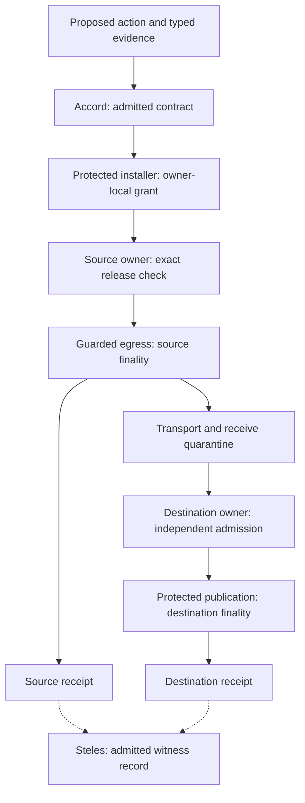
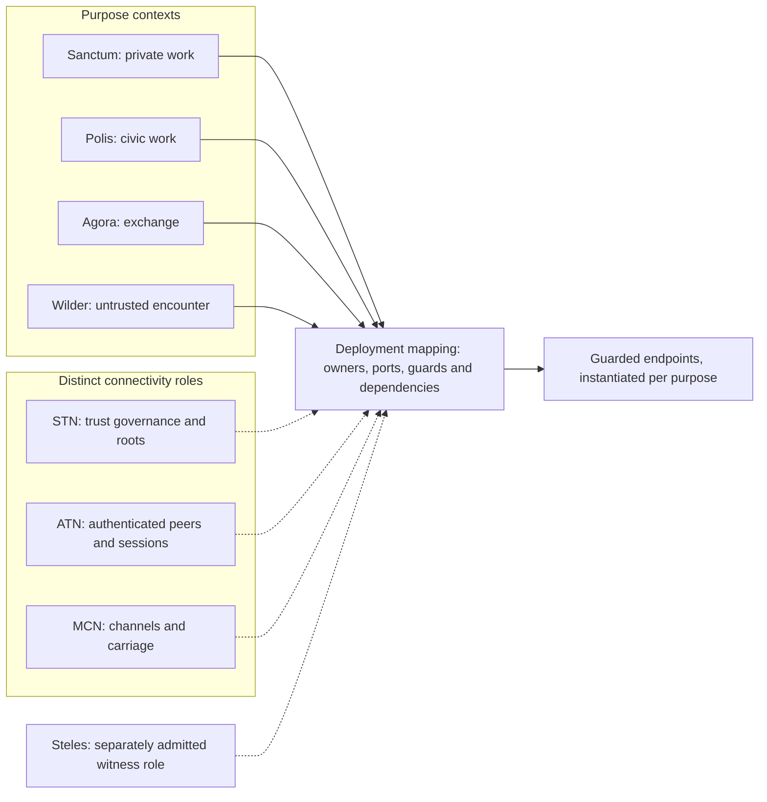

# ASKA v6 — System specification

ASKA is a proposed architecture for physically scoped computing, purpose-aware networking and enforceable authorization of consequences. The documentation specifies target behavior, security assumptions, test oracles and unresolved engineering choices. It is not a claim of manufactured hardware, completed formal verification or certified operation.

An **isolated execution stack (IES)** owns an assigned physical compute and writable-resource domain. A **cell** is an execution lifetime within that domain. Guards mediate memory, DMA, object transfer, release and effect paths. Accord derives **CLAIM → CONTRACT → GRANT → RECEIPT**: claims supply evidence, contracts describe admitted terms, grants install owner-local rights, and receipts record a named finality point. Source release and receiver admission are separately checked. Observation, watchers and response owners supply distinct prevention, detection and response properties; their trust roots and visibility limits must be assessed separately.

The architecture does not assume that verified code is benevolent. Incorrect specifications, malicious signers, compromised build pipelines, hostile authorized actors and physical bypasses remain within the defined analysis. Research options and illustrative cost figures do not establish implementation feasibility. The finite semantic exercises in the conformance chapter are not hardware-test results.

## System views

### Cross-purpose transfer: separate authority and finality

This view follows one cross-purpose transfer. Accord evaluates claims and the applicable contract, but an admitted decision creates usable authority only after a protected installer accepts a grant for its own resources. The source owner then checks the live grant, source version, permitted representation, recipient, labels and budget at the release boundary. The derivation and enforcement rules are specified in [authority calculus](06_authority_calculus_and_nonexpansion.md), [information flow](07_information_flow_and_release.md) and [Accord admission](27_accord_system_and_machine_authorization.md).

The transport path carries an authorized representation; it supplies no further permission. Received content remains quarantined until the destination verifies its own admission conditions and publishes the object. A source release can succeed even if the destination subsequently rejects the transfer. [Purpose boundaries](34_purpose_planes_and_network_roles.md), [gateway crossings](36_dynamic_trust_gateways_and_crossings.md) and [record admission](38_packet_records_delivery_and_egress.md) specify those checks. The two receipts identify different finality points, not a single end-to-end success. Steles may receive a permitted commitment to either event without acquiring the underlying content or authority over either owner; see [effect reconciliation](17_transactions_effects_and_reconciliation.md) and [witnessing](40_witnesses_media_provenance_and_notice.md). The arrows identify logical decisions, not a shared implementation service or a prescribed network route.

### Purpose domains and network roles

Sanctum, Polis, Agora and Wilder identify the purpose and governing conditions of work; they are neither security clearance levels nor a fixed physical connector count. Steles has a separate, scoped witnessing role. A deployment maps each purpose to actual execution resources, ingress and egress guards, data owners and shared dependencies. The box labeled *deployment mapping* represents that inventory, not a central machine with authority over every purpose. See [reference-machine reachability](04_reference_machine_and_reachability.md), [purpose boundaries and network roles](34_purpose_planes_and_network_roles.md) and [assurance dependencies](03_assurance_trust_and_failure_domains.md).

STN addresses governance and trust roots; ATN concerns authenticated connectivity; MCN describes channel use. The dotted lines mark dependencies that a deployment may use, not authority delegated by the network. A valid peer session or route therefore gives no right to bridge purpose domains, disclose data or install a grant. The [physical transit](35_physical_transit_topology_and_routing.md), [session admission](37_admission_identity_and_sessions.md) and [system-wide release](39_system_wide_release_and_output_channels.md) chapters specify the distinct checks. Native first-contact traffic also requires its own encounter buffers, parser resources and DMA path, separate from established-session resources; [Chapter 34](34_purpose_planes_and_network_roles.md) defines that boundary. The diagram summarizes roles; physical wiring and interface counts remain in [Chapter 04](04_reference_machine_and_reachability.md).

## Document map

### Machine, authority and resource boundaries

- [01 — System architecture](01_system_architecture.md)
- [02 — Requirements and threat model](02_requirements_and_threat_model.md)
- [03 — Assurance, trust and failure domains](03_assurance_trust_and_failure_domains.md)
- [04 — Reference machine and reachability](04_reference_machine_and_reachability.md)
- [05 — Unified execution, data and effect contract](05_unified_execution_data_and_effect_contract.md)
- [06 — Authority calculus and non-expansion](06_authority_calculus_and_nonexpansion.md)
- [07 — Information flow and release](07_information_flow_and_release.md)
- [08 — Terminology and specification conventions](08_terminology_and_specification_conventions.md)
- [09 — IES, cells, resources and scheduling](09_ies_cells_resources_and_scheduling.md)
- [10 — Processor ISA and execution semantics](10_processor_isa_and_execution_semantics.md)
- [11 — Heterogeneous compute, chiplets and packaging](11_heterogeneous_compute_chiplets_and_packaging.md)
- [12 — Memory, cache and revocation](12_memory_cache_and_revocation.md)
- [13 — DMA, devices and accelerators](13_dma_devices_and_accelerators.md)
- [14 — DMNoC and internal communications](14_dmnoc_and_internal_communications.md)
- [15 — Object mailboxes and handoff](15_object_mailboxes_and_handoff.md)
- [16 — Persistent objects and storage recovery](16_persistent_objects_and_storage_recovery.md)
- [17 — Transactions, effects and reconciliation](17_transactions_effects_and_reconciliation.md)
- [18 — Physical side channels and temporal protection](18_physical_side_channels_and_temporal_protection.md)

### Observation, response and controlled evolution

- [19 — Security observation, mesh roles and sensor coverage](19_security_observation_and_local_meshes.md)
- [20 — Independent watchers and meta-monitoring](20_independent_watchers_and_meta_monitoring.md)
- [21 — Security fabrics, one-way links and event provenance](21_security_fabrics_telemetry_and_provenance.md)
- [22 — Security analysis AI and false-alarm control](22_security_analysis_ai_and_false_alarm_control.md)
- [23 — Protective response and containment](23_protective_response_and_containment.md)
- [24 — Software updates, generated artifacts and supply-chain safety](24_software_update_generation_and_supply_chain.md)
- [25 — Monitoring privacy and observation authority](25_monitoring_privacy_and_observation_authority.md)
- [26 — Boot, key custody, recovery and continuity](26_boot_key_custody_recovery_and_continuity.md)

### Contracts, people, software and agents

- [27 — Accord system and machine authorization](27_accord_system_and_machine_authorization.md)
- [28 — Authority schemas and PACT state machines](28_authority_schemas_and_pact_protocol.md)
- [29 — Identity, relationships, delegation and revocation](29_identity_relationships_delegation_and_revocation.md)
- [30 — Governance profiles, conflicts and institutions](30_governance_profiles_conflicts_and_institutions.md)
- [31 — Keystone and trusted user interaction](31_keystone_trusted_user_interaction.md)
- [32 — AI environment, delegated agents and effect approval](32_ai_environment_agents_and_effect_approval.md)
- [33 — Native applications, toolchains and interoperability](33_native_apps_toolchains_and_interoperability.md)

### Purpose networks and output

- [34 — Purpose planes and network roles](34_purpose_planes_and_network_roles.md)
- [35 — Physical transit topology and routing](35_physical_transit_topology_and_routing.md)
- [36 — Dynamic trust gateways and crossings](36_dynamic_trust_gateways_and_crossings.md)
- [37 — Admission, identity and sessions](37_admission_identity_and_sessions.md)
- [38 — Packet records, delivery and egress](38_packet_records_delivery_and_egress.md)
- [39 — System-wide release and output channels](39_system_wide_release_and_output_channels.md)

### Evidence and institutional profiles

- [40 — Witnessing, notice and media provenance](40_witnesses_media_provenance_and_notice.md)
- [41 — Legal process, rights and emergencies](41_legal_process_rights_and_emergencies.md)
- [42 — Civic services, elections and community governance](42_civic_services_elections_and_community_governance.md)
- [43 — Family, care, professional and personal authority](43_family_care_professional_and_personal_authority.md)
- [44 — Commerce, enterprise and institutional workflows](44_commerce_enterprise_and_institutional_workflows.md)

### Tests, assurance and research

- [45 — End-to-end traces and incident walkthroughs](45_end_to_end_traces_and_incident_walkthroughs.md)
- [46 — Formal properties and state models](46_formal_properties_and_state_models.md)
- [47 — Conformance tests and vectors](47_conformance_tests_and_vectors.md)
- [48 — Reference realizations and legacy interoperability](48_reference_realizations_and_legacy_interoperability.md)
- [49 — Performance, cost, power and availability](49_performance_cost_power_and_availability.md)
- [50 — Assurance claims, profiles and manifests](50_assurance_claims_profiles_and_manifests.md)
- [51 — Research program and candidate substrates](51_research_program_and_candidate_substrates.md)
- [52 — Prior art, sources and evidence register](52_prior_art_sources_and_evidence_register.md)

## Interpretation and qualification

- `MUST`, `SHOULD` and `MAY` are normative only as defined in the terminology chapter. A requirement identifier names a target obligation, not a completed result. Tests and fixtures become evidence only when a specified apparatus is executed and the observations are retained.
- **COMMITTED** establishes the operation's declared finality point, and no more; external delivery and real-world effects require their own evidence. **UNCERTAIN** remains unresolved until reconciliation supplies that evidence.
- Independence claims are relative to named physical, administrative, firmware, power, key and maintenance dependencies. A signature, duplicated log or separate software process is not proof of independent origin.
- Each deployment profile identifies the actual enforcers, access paths, trust roots, applicable requirements, service assumptions, negative controls, and qualified evidence status. The research plan records decisions still needed to construct an implementation.

The prior-art register provides primary publications, source-access limits and comparisons to proposed ASKA obligations. It does not assert novelty or transfer external proofs to ASKA.
