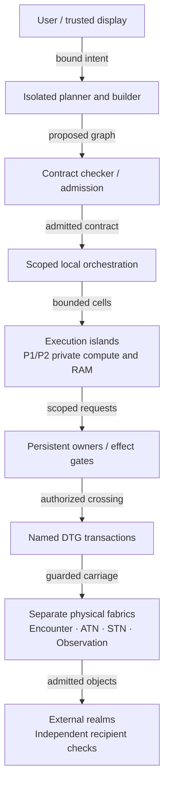

# ASKA 4.0 — Research Architecture

ASKA proposes a computer that confines a compromised parser, renderer, or AI planner to its assigned compute, private memory, and explicitly granted effects. Cells exchange objects through guards; separate owners commit durable state and device operations; physically distinct networks carry different purposes. The goal is to keep those boundaries effective even when an attacker controls every instruction inside a cell.

**Status: unvalidated research architecture. Baseline cutoff: 22 October 2026.** Start with [01 — Architecture and reading map](01_architecture_and_reading_map.md).

## The problem

A parser exploit becomes a system compromise when the parser can reach more than its task requires. In conventional environments, inherited credentials, global filesystem names, ambient syscalls, and broadly privileged helpers can turn arbitrary instruction control into storage, network, or administrative access. A monolithic kernel or hypervisor can concentrate the authority over otherwise separate workloads in one failure domain.

Logical protection also leaves physical dependencies. Mutually distrusting workloads may share coherent memory, caches, controllers, and scheduling machinery. VLANs and overlays may depend on the same switch tables, ports, and administrator. Giving an AI planner broad execution credentials adds another route from hostile input to privileged effects: retrieved text can influence the component that holds the credentials.

Prevention still matters. Memory safety and input validation reduce exposure. ASKA asks a separate question: **after prevention fails completely, which memory transactions, disclosures, and external effects can the attacker still cause?** Physical ownership removes foreign memory paths; mandatory guards check the remaining interfaces. These protections depend on the guards and roots that enforce them. A failed guard is a separate failure case, not something the architecture assumes away.

## Core operating principles

- **Own physical resources.** Assign each cross-trust execution domain exclusive cores or engines, private writable memory banks, and guarded endpoints for its admitted lifetime. Shared cache/MMU protection alone does not meet that requirement.
- **Mediate every consequential crossing.** Admit immutable object versions and scoped operation handles under explicit contracts. Reading, computing, storing, disclosing, transporting, and receiving are distinct rights. Preserve restrictions through copying, rendering, compilation, encryption, logging, and accelerator work.
- **Check authority where the effect becomes irreversible.** The recipient checks the current method grant, object and endpoint generations, stable inputs, policy, and charged resources at commit. Source release controls separately bind any approved disclosure to its exact output or verified output contract. Authentication and network membership supply no missing permission.

These rules apply to displays, printing, removable media, backup, debug, management, and recovery as well as ordinary memory and network paths. A boundary that ignores one of those paths leaves an escape route.

## Architectural flow



The diagram follows a task toward an external effect. Each arrow denotes a separately mediated interface, not unrestricted access. It does not connect the four fabrics to one another or require local storage operations to traverse a gateway. Trusted interaction binds approval to an immutable proposal; planners cannot modify that binding. Independent realm authorities govern these stages within their own scopes, and local orchestrators allocate only delegated resources.

## System architecture in five parts

### 1. Ephemeral execution islands: compute and memory

**Decision D01 selects Candidate A, the spatial object machine.** An **Isolated Execution Stack (IES)** owns a physical resource set, a lifecycle generation, a confinement policy, and explicit communication edges. A **cell** is an execution lifetime inside that IES. A **realm** owns resources and policy under its own authorities. Belonging to the same application grants cells no implicit access to one another.

An island owns its execution engines, writable RAM banks, local cache/scratchpad, and submission endpoints. Distrusting islands have no foreign memory addressing path and no shared coherent writable address space. Local coherence within one owner is permitted. External memory needs a dedicated controller/bank path or a protected service that transfers objects; any shared controller remains a declared timing and failure dependency.

[04 — Physical substrate](04_physical_substrate_and_frontier.md) defines four profiles:

| Profile | Boundary and limits |
|---|---|
| **P0 — Shared logical** | Hardware access checks on shared cores, caches, or controllers. Useful for comparisons and intermediate builds; does **not** meet native physical ownership. |
| **P1 — Spatial island** | Exclusive execution engine, private writable memory, and guarded endpoints. Minimum native cross-trust profile; package utilities may remain shared. |
| **P2 — Independent root domain** | Separate physical enforcement, boot/update authority, keys, and management, with shared facilities disclosed. Used for sovereign policy, recovery, and high-consequence owners. |
| **P3 — Controlled physical environment** | P2 plus specified enclosure, probing/fault assumptions, physical controls, and tested leakage limits. P2 alone does not establish P3. |

These are resource and threat profiles, not certification levels. Separate chips can still share a vulnerable updater, reset controller, supplier, or power supply. Every boundary needs an inventory of buses, wires, DMA, debug, reset, clock domains, voltage, thermal coupling, boot storage, management, and observation paths.

Cells exchange explicit immutable objects through guarded message mailboxes or use an exclusive ownership transfer. A coherent snapshot excludes writers and drains outstanding accesses before copying; an immutable loan retains lifetime references until readers retire. No worker receives ambient OS authority: there is no global POSIX filesystem, global memory address space, universal syscall interface, or inherited root credential. Scoped names, libraries, interactive tools, existing algorithms, and long-running services remain possible when they expose only explicit rights. Native operation requires neither Linux nor a global IP address space.

Protected admission installs finite memory, execution, queue, time, and output limits. Local references need bounds, provenance, and liveness checks or an accepted compiler/verifier argument. Whole-cell reset alone does not establish temporal memory safety. Guards also constrain a malicious engine that issues arbitrary bus transactions or DMA requests.

Before reuse, the controller stops new work, drains CPU and device transactions, retires references, sanitizes registers, scratchpad, caches, queues, and retained plaintext, then activates a fresh generation. Old handles and delayed completions retain their original identity; they cannot acquire the next occupant's authority. Uncertain completion leaves the resource quarantined. Incrementing a generation does not erase memory.

The execution contract permits conventional capability cores, new object instructions, and spatial/dataflow engines. Candidate D, independent appliances, supplies stronger physical boundaries for sovereign functions; Candidate C can implement an engine inside A. Candidate B, a shared coherent capability machine, remains a useful comparison but does not satisfy P1 merely by proving stronger logical access checks.

### 2. Dedicated persistent state services: storage and effects

Long-lived state belongs to explicit persistent object owners. A runtime heap or globally traversable file path does not define durable authority. Owners expose narrow methods such as `read_version` and `replace_document_if_version`; each method checks its own grant, parameters, version, policy, confinement, lifetime, and resource cost.

Request parsing and candidate computation run in fresh confined cells with private scratch memory. A separate commit controller owns durable versions, journals, deduplication records, and protected policy metadata. Workers submit sealed proposals; they receive no raw storage queue and cannot pass an arbitrary pointer off as durable state. Owners split by consequence and tenancy, with P2 boundaries where required. A service that decrypts several compartments inherits their combined confinement.

[07 — Persistence and effects](07_persistence_and_effects.md) separates preparation from durable commit:

```text
PROPOSED -> VALIDATED -> PREPARED -> COMMITTED -> RECEIPTED
```

In this two-phase prepare/commit structure, validation checks the candidate and reserves resources without publishing it. At commit, the controller serializes conflicting writes, policy changes, deduplication, and allowance consumption; it rechecks policy and affected generations in that order. It then records the version, outcome, and recovery metadata under a declared storage guarantee before publishing visibility. A receipt binds the operation identifier, request commitment, resulting version, outcome, and durability class. Identical retries return the recorded result; changed parameters under the same identifier fail.

This sequence is not a universal distributed consensus protocol. Implementations must specify journal atomicity, flush ordering, durability domains, replication assumptions, and crash recovery. A hash chain does not make a write durable. If recovery cannot determine the outcome, it reports uncertainty and blocks unsafe replay. Restoring an old snapshot must not revive old authority or consumed operations.

Physical and external effects need their own commit rules. Printing, payment settlement, actuator movement, and external network frames require independent recipient authority checks at the irreversible effect point. Device owners expose constrained methods, not raw command queues. Printing binds the immutable rendered job, printer, copy count, labels, and output policy.

A device may act and lose its acknowledgment before the local journal records success. Its service therefore needs idempotent commands, durable device-side deduplication, explicit prepare/commit support, or an uncertain-outcome protocol with reconciliation. There is no generic exactly-once guarantee. Aborting a cell cannot undo a payment, recall an emitted secret, or unprint a page.

Commit checks also do not prove application semantics: a malicious worker can propose an incorrect result within its valid rights. The accepted transition implementation or a checked input/output relation must establish correctness. The commit controller's decoder, drivers, allocator, recovery code, and update root retain their own proof and testing obligations.

### 3. Physical purpose networks and gateways: carriage

[11 — Purpose networks](11_purpose_networks_and_gateways.md) assigns distinct physical facilities to purposes that require separation:

| Fabric | Work it carries |
|---|---|
| **Encounter** | Untrusted first contact, discovery, enrollment, and hostile imports through dedicated ports, parser lanes, ingress FIFOs, buffer banks, and DMA paths. |
| **ATN — Authenticated Trust Network** | Scoped application and collaboration traffic among admitted, known peers, subject to independent receiving policy. |
| **STN — Sovereign Trust Network** | Out-of-band management, identity, key custody, policy, and recovery on separately rooted equipment and paths. No general application traffic. |
| **Observation** | Bounded audit and health telemetry over one-way or guarded export interfaces. Classified logs remain protected objects. |

ATNs and STNs belong to realms or federations; neither names a worldwide trusted network. Their endpoints and controllers may be malicious. Established traffic must not traverse an encounter FIFO or depend on its free-buffer pool. Downstream shared controllers, cryptographic engines, power, clocks, cooling, and reset still need explicit service bounds or a reported unmet requirement.

VLANs, tunnels, different queues in one switch, and wavelengths on a common fiber do not constitute separate physical facilities. An IP overlay can test endpoint checks and ciphertext integrity, but cannot establish cable geography or native purpose separation. Route proposals select among authorized paths; workload destination fields cannot select an unauthorized physical network. Copyable tokens do not enforce exact use limits without protected accounting. Finite queues cannot absorb sustained overload.

A **Dynamic Trust Gateway (DTG)** terminates both protocols and creates a new, named transaction. It confines ingress parsing, checks release/effect authority, and constructs the authorized egress operation. It never acts as a transparent router or unrestricted bridge. High-consequence crossings require independently controlled enforcement on both sides; one DTG cannot hold unrestricted policy authority over both realms.

[12 — Cross-domain security](12_cross_domain_security_and_information_release.md) separates semantic release approval, exact-output enforcement, carriage, receiver publication, and application effects. The source enforcer binds approved bytes, metadata, destination, representation, lifetime, and cumulative allowance through emission. The destination checks its own current policy. Those local commits do not assume a simultaneous policy snapshot across partitioned realms.

Adding a cable or rogue switch changes reachability, not authority, provided traffic still crosses the mandatory guards. Tapping plaintext after the last guard changes the physical assumptions. Import and response paths need separate contracts; a compromised import transformer must not inherit response plaintext or export rights. A diode limits direction only: it can still carry secrets or hostile input in that direction.

Exact-output enforcement stops substitution after approval. It cannot prove an arbitrary report safe when the semantic approver is malicious. Read access does not authorize export, encryption does not remove source restrictions, and revocation cannot make a recipient forget information already disclosed. Timing, errors, traffic shape, repeated queries, and human perception require explicit observation profiles and limits. Physical separation alone does not eliminate leakage.

### 4. AI operating layer: intent and synthesis without authority

AI is native to user interaction, permitted context retrieval, intent interpretation, task graphing, code synthesis, and orchestration. [10 — AI environment and trusted interaction](10_ai_environment_and_trusted_interaction.md) places planners and builders in confined domains. They propose work. They have **zero ambient authority** to mint permissions, broaden policy, bypass user intent, or approve their own deployments.

The planner submits an immutable task graph. A contract checker checks schemas, provenance, confinement, effect scope, finite budgets, lifetimes, and physical placement against existing grants. Local orchestrators install only admitted descriptors. A bounded standing grant can authorize routine work; the model cannot infer new consent from a vague instruction or retrieved text.

For effects requiring approval, trusted input routing and a protected display surface bind the user's decision to canonical parameters, destination, object/version, bounds, expiration, proposal commitment, and policy version. Application pixels cannot cover the approval region. Complex renderers run in fresh cells; a separate display enforcer checks surface generation, backing extent, dimensions, arithmetic, placement, and layer rights at presentation. It constrains a fully compromised renderer. The trusted input hardware and presentation controller remain explicit dependencies, and a valid image can still deceive a person.

Context owners provide only admitted views. Summaries, plans, embeddings, generated code, and errors inherit their sources' restrictions. Private inference state, accelerator memory, KV caches, and adaptation follow the ownership lifecycle; confidential sessions cannot silently update shared weights or indexes. Sending context to a public model API requires disclosure permission.

A builder produces an artifact digest, dependency manifest, effect contract, provenance, test results, and any checkable certificates. The checker verifies certificates under its accepted proof system; a model's claim that a proof passed carries no weight. An independent deployment role authorizes the artifact. Runtime confinement still applies after admission.

Prompt sanitization does not prove freedom from injection. The acceptance test starts with the planner already under attacker control. Deterministic revoke, stop, and recovery paths must remain available when the AI fails or becomes malicious.

### 5. Split governance and trust roots: administration

[14 — Governance, updates, and recovery](14_governance_updates_and_recovery.md) separates the resource allocator, application signer, policy administrator, gate updater, recovery custodian, and observer/response service. An allocator can reassign specified engines and banks; that right does not let it read private objects. A signer can attest an application artifact; that right does not let it install guard firmware or approve a user effect.

Protected installation interfaces enforce these scopes. Different accounts behind one omnipotent daemon do not provide independent authority. ASKA rejects a universal single-pane-of-glass administrator or fleet-wide master key spanning supposedly independent realms. A local ultimate root may control its own boundary, but a cross-root change requires each affected root's approval. Emergency recovery creates no universal decryption or export bypass.

Each independence claim records actual key custodians, enforcement implementations, compilers, build/release pipelines, update and recovery roots, suppliers, power, clocks, reset, debug, packaging, and network facilities. Two keys under one installer, or two guards sharing the same defective verifier, can fail together. Separate physical trust roots help only to the extent that those dependencies support the claim.

Updates bind artifact digests, target roles, contract revisions, evidence, and recovery procedures. Reusing a package name grants no additional rights. Rollback cannot rewind consumed operations, nonce state, or committed versions. Recovery starts with affected paths closed and establishes fresh generations wherever continuity is uncertain; unaffected domains continue only within their reserved resources and authority.

## Project status: what ASKA is and is not

**ASKA is a research specification, not off-the-shelf software.** As of the baseline cutoff, the project claims no complete working ASKA hardware, production silicon, finished ASIC, complete protocol implementation, measured whole-system performance result, or verified whole-system proof. The complete architecture remains unvalidated.

The documents distinguish obligations, choices, and conjectures:

| Record | Meaning |
|---|---|
| **R01–R24** in [02](02_requirements_and_threat_model.md) | Governing target requirements covering authority, physical ownership, flow, lifetimes, persistence, AI, independent governance, useful service, evidence, and every modeled crossing. An intermediate build cannot weaken them by omission. |
| **D01–D09** in [03](03_architectural_candidates_and_decisions.md) | Architectural decisions with alternatives and reopening criteria: organization, execution semantics, ISA selection, mutable state, communication, AI, governance, protocol engineering, and cross-domain release. D03 explicitly leaves the binary ISA unselected. |
| **H01–H04** | Unproven hypotheses: private request memory and typed messages can support granular programming without broad brokers; batching and safe reuse can recover useful utilization; future integration can make private memory and guarded links affordable; compositional contracts can make least-authority development easier than privileged brokering. |
| **Realization records** in [17](17_research_and_realizations.md) and [18](18_traceability_and_evolution.md) | Reports of requirements satisfied, assumed, unestablished, or violated by a particular experiment. None is a substitute for target conformance. |

ASKA selects object/effect semantics and complete mediation without fixing a binary ISA, fabrication process, interconnect, or production packet encoding. Capability processors, new object instructions, spatial/dataflow engines, advanced integration, and optical links remain candidates against the same requirements. External demonstrations establish individual mechanisms or processes, not an ASKA implementation. The program promises no fabrication date.

The research moves from semantic/application models through separated physical demonstrators, competing engines and fabrics, integrated substrates and toolchains, and independently administered long-lived realms. Intermediate tiers have narrower claims:

- A conventional-host interpreter can test contracts and workflows, not hostile-host exclusion or physical ownership.
- Confidential VMs and DPUs can test qualified endpoint/key placement, not establish granular native applications or independent sovereign administration.
- A shared capability processor can test references and local compartments, not P1 resource separation.
- An IP/SCION overlay can test admission and carriage, not disjoint physical purpose facilities.
- A multi-board demonstrator can establish specific observed paths and failures, not production silicon cost or universal independence.
- Integrated P1 islands still need additional roots and physical controls for P2/P3 claims.

[16 — Validation and cost models](16_validation_and_cost_models.md) requires experiments to expose deliberately broken variants. Retain a writer during transfer, omit a recipient check, reopen consumed allowance after reset, or share an unrestricted updater: the experiment must detect the corresponding forbidden effect. Observe actual memory writes, publication, and egress independently of a gate's own `allow` log.

Software models establish properties only within their stated bounds and assumptions. They do not prove physical isolation. Refinement must connect abstract events to actual instructions, bus transactions, drains, flushes, and transmit gates; board/netlist inspection and external measurements must account for real paths. Report model bounds, fairness, tools, revisions, inputs, commands, configuration, observer placement, counterexamples, and residual dependencies.

Measure useful authorized work alongside denied attacks: throughput, latency, memory, transfer traffic, lifecycle cost, energy, area, wiring, recovery, false denials, and developer/operator effort. Use the same contracts and observation assumptions when comparing candidates. Private memory consumes area, copies consume bandwidth, sanitation takes time, and reserved resources can sit idle. Future process or optical roadmaps are not measurements. A system that preserves safety only by stopping all work has not established useful service.

Report prevention, containment, abuse of valid authority, propagation, and availability separately. A permitted recipient can misuse information already released to it; a viewer can remember or photograph a screen. Unmodeled timing, power, thermal, probing, or fabrication failures remain exclusions, not solved problems.

## Specification map

Read 01–03 for the target and decisions. Read 12 alongside 08 and 11: the crossing contract includes devices, media, human-visible output, management, and recovery.

| Document | What it covers |
|---|---|
| [01 — Architecture and reading map](01_architecture_and_reading_map.md) | Defines IESs, cells, realms, the five system parts, reading order, and how to distinguish requirements from research claims. |
| [02 — Requirements and threat model](02_requirements_and_threat_model.md) | States R01–R24, application/network/management/hardware adversaries, insider powers, effect safety predicates, and conditional progress obligations. |
| [03 — Architectural candidates and decisions](03_architectural_candidates_and_decisions.md) | Compares spatial islands, shared capability machines, dataflow fabrics, and independent appliances; records D01–D09, reopening criteria, H01, and H02. |
| [04 — Physical substrate and frontier](04_physical_substrate_and_frontier.md) | Defines P0–P3, path inventories, physical bypass and link continuity; examines packaging, 3D integration, optics, unconventional compute, and H03. |
| [05 — Execution and instruction semantics](05_execution_and_instruction_semantics.md) | Specifies cell admission, object/effect operations, region safety, ISA comparisons, scheduling limits, and externally guarded accelerator/DMA work. |
| [06 — Memory, ownership, and lifecycle](06_memory_ownership_and_lifecycle.md) | Defines coherent snapshots, exclusive transfer, immutable loans, stable release bindings, drain/revocation, generations, sanitation, and safe reuse. |
| [07 — Persistence and effects](07_persistence_and_effects.md) | Separates fresh request workers from durable commit controllers; specifies transactions, receipts, crash/restore behavior, device effects, keys, deletion, and retention. |
| [08 — Authority and information flow](08_authority_and_information_flow.md) | Defines scoped grants, delegation, confinement categories, integrity, transformation rules, controlled release, policy currentness, and observation proof obligations. |
| [09 — Native applications and development](09_native_applications_and_development.md) | Defines component contracts, SDK semantics, graph checking, the document-review workflow, cross-domain application edges, developer tools, and H04. |
| [10 — AI environment and trusted interaction](10_ai_environment_and_trusted_interaction.md) | Separates context, planning, building, checking, and deployment; specifies approval binding, protected presentation, inference-state ownership, and hostile-planner tests. |
| [11 — Purpose networks and gateways](11_purpose_networks_and_gateways.md) | Specifies physical fabric roles, dedicated encounter resources, routing/admission alternatives, DTG transactions, one-way paths, and overload limits. |
| [12 — Cross-domain security and information release](12_cross_domain_security_and_information_release.md) | Separates reachability from rights; defines release transactions, complete path registers, observation profiles, insider/bridge tests, human limits, and comparison with established guidance. |
| [13 — Admission and delivery](13_admission_and_delivery.md) | Defines first contact, bilateral contract installation, encoding obligations, receive quarantine/publication, replay, expiry, and link/session recovery. |
| [14 — Governance, updates, and recovery](14_governance_updates_and_recovery.md) | Scopes administrative roles, independent approvals, update/boot/root replacement, partition recovery, common-cause dependency records, and audit authority. |
| [15 — Compromise and failure cases](15_compromise_and_failure_cases.md) | Applies the contracts to PHP lifetime failures, Apple parser paths, persistent-worker and AI takeover, insider transfers, valid-authority abuse, management failures, and availability attacks. |
| [16 — Validation and cost models](16_validation_and_cost_models.md) | Defines assurance layers, executable models, negative controls, physical observations, hypothetical cost arithmetic, matched comparisons, and reproducible acceptance evidence. |
| [17 — Research and realizations](17_research_and_realizations.md) | Lays out research tracks and phases A–E, intermediate realization limits, technology dependencies, fallback paths, and stopping rules. |
| [18 — Traceability and evolution](18_traceability_and_evolution.md) | Maps every requirement to designs and regression obligations; records decision evidence, corrections to earlier ideas, conformance reports, and change-review questions. |
| [19 — Sources and evidence](19_sources_and_evidence.md) | Registers primary sources, inspection depth, comparison scope, external demonstrations, and the limits of what each source establishes for ASKA. |

## Historical context and attribution

The root documents define ASKA 4.0. Earlier designs remain available as historical archives: [v1 archive notice](v1/ARCHIVE_NOTICE.md), [v2](v2/README.md), and [v3](v3/README.md). [18 — Traceability and evolution](18_traceability_and_evolution.md) records departures from those designs and the reasons for them.

Original documentation and diagrams use [Creative Commons Attribution 4.0 International (CC BY 4.0)](LICENSE), except where separate terms apply. Third-party material retains its own terms. Suggested attribution: **Paul Lowndes and ASKA contributors, ASKA 4.0**, with this repository and the commit used. **The copyright license grants no patent rights.**

Contributions can supply counterexample traces, corrected assumptions, source comparisons, and reproducible models or measurements. Identify the document and requirement under test, distinguish proposals from observed results, and provide the conditions needed to reproduce each result. Original documentation contributions use the repository's CC BY 4.0 license; identify any separately licensed material.
