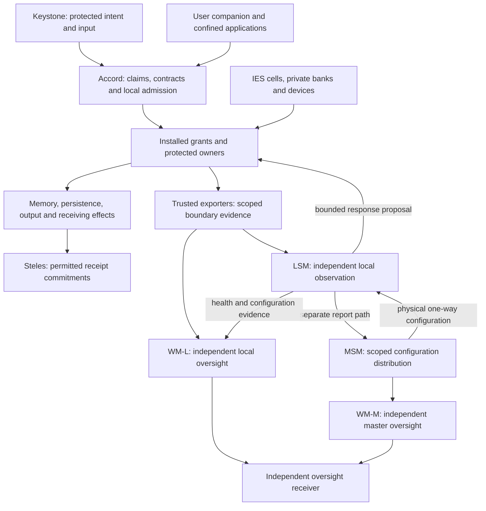

# ASKA v6 — Integrated machine specification

**Status:** proposed normative architecture and research specification. The requirements define a target machine; they do not certify manufactured hardware, a complete implementation or an end-to-end proof.

## What ASKA specifies

ASKA is a networked spatial computer whose application engines own bounded physical compute and writable memory, whose consequential operations pass through protected owners, and whose security observation has separately declared roots. It combines native execution, storage, devices, purpose-separated communication, human and institutional authority, AI-mediated work, independent monitoring and accountable outcomes. The central engineering question is what a compromised component can physically reach and cause while useful authorized work remains possible.

An isolated execution stack (IES) owns a physical resource domain. A cell is a bounded execution lifetime within it. Coherent cores and caches may exist inside one IES; cross-trust communication uses guarded copies, immutable objects or acknowledged exclusive transfer. Memory, DMA, object handoff, persistent commits and external emissions each retain current owner, generation, grant and label bindings. Changing a process name, route or representation cannot create new authority.

Accord supplies the chain **CLAIM → CONTRACT → GRANT → RECEIPT**. A claim is evidence; a contract records admitted terms; a grant installs bounded local authority; a receipt identifies the particular consequence established. Source disclosure and destination acceptance remain independent. Consent, duty, delegation, guardianship and legal compulsion are distinct authority bases. No AI, institution, firmware signer, Keystone module or network membership is a universal administrator.

## Integrated architecture

The diagram shows roles and authorized relationships, not all physical wiring. [Chapter 04](04_reference_machine_and_reachability.md) owns the full interface classes, roots, reset/clock/power/debug reachability and counted physical reference profiles. A functional arrow never substitutes for a guarded physical path or a grant.

Inline guards prevent a forbidden consequence at a declared boundary. LSM and MSM observation can identify suspicious events or coverage loss within their actual visibility. WM-L and WM-M watch separately rooted observer behavior; they do not form an infinite chain or acquire policy control. Steles witnesses received commitments and notices. These roles are distinct, and common suppliers, power, installers or exporters remain explicit dependencies.

Protective responses use finite templates and preinstalled standing grants with targets, budgets, expiry, cumulative limits and safety interlocks. They can operate locally without fresh human negotiation for each alarm. A model's alarming output cannot authorize a global shutdown or arbitrary program execution. Correctly signed bad updates, compromised observers and forged watcher evidence are included in the threat model.

## Purposes, trust roles and physical fabrics

| Layer | Named roles | Meaning and limit |
|---|---|---|
| Societal purposes | Sanctum, Polis, Agora, Wilder | Personal, civic, commercial/institutional and open-world contexts; no universal clearance ordering |
| Independent witness | Steles | Scoped commitments, receipts, notice and correction; separate from security watchers |
| Protected human interaction | Keystone | Canonical trusted intent, input and key use; no universal data reader |
| Network trust organization | STN, ATN, MCN | Sovereign trust governance, authenticated connectivity and multiple channels; carriage does not create effect permission |
| Security fabrics | Configuration, reporting, oversight and response-proposal interfaces | Separate direction, parser, budget and authority contracts; two opposite links are not a whole-system air gap |
| Physical realization | RP-A, RP-B and LP-1 | Concrete reference arrangements with explicit weaker laboratory assumptions and evidence gaps |

RP-A is a split-board workstation target. RP-B distributes the same logical roles across independently powered community appliances with separately inventoried local and upstream routes. LP-1 is a proposed smaller laboratory apparatus for testing real guards, observation and lifecycle boundaries. None is represented as built. Each native reference also includes a dedicated first-contact encounter port and separate parser/FIFO/bank/DMA resources, so established sessions do not depend on the encounter pool. Port counts are specific to the installation boundary in Chapter 04; four purposes plus one witness do not imply a universal transceiver count.

## AI, applications and institutions

The onboard user companion is a primary interaction and planning interface. It receives bounded task context and proposes effects under installed authority. Security analysis AI evaluates authorized telemetry with explicit uncertainty and calibration. AESDS synthesis agents build and test in isolation; IAMA is a candidate for analyzing legacy behavior and proposing transformations. These roles have separate contexts and privileges. No role signs or installs its own expanded authority or changes its acceptance oracle.

Native applications separate untrusted parsing, private computation, durable state, trusted presentation and final effects. Compatibility domains can host conventional operating systems and cloud adapters, with their weaker assumptions disclosed. Collaboration, MPC, zero-knowledge and federated-learning candidates require protocol-specific privacy and output controls; cryptographic names alone do not establish confidentiality.

Civil chapters specify conflicting obligations, notice, challenge, unavailable keys, care relationships, commerce, civic services and community governance. The machine can enforce admitted technical scope and preserve evidence. It does not determine universal legal legitimacy, infer consent from identity, or establish truth merely because a sensor or institution signed a statement.

## Evidence and limits

The specification distinguishes requirements, decisions, assumptions, candidates, hypotheses, model results, measurements and independent replication. The primary-source register records exact URLs, publication status, inspected locations and limitations. External research informs individual mechanisms; it does not prove ASKA as a whole.

[Chapter 56](56_conformance_tests_and_vectors.md) contains an executable finite semantic demonstration, deliberate failing variants, a replay-order check and two real HMAC vectors. Its results are limited to that code and abstraction. Hardware containment, complete protocol interoperability, physical diode behavior, observer independence, passive RAM/SSD sensing, dense packaging, safe autonomous evolution and measured whole-system cost remain implementation and research obligations. Advanced physical or quantum sensing is optional research and cannot be a hidden dependency of baseline guard conformance.

[Chapter 59](59_assurance_claims_profiles_and_manifests.md) evaluates physical separation, observation, confidentiality, forwarding, effect finality, update resilience and conditional availability separately. A strong result in one dimension cannot average away a failed boundary in another. Every deployment must declare its actual roots, paths, assumptions, surviving services and counterexamples.

## Reading paths

- **Architecture and implementers:** begin with Chapters 01–08, then physical compute/storage 09–19, security 20–30 and networking 40–46. Use Chapter 04 as the canonical physical inventory.
- **Applications, AI and authority:** read 05–08, Accord and applications 31–39, witness/media 47–48 and institutional workflows 49–53.
- **Assurance and evaluation:** read the threat/failure model 02–03, complete traces 54, formal/test chapters 55–56, realizations/cost 57–58 and profiles/research/traceability/sources 59–62.
- **First demonstrator:** combine the LP-1 wiring and roles in 57 with the complete application and dependency gates in 60. Use the acceptance obligations in 56 and 61 without mistaking them for completed hardware tests.

## Complete chapter map

The root contains this README and the following 62 chapters. Each numbered chapter owns its normative requirements and acceptance obligations; Chapter 61 maps them to enforcers, assumptions, evidence and status. Relative links are intended to work after extracting the ZIP into one directory.

### I — Governing architecture and system semantics

| Chapter | Owning subject |
|---|---|
| [01 — System architecture](01_system_architecture.md) | Physical machine, trusted boundaries and integrated operating model |
| [02 — Requirements and threat model](02_requirements_and_threat_model.md) | System requirements, attackers, trusted functions and conditional progress |
| [03 — Assurance, trust and failure domains](03_assurance_trust_and_failure_domains.md) | Root dependencies, common failures and the meaning of independence |
| [04 — Reference machine and reachability](04_reference_machine_and_reachability.md) | Authoritative RP-A/RP-B topology, interfaces, custodians and physical counts |
| [05 — Unified execution, data and effect contract](05_unified_execution_data_and_effect_contract.md) | Common object, computation, transfer and consequence semantics |
| [06 — Authority calculus and non-expansion](06_authority_calculus_and_nonexpansion.md) | Capabilities, grants, delegation, budgets, conflicts and non-expansion |
| [07 — Information flow and release](07_information_flow_and_release.md) | Confidentiality, integrity, exact release and observation limits |
| [08 — Terminology and specification conventions](08_terminology_and_specification_conventions.md) | Canonical terms, identifiers, normative keywords and state namespaces |

### II — Native physical compute and storage

| Chapter | Owning subject |
|---|---|
| [09 — IES, cells, resources and scheduling](09_ies_cells_resources_and_scheduling.md) | Physical allocation, cells, resource borrowing and safe reclamation |
| [10 — Processor ISA and execution semantics](10_processor_isa_and_execution_semantics.md) | Candidate ISAs, protected operations and refinement obligations |
| [11 — Heterogeneous compute, chiplets and packaging](11_heterogeneous_compute_chiplets_and_packaging.md) | Specialized compute, chiplets, packaging and shared physical constraints |
| [12 — Memory, cache and revocation](12_memory_cache_and_revocation.md) | Ownership tables, coherence, caches, generations and revocation |
| [13 — DMA, devices and accelerators](13_dma_devices_and_accelerators.md) | Device assignment, DMA, accelerators and maintenance paths |
| [14 — DMNoC and internal communications](14_dmnoc_and_internal_communications.md) | Internal routing, guarded communication, queueing and service reservations |
| [15 — Object mailboxes and handoff](15_object_mailboxes_and_handoff.md) | Copies, immutable sharing, exclusive transfer and protected publication |
| [16 — Persistent objects, storage and HESE-DAR](16_persistent_objects_storage_and_hese_dar.md) | Durable owners, keys, media behavior, backup and sanitization |
| [17 — Transactions, effects and reconciliation](17_transactions_effects_and_reconciliation.md) | Preparation, commit, uncertainty, receipts and independent reconciliation |
| [18 — Physical side channels and temporal protection](18_physical_side_channels_and_temporal_protection.md) | Timing, power, thermal and electromagnetic channels and physical attack scope |
| [19 — Substrate and unconventional compute research](19_substrate_and_unconventional_compute_research.md) | Optional substrates, quantum concepts, sensing hypotheses and falsifiers |

### III — Independent security and controlled evolution

| Chapter | Owning subject |
|---|---|
| [20 — Master and local security meshes](20_master_and_local_security_meshes.md) | Separate MSM/LSM roles, distribution scope and local continuity |
| [21 — Passive observation, sensors and coverage](21_passive_observation_sensors_and_coverage.md) | Passive taps, protected exporters, active observation and blind spots |
| [22 — Independent watchers and meta-monitoring](22_independent_watchers_and_meta_monitoring.md) | Finite independent watchers, coverage, tampering and terminating roots |
| [23 — Security mesh fabrics and one-way links](23_security_mesh_fabrics_and_one_way_links.md) | Physical one-way configuration, separate reports and bounded feedback |
| [24 — Security event provenance and telemetry](24_security_event_provenance_and_telemetry.md) | Authenticated events, protected sequences, gaps, labels and accounting |
| [25 — Security analysis AI and false-alarm control](25_security_analysis_ai_and_false_alarm_control.md) | Security analysis, calibration, second-stage review and false-alarm costs |
| [26 — Protective response and containment](26_protective_response_and_containment.md) | Standing grants, finite response templates, containment and safe-state ordering |
| [27 — Software update and supply-chain safety](27_software_update_and_supply_chain_safety.md) | Typed updates, independent roles, signed defects, canaries and recovery |
| [28 — AESDS, IAMA and autonomous evolution](28_aesds_iama_and_autonomous_evolution.md) | Isolated synthesis, legacy analysis, protected tests and controlled deployment |
| [29 — Monitoring privacy and observation authority](29_monitoring_privacy_and_observation_authority.md) | Observation authority, telemetry minimization, privacy, retention and disclosure |
| [30 — Boot, key custody, recovery and continuity](30_boot_key_custody_recovery_and_continuity.md) | Boot and key roots, attestation, antirollback and bounded restoration |

### IV — Accord, AI and native applications

| Chapter | Owning subject |
|---|---|
| [31 — Accord system and machine authorization](31_accord_system_and_machine_authorization.md) | Accord modules and the Claim–Contract–Grant–Receipt authorization chain |
| [32 — CLAIM, CONTRACT, GRANT and RECEIPT schemas](32_claim_contract_grant_receipt_schemas.md) | Typed schemas, canonical encoding, binding, budgets and receipt status |
| [33 — PACT protocol and state machines](33_pact_protocol_and_state_machines.md) | PACT negotiation, local admission, retries, revocation and disagreement |
| [34 — Identity, relationships, delegation and revocation](34_identity_relationships_delegation_and_revocation.md) | Pairwise identities, relationships, delegation and nondelegable duties |
| [35 — Governance profiles, conflicts and institutions](35_governance_profiles_conflicts_and_institutions.md) | Governance profiles, applicability, conflicts, review and institutional limits |
| [36 — Keystone and trusted user interaction](36_keystone_trusted_user_interaction.md) | Protected display/input, canonical intent, accessibility and local control |
| [37 — AI-native operating environment](37_ai_native_operating_environment.md) | User companion, task context, retrieval, planning and deterministic supervision |
| [38 — Native applications, toolchains and interoperability](38_native_apps_toolchains_and_interoperability.md) | Native application graphs, toolchains, collaboration and qualified adapters |
| [39 — Agents, delegated workflows and effect approval](39_agents_delegated_workflows_and_effect_approval.md) | Delegated agents, tools, periodic budgets and final effect approval |

### V — Purpose networks, witness and physical evidence

| Chapter | Owning subject |
|---|---|
| [40 — Societal planes and endpoint separation](40_societal_planes_and_endpoint_separation.md) | Sanctum, Polis, Agora, Wilder, Steles and distinct endpoint roles |
| [41 — STN, ATN, MCN and purpose-network roles](41_stn_atn_mcn_and_purpose_network_roles.md) | Sovereign trust, authenticated connectivity and multiple-channel organization |
| [42 — Physical transit topology and routing](42_physical_transit_topology_and_routing.md) | Ports, carrier dependencies, path evidence, reservations and resilience |
| [43 — Dynamic trust gateways and crossings](43_dynamic_trust_gateways_and_crossings.md) | Dynamic trust gateways, source release and independent receiving policy |
| [44 — Admission, identity and sessions](44_admission_identity_and_sessions.md) | Discovery, attestation, enrollment, transcripts, keys and scoped sessions |
| [45 — Packet records, delivery and egress](45_packet_records_delivery_and_egress.md) | Quarantine, authenticated records, replay, publication and final egress |
| [46 — System-wide release and output channels](46_system_wide_release_and_output_channels.md) | Network, display, print, media, backup, logs, debug and actuator release |
| [47 — Steles, witness receipts and notice](47_steles_witness_receipts_and_notice.md) | Private witness commitments, notice, correction and evidence confidence |
| [48 — Media provenance and physical evidence](48_media_provenance_and_physical_evidence.md) | Media provenance, privacy blurring, microstructures and physical-evidence research |

### VI — Civil and institutional workflows

| Chapter | Owning subject |
|---|---|
| [49 — Legal process, rights and emergencies](49_legal_process_rights_and_emergencies.md) | Legal requests, emergency scope, custody, notice, challenge and unavailable keys |
| [50 — Civic services, elections and public accountability](50_civic_services_elections_and_public_accountability.md) | Public services, eligibility, ballot secrecy, audits and civic resilience |
| [51 — Family, care, professional and personal authority](51_family_care_professional_and_personal_authority.md) | Care, guardianship, professional duties, personal delegation and succession |
| [52 — Commerce, enterprise and institutional workflows](52_commerce_enterprise_and_institutional_workflows.md) | Contracts, invoices, payments, enterprise duties and real-world finality |
| [53 — Community, realm governance and disputes](53_community_realm_governance_and_disputes.md) | Independent communities, shared infrastructure, cooperation and disputes |

### VII — Traces, validation, realizations and evidence

| Chapter | Owning subject |
|---|---|
| [54 — End-to-end traces and incident walkthroughs](54_end_to_end_traces_and_incident_walkthroughs.md) | Twenty-five complete conceptual transactions and adversarial incident traces |
| [55 — Formal properties and state models](55_formal_properties_and_state_models.md) | State models, invariants, refinement, composition and conditional liveness |
| [56 — Conformance tests and vectors](56_conformance_tests_and_vectors.md) | Acceptance campaigns, executable finite models and exact primitive vectors |
| [57 — Reference realizations and legacy interoperability](57_reference_realizations_and_legacy_interoperability.md) | Two physical reference deployments, a laboratory prototype and legacy/cloud boundaries |
| [58 — Performance, cost, power and availability](58_performance_cost_power_and_availability.md) | Illustrative cost arithmetic, resource overhead, utilization and availability |
| [59 — Assurance claims, profiles and manifests](59_assurance_claims_profiles_and_manifests.md) | Separate assurance dimensions, evidence statuses, registries and manifests |
| [60 — Research program and architectural decisions](60_research_program_and_architectural_decisions.md) | Architectural decisions, falsifiable hypotheses and dependency-ordered experiments |
| [61 — Requirement, decision and evidence traceability](61_requirement_decision_evidence_traceability.md) | Every requirement mapped to an enforcer, assumption, oracle and evidence status |
| [62 — Prior art, sources and evidence register](62_prior_art_sources_and_evidence_register.md) | Primary-source comparisons, publication status, inspected scope and access limits |

## Normative use

Uppercase MUST, SHOULD and MAY have the meanings defined in Chapter 08. Normative obligations are identified as `R-NN-XX`; matching acceptance obligations use `T-NN-XX`. A permissive example does not override a restriction. An omitted permission is not an unrestricted grant. A conflict is resolved through the applicable local contract and governance process, with denial, suspension, challenge or technical unavailability represented explicitly.

COMMITTED identifies one established finality point; a later unknown external outcome is separately scoped. RECONCILED appends evidence or correction without rewriting the original consequence. Disclosure already received by an unconstrained recipient cannot be revoked by changing a local table. These limits remain part of the machine contract wherever applications, monitoring, recovery or institutional workflows depend on them.
